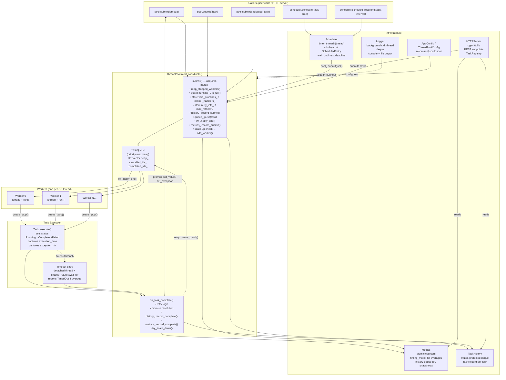
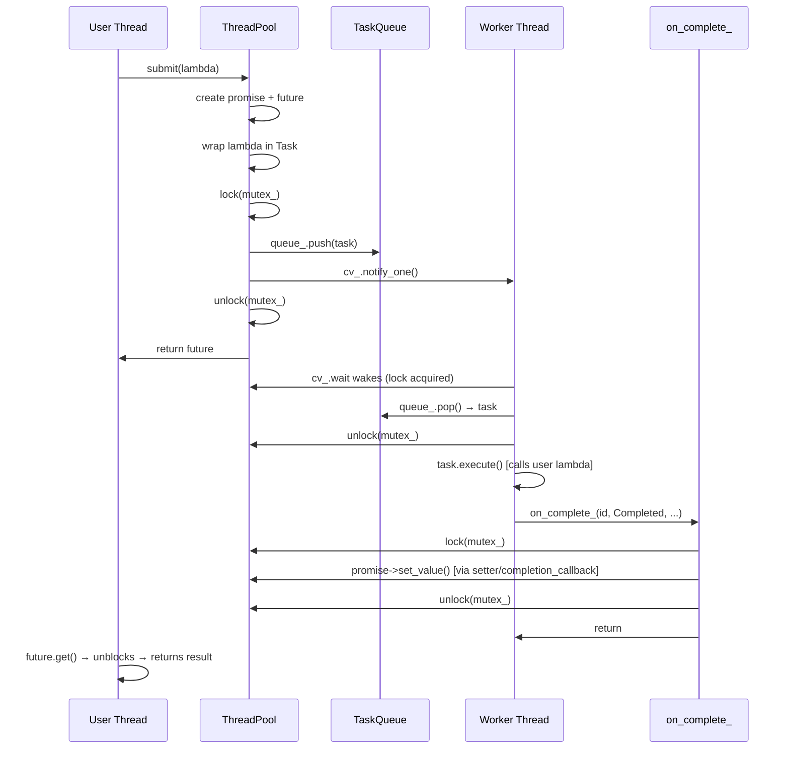

# CTEE — Complete Codebase Learning Guide
### Concurrent Task Execution Engine (C++20)

> **Purpose:** A complete mentor-written guide to every file, every important line of code, the full
> runtime flow, concurrency analysis, and interview preparation — all grounded directly in the actual source code.
> Generated from reading and analyzing every component in this repository.

---

## Master Table of Contents

- [Phase 1 — Project Overview](#phase-1--project-overview-concurrent-task-execution-engine-ctee)
  - [1.1 Project Directory Structure](#11-project-directory-structure)
  - [1.2 High-Level Architecture](#12-high-level-architecture)
  - [1.3 Architecture Diagram](#13-architecture-diagram)
  - [1.4 File Dependency Map](#14-file-dependency-map)
  - [1.5 End-to-End Overview](#15-end-to-end-overview)
- [Phase 2 — Core Library Files (Line-by-Line)](#phase-2--every-file-explained-in-detail-core-library)
  - [File 1 — include/ctee/core/task_priority.h](#file-1--includecteecoretask_priorityh)
  - [File 2 — include/ctee/core/task_result.h](#file-2--includecteecoretask_resulth)
  - [File 3 — include/ctee/core/task.h + src/core/task.cpp](#file-3--includecteecoretaskh--srccoretaskcpp)
  - [File 4 — include/ctee/core/task_queue.h + src/core/task_queue.cpp](#file-4--includecteecoretask_queueh--srccoretask_queuecpp)
  - [File 5 — include/ctee/core/worker.h + src/core/worker.cpp](#file-5--includecteecoreworkerh--srccoreworkercpp)
  - [File 6 — include/ctee/core/thread_pool_config.h](#file-6--includecteecorethread_pool_configh)
  - [File 7 — include/ctee/core/thread_pool.h + src/core/thread_pool.cpp](#file-7--includecteecorethread_poolh--srccorethread_poolcpp)
  - [File 8 — include/ctee/core/metrics.h + src/core/metrics.cpp](#file-8--includecteecoremetricsh--srccoremetricscpp)
  - [File 9 — include/ctee/core/task_history.h + src/core/task_history.cpp](#file-9--includecteecoretask_historyh--srccoretask_historycpp)
  - [File 10 — include/ctee/core/scheduler.h + src/core/scheduler.cpp](#file-10--includecteecoreschedulerh--srccoreschedulercpp)
- [Phase 2 Part B — Infrastructure & Server Layer Files](#phase-2-part-b--infrastructure--server-layer-files)
  - [File 11 — include/ctee/common/logger.h + src/common/logger.cpp](#file-11--includecteecommonloggerh--srccommonloggercpp)
  - [File 12 — include/ctee/common/config.h + src/common/config.cpp](#file-12--includecteecommonconfigh--srccommonconfigcpp)
  - [File 13 — include/ctee/common/thread_naming.h](#file-13--includecteecommonthread_namingh)
  - [File 14 — include/ctee/common/non_copyable.h](#file-14--includecteecommonnon_copyableh)
  - [File 15 — include/ctee/common/result.h](#file-15--includecteecommonresulth)
  - [File 16 — include/ctee/server/server_config.h](#file-16--includecteeserverserver_configh)
  - [File 17 — include/ctee/server/http_server.h + src/server/http_server.cpp](#file-17--includecteeserverhttp_serverh--srcserverhttp_servercpp)
  - [File 18 — include/ctee/server/route_handler.h + src/server/route_handler.cpp](#file-18--includecteeserverroute_handlerh--srcserverroute_handlercpp)
  - [File 19 — include/ctee/server/task_registry.h + src/server/task_registry.cpp](#file-19--includecteeservertask_registryh--srcservertask_registrycpp)
  - [File 20 — src/main.cpp](#file-20--srcmaincpp)
- [Phase 3 — Complete Runtime Execution Flow](#phase-3--complete-runtime-execution-flow)
  - [3.1 Initialization Flow](#31-initialization-flow)
  - [3.2 Task Submission Flow](#32-task-submission-flow)
  - [3.3 Worker Pickup & Execution Flow](#33-worker-pickup--execution-flow)
  - [3.4 Task Completion & Result Routing](#34-task-completion--result-routing)
  - [3.5 Auto-scaling Flow](#35-auto-scaling-flow)
  - [3.6 Scheduled & Recurring Tasks](#36-scheduled--recurring-tasks)
  - [3.7 Cancellation Flow](#37-cancellation-flow)
  - [3.8 Shutdown & Destruction](#38-shutdown--destruction)
  - [3.9 Sequence Diagram](#39-complete-end-to-end-sequence-diagram)
- [Phase 4 — Concurrency and Thread-Safety Analysis](#phase-4--concurrency-and-thread-safety-analysis)
  - [4.1 Shared Data Map](#41-shared-data-map--what-is-protected-by-what)
  - [4.2 Condition Variable Predicates](#42-condition-variable-predicate-analysis)
  - [4.3 Lock Ordering & Deadlock Prevention](#43-lock-ordering--deadlock-prevention)
  - [4.4 Race Conditions & Gaps Audited](#44-race-conditions--subtle-bugs-discovered)
  - [4.5 Memory Ordering & Atomics](#45-memory-ordering--atomics-audit)
  - [4.6 Thread Safety Summary Table](#46-thread-safety-summary-table)
- [Phase 5 — Call Graph and Data-Flow Map](#phase-5--call-graph-and-data-flow-map)
  - [5.1 Complete Call Graph](#51-complete-call-graph)
  - [5.2 Complete Data-Flow Map](#52-complete-data-flow-map)
  - [5.3 Lifetime & Ownership Map](#53-lifetime--ownership-map)
- [Phase 6 — Tests and Examples Analysis](#phase-6--tests-and-examples-analysis)
  - [6.1 Test Infrastructure](#61-test-infrastructure)
  - [6.2 ThreadPool Tests](#62-tests-core-thread_pool_testcpp-32-kb--largest-test-file)
  - [6.3 TaskQueue Tests](#63-tests-core-task_queue_testcpp)
  - [6.4 Worker Tests](#64-tests-core-worker_testcpp)
  - [6.5 Concurrency Tests](#65-tests-core-concurrency_testcpp)
  - [6.6 Deadlock Tests](#66-tests-core-deadlock_testcpp)
  - [6.7 Stress & Load Tests](#67-tests-core-stress_testcpp--load_testcpp)
  - [6.8 Feature Tests](#68-feature-tests)
  - [6.9 Example Programs](#69-examples-basic_poolcpp)
  - [6.10 Untested Scenarios & Risk Assessment](#610-untested-scenarios--risk-assessment)
- [Phase 7 — Technical Interview Preparation Guide](#phase-7--technical-interview-preparation-guide)
  - [7.1 Project Explanation Scripts](#71-project-explanation-scripts)
  - [7.2 File-Specific Interview Questions](#72-file-specific-interview-questions)
  - [7.3 Architectural Deep Dives](#73-architectural-deep-dives)
  - [7.4 Concurrency Deep Dives](#74-concurrency-deep-dives)
  - [7.5 C++ Questions](#75-c-questions)
  - [7.6 Trade-offs & Production Limitations](#76-trade-offs--production-limitations)

---

# Phase 1 — Project Overview: Concurrent Task Execution Engine (CTEE)

---

## 1.1 Project Directory Structure

```
Concurrent_Task_Execution_Engine/
│
├── CMakeLists.txt              ← Root build config (C++20, FetchContent for httplib + nlohmann/json)
├── build.bat / build.sh        ← Convenience build scripts for Windows/Linux
├── build_now.bat               ← Alternate quick-build script
├── configure_and_build.bat     ← CMake configure + build in one step
├── .clang-format               ← Code style configuration (auto-formatter)
├── .gitignore                  ← Git exclusions
├── README.md                   ← Project documentation (50 KB — extensive)
│
├── cmake/
│   └── CTEEConfig.cmake.in     ← CMake package config template (for install/find_package)
│
├── include/ctee/               ← All PUBLIC headers (the library's interface)
│   ├── core/
│   │   ├── task_priority.h     ← TaskPriority enum (Low/Normal/High/Critical)
│   │   ├── task_result.h       ← TaskStatus enum + TaskResult struct
│   │   ├── task.h              ← Task class declaration (the unit of work)
│   │   ├── task_queue.h        ← TaskQueue (priority heap + dependency tracking)
│   │   ├── task_history.h      ← TaskHistory (per-task audit log)
│   │   ├── thread_pool_config.h← ThreadPoolConfig, ThreadPoolStats, WorkerInfo, QueueInfo
│   │   ├── metrics.h           ← Metrics + MetricsSnapshot (live performance stats)
│   │   ├── worker.h            ← Worker (one execution thread)
│   │   ├── scheduler.h         ← Scheduler (time-based dispatch)
│   │   └── thread_pool.h       ← ThreadPool (the main public API)
│   ├── common/
│   │   ├── config.h            ← AppConfig struct + load_config()
│   │   ├── logger.h            ← Logger (async background logging)
│   │   ├── non_copyable.h      ← NonCopyable utility base class
│   │   ├── result.h            ← Generic Result<T> type (success/error)
│   │   └── thread_naming.h     ← set_thread_name() (platform-specific, header-only)
│   └── server/
│       ├── server_config.h     ← ServerConfig (host, port)
│       ├── http_server.h       ← HTTPServer declaration
│       ├── route_handler.h     ← RouteHandler declaration (REST API)
│       └── task_registry.h     ← TaskRegistry (server-side task tracking)
│
├── src/                        ← Implementation files
│   ├── CMakeLists.txt          ← Defines ctee_core + ctee_server + ctee_exe targets
│   ├── main.cpp                ← Executable entry point (starts pool+scheduler+HTTP server)
│   ├── core/
│   │   ├── task.cpp            ← Task impl (UUID gen, execute, comparator)
│   │   ├── task_queue.cpp      ← TaskQueue impl (heap ops, dependency check, cancellation)
│   │   ├── task_history.cpp    ← TaskHistory impl (mutex-protected deque)
│   │   ├── metrics.cpp         ← Metrics impl (atomics + timing mutex + history)
│   │   ├── worker.cpp          ← Worker impl (jthread run loop, timeout, state machine)
│   │   ├── scheduler.cpp       ← Scheduler impl (timer loop, min-heap, recurring tasks)
│   │   └── thread_pool.cpp     ← ThreadPool impl (submit, shutdown, scaling, retry)
│   ├── common/
│   │   ├── config.cpp          ← JSON config loading (nlohmann/json)
│   │   └── logger.cpp          ← Logger impl (async queue, background drain thread)
│   └── server/
│       ├── http_server.cpp     ← HTTPServer impl (cpp-httplib, route registration)
│       ├── route_handler.cpp   ← REST endpoint handlers (submit, cancel, stats, history…)
│       └── task_registry.cpp   ← TaskRegistry impl (server-side task metadata store)
│
├── tests/
│   ├── CMakeLists.txt          ← Test targets (likely uses GoogleTest via FetchContent)
│   ├── core/                   ← 19 test files covering every core component
│   │   ├── thread_pool_test.cpp   (32 KB — largest test file)
│   │   ├── concurrency_test.cpp
│   │   ├── deadlock_test.cpp
│   │   ├── benchmark_test.cpp
│   │   ├── load_test.cpp
│   │   ├── metrics_test.cpp
│   │   ├── scheduler_test.cpp
│   │   ├── task_queue_test.cpp
│   │   ├── edge_case_test.cpp
│   │   ├── stress_test.cpp
│   │   ├── task_test.cpp
│   │   ├── worker_test.cpp
│   │   ├── retry_test.cpp
│   │   ├── timeout_test.cpp
│   │   ├── dependencies_test.cpp
│   │   ├── config_test.cpp
│   │   ├── batch_test.cpp
│   │   ├── task_history_test.cpp
│   │   └── thread_naming_test.cpp
│   ├── common/
│   │   └── logger_test.cpp
│   └── server/
│       └── http_server_test.cpp
│
├── examples/
│   ├── CMakeLists.txt
│   └── basic_pool.cpp          ← Simple demo: submit lambdas, get futures, check stats
│
└── frontend/                   ← React/Vite dashboard (separate web app)
    ├── index.html
    ├── package.json
    ├── vite.config.js
    ├── tailwind.config.js
    └── src/                    ← React source (talks to HTTP server via REST)
```

---

## 1.2 High-Level Architecture

CTEE has **six major components**, cleanly separated into headers/sources:

| Component | Key Files | Responsibility |
|---|---|---|
| **Task** | `task.h/cpp`, `task_priority.h`, `task_result.h` | Represents a single unit of work. Holds the callable, ID, priority, status, retry/timeout config, dependency list, and result. |
| **TaskQueue** | `task_queue.h/cpp` | Priority max-heap that stores pending tasks. Handles dependency gating (blocks tasks whose `depends_on` IDs haven't completed). Supports cancellation marking. |
| **Worker** | `worker.h/cpp` | One OS thread (`std::jthread`). Loops forever: wait → pop task → execute → report. Implements state machine (Idle/Waiting/Running/Stopped). |
| **ThreadPool** | `thread_pool.h/cpp`, `thread_pool_config.h` | Central coordinator. Manages a vector of Workers, the TaskQueue, metrics, task history, retry state, promises, and auto-scaling. Owns the public API: `submit()`, `cancel()`, `pause()`, `shutdown()`. |
| **Scheduler** | `scheduler.h/cpp` | A separate `jthread` timer loop that sits on top of `ThreadPool`. Maintains a min-heap ordered by "next execution time". Fires tasks into the pool at their due time and re-queues recurring tasks. |
| **Metrics + TaskHistory** | `metrics.h/cpp`, `task_history.h/cpp` | Metrics: lock-free atomic counters + time-series snapshots. TaskHistory: per-task audit log (submitted/completed timestamps, status). Both are `shared_ptr`-owned by the pool. |

**Supporting infrastructure:**

| Component | Key Files | Responsibility |
|---|---|---|
| **Logger** | `logger.h/cpp` | Async background logger. Callers push `LogEntry` into a deque; a background `std::thread` drains and formats entries. Never blocks the caller. |
| **Config** | `config.h/cpp`, `thread_pool_config.h` | `ThreadPoolConfig` holds all pool tuning knobs. `AppConfig` wraps pool + server + retry defaults. `load_config()` parses a JSON file via nlohmann/json. |
| **HTTP Server** | `http_server.h/cpp`, `route_handler.h/cpp`, `task_registry.h/cpp` | A REST API (cpp-httplib) that exposes the pool and scheduler over HTTP. The frontend dashboard calls these endpoints. |
| **Utilities** | `thread_naming.h`, `non_copyable.h`, `result.h` | Platform-specific thread naming, a copy-prevention base class, and a generic `Result<T>` type. |

---

## 1.3 Architecture Diagram



**Key to arrows:**
- **Solid arrow** → direct function call or data flow in the normal path.
- **Dashed arrow** → indirect usage (optional, background).

---

## 1.4 File Dependency Map

### What "depends on" means

There are three distinct kinds of dependency:

| Type | Description | Example |
|---|---|---|
| **Header inclusion** (compile-time) | `#include "X.h"` means the compiler needs `X.h` to compile this file. | `thread_pool.h` includes `task.h` |
| **Class uses another class** (semantic) | A class holds a member of another type, or calls its methods. | `ThreadPool` holds a `detail::TaskQueue` member |
| **Runtime callback** (dynamic) | A function pointer or `std::function` passed at construction, called later from a different thread. | `Worker` receives `on_complete_` → calls `ThreadPool::on_task_complete()` |

### Header Inclusion Tree

```
task_priority.h          ← no project deps
task_result.h            ← no project deps

task.h
  ├── task_priority.h
  └── task_result.h

task_queue.h
  └── task.h

task_history.h
  └── task_result.h

thread_pool_config.h     ← no project deps

metrics.h
  └── task_result.h

worker.h
  ├── task_queue.h
  └── task_result.h

scheduler.h
  ├── task.h
  ├── task_priority.h
  └── task_result.h

thread_pool.h            ← the "fat" header — includes everything
  ├── task.h
  ├── task_queue.h
  ├── task_history.h
  ├── thread_pool_config.h
  ├── worker.h
  └── metrics.h

logger.h                 ← no project deps

config.h
  ├── thread_pool_config.h
  └── server/server_config.h

thread_naming.h          ← header-only, platform #ifdef
non_copyable.h           ← no project deps
result.h                 ← no project deps
```

### Class-Level Dependencies

| Class | Holds / Uses |
|---|---|
| `Task` | `TaskPriority`, `TaskStatus`, `TaskResult`, `FuncType` (std::function<void()>) |
| `detail::TaskQueue` | `Task` (stored in vector heap_) |
| `detail::Worker` | References to `std::mutex`, `std::condition_variable_any`, `TaskQueue`, `bool pool_running_`, `bool pool_paused_`; owns a `std::jthread`; calls `on_complete_` callback |
| `ThreadPool` | Owns `detail::TaskQueue`, `vector<unique_ptr<detail::Worker>>`, `shared_ptr<Metrics>`, `shared_ptr<TaskHistory>`, `std::mutex`, `std::condition_variable_any`, maps for promises/callbacks/retry |
| `Scheduler` | Holds a reference `ThreadPool&`, owns a `std::jthread`, a min-heap `vector<ScheduledEntry>` |
| `Metrics` | Atomic counters, `timing_mutex_`, `history_mutex_`, `deque<MetricsSnapshot>` |
| `TaskHistory` | `std::mutex`, `deque<TaskRecord>` |
| `Logger` | `std::thread` (background worker), `std::mutex`, `std::condition_variable`, `deque<LogEntry>`, `std::ofstream` |
| `HTTPServer` | References `ThreadPool&`, `Scheduler&`; owns `RouteHandler`, `unique_ptr<httplib::Server>`, `std::thread` |
| `RouteHandler` | References `ThreadPool&`, `Scheduler&`; owns `TaskRegistry` |

### Runtime Callback Connections

```
ThreadPool::add_worker()
  └── creates Worker with:
       on_complete_ = [this](...){ on_task_complete(...); }   ← Worker → ThreadPool
       on_start_    = [this](){ metrics_->record_start(); }   ← Worker → Metrics
```

This is the most important runtime link: the Worker does not know about `ThreadPool` at compile time through a member — it communicates back exclusively through a callback function stored as `std::function`.

---

## 1.5 End-to-End Overview

Here is what happens, from start to finish, for a single task:

### Step 1 — Pool Construction
```cpp
ctee::ThreadPoolConfig config;
config.min_threads = 4;
ctee::ThreadPool pool(config);
```
- `ThreadPool` constructor stores `config_`, creates `Metrics` and `TaskHistory` (both `shared_ptr`).
- It calls `add_worker()` exactly `min_threads` times (default: 2).
- Each `add_worker()` creates a `detail::Worker`, which immediately launches a `std::jthread` that starts its `run()` loop.
- Each worker thread immediately blocks inside `cv_.wait(lock, ...)` waiting for work.

### Step 2 — Task Submission
```cpp
auto future = pool.submit([]() { return 42; });
```
- The template `submit(F&&, Args&&...)` is called.
- A `std::promise<int>` is created and a `std::future<int>` is extracted from it.
- A `Task` object is constructed. Its `func_` is a lambda that: calls the user's lambda, stores the result in a `shared_ptr`, then assigns a "setter" function to set the promise.
- Under `mutex_`: the task is pushed into `queue_` (the priority heap), `cv_.notify_one()` is called to wake one worker, and metrics are updated.
- The `future` is returned to the caller.

### Step 3 — Worker Picks Up the Task
- One worker wakes from `cv_.wait(lock, ...)`.
- It checks: `!queue_.empty() && !pool_paused_` is true.
- It calls `queue_.pop()`, which runs the priority heap's `pop_heap` and performs dependency checking.
- The lock is released. The worker holds the `Task` by value (`optional<Task> task_opt`).

### Step 4 — Task Execution
- `task_opt->execute()` is called.
- Inside `Task::execute()`: the status is set to `Running`, `func_()` is invoked, the result (success or exception) is recorded in `result_`, and status is set to `Completed` or `Failed`.
- If the task has a `timeout_ms > 0`, execution happens on a **detached thread** and the worker waits via `shared_future::wait_for()`. If the deadline passes, `TimedOut` is reported.

### Step 5 — Completion Callback
- The worker calls its `on_complete_` callback with (task_id, status, wait_time, exec_time).
- This runs `ThreadPool::on_task_complete()` (under `mutex_`):
  - If the task **succeeded**: the promise is set to the result via the `setter` lambda (for the template overload) or `promise->set_value()` (for the `Task` overload). The caller's `future.get()` unblocks.
  - If the task **failed and has retries left**: the same task is re-enqueued with the same ID, and the promise is deferred.
  - If the task **failed with no retries**: `promise->set_exception()` is called. The caller's `future.get()` throws.
  - If the task **timed out**: same as failed — exception is set.
  - Metrics and TaskHistory are updated.
  - `try_scale_down()` is called to check whether excess workers should be retired.

### Step 6 — Result Retrieval
```cpp
int result = future.get(); // → returns 42
```
- `future.get()` blocks until the promise has been set (either value or exception).
- If a value was set: returns it.
- If an exception was set: rethrows it.

### Step 7 — Shutdown
```cpp
pool.shutdown();
```
- `running_` is set to `false` under `mutex_`, `paused_` is cleared.
- `cv_.notify_all()` wakes all workers.
- Each worker sees `!pool_running_ && queue_.empty()` and breaks out of its loop.
- `worker.reset()` on each `unique_ptr<Worker>` calls `Worker::~Worker()`, which joins the `jthread`.
- After all workers are joined, the pool is fully stopped.

---

# Phase 2 — Every File Explained in Detail (Core Library)

Files are presented in **strict dependency order** — leaf files first, then the files that depend on them.
Each file follows the same structure: Identity → Line-by-Line → C++ Concepts → Connections → Example.

---

## File 1 — `include/ctee/core/task_priority.h`

### A. Identity
- **Type:** Public header (interface-only)
- **Purpose:** Defines the `TaskPriority` enum that controls which task runs first.
- **Depends on:** Nothing (pure C++ standard library).
- **Used by:** `task.h`, `task_queue.h`, `scheduler.h`, `thread_pool.h`, `task_registry.h`, all test files.
- **Essential?** Yes — every task has a priority.

### B. Line-by-Line

```cpp
#pragma once
```
**What it does:** Tells the compiler "include this file only once, no matter how many times it appears in `#include` chains."  
**Why:** Without it, if two files both include `task_priority.h` and then include each other, the compiler would see the same declarations twice and produce errors.  
**Alternative:** The older way uses `#ifndef TASK_PRIORITY_H / #define / #endif` guards. `#pragma once` is simpler and supported by every modern compiler.

```cpp
#include <cstdint>
#include <string>
```
`<cstdint>` gives you fixed-width integer types like `std::uint8_t`. `<string>` is included for the `to_string` declaration (though `to_string` takes a `TaskPriority` by value, not `std::string`).

```cpp
namespace ctee {
```
**What it does:** Wraps everything in the `ctee` namespace.  
**Why:** Without namespaces, `TaskPriority` would be a global name that could clash with any other library that defines its own `TaskPriority`. The namespace acts like a folder for names.

```cpp
enum class TaskPriority : std::uint8_t {
    Low      = 0,
    Normal   = 1,
    High     = 2,
    Critical = 3
};
```
**C++ Concept — `enum class`:**  
A regular `enum` in C++ leaks its values into the enclosing scope. `enum class` (a C++11 feature) prevents that. You must write `TaskPriority::High`, not just `High`. This prevents name collisions and makes code self-documenting.

**`: std::uint8_t`** — The underlying storage type. Instead of the compiler choosing `int` (4 bytes), you specify `uint8_t` (1 byte). Since there are only 4 values, 1 byte is more than enough. This matters when `TaskPriority` is stored inside every `Task` object.

**Values 0–3:** The integer values matter because they are used in `Task::operator<` as a comparison: higher number = higher priority = runs first.

```cpp
const char* to_string(TaskPriority priority);
```
**Declaration only** — the implementation lives in `task.cpp`. Returns a human-readable C-string like `"high"` or `"critical"`. Used by the HTTP layer for JSON serialization.

---

## File 2 — `include/ctee/core/task_result.h`

### A. Identity
- **Type:** Public header — two things in one: the `TaskStatus` lifecycle enum and the `TaskResult` struct.
- **Purpose:** Defines what a task can be in (its status) and what it produces (its result).
- **Depends on:** `<chrono>`, `<exception>`, `<optional>`, `<string>`.
- **Used by:** Almost every file in the project.

### B. Line-by-Line

```cpp
enum class TaskStatus : std::uint8_t {
    Pending   = 0,
    Queued    = 1,
    Running   = 2,
    Completed = 3,
    Failed    = 4,
    Cancelled = 5,
    TimedOut  = 6
};
```
This is a **7-state lifecycle machine** for a task:

| State | When set |
|---|---|
| `Pending` | Default when a `Task` is first constructed |
| `Queued` | When `submit()` calls `task.set_status(TaskStatus::Queued)` before pushing into the queue |
| `Running` | When `Task::execute()` begins |
| `Completed` | When `func_()` returns without throwing |
| `Failed` | When `func_()` throws any exception |
| `Cancelled` | When `ThreadPool::cancel()` is called |
| `TimedOut` | When the `shared_future::wait_for()` deadline expires in the Worker |

```cpp
struct TaskResult {
    bool success = false;
    std::optional<std::string> value;
    std::exception_ptr exception;
    std::chrono::milliseconds execution_time{0};
};
```
**`bool success`:** `true` only if the task completed without throwing.

**`std::optional<std::string> value`:** Optional string payload. In practice this field is **not written to** by `Task::execute()` in the current implementation — the actual result travels through `std::promise`/`std::future`, not here. This field exists as a potential future extension (e.g., serialized JSON output).

**C++ Concept — `std::exception_ptr`:**  
This is a special pointer that can hold any exception object across thread boundaries. When a task throws, `Task::execute()` calls `std::current_exception()` which captures the thrown exception into an `exception_ptr`. That pointer can later be re-thrown with `std::rethrow_exception()` on a different thread. This is how exceptions safely travel from a worker thread back to the caller via a `future`.

**`std::chrono::milliseconds execution_time{0}`:**  
`{}` initializes to zero milliseconds. Written by `Task::execute()` as `duration_cast<milliseconds>(end - start)`.

---

## File 3 — `include/ctee/core/task.h` + `src/core/task.cpp`

### A. Identity
- **Type:** Core class — the fundamental unit of work.
- **Purpose:** Encapsulates everything about one job: the callable, identity, priority, status, scheduling metadata, retry config, dependency list, timeout, and result.
- **Depends on:** `task_priority.h`, `task_result.h`.
- **Used by:** `TaskQueue`, `Worker`, `ThreadPool`, `Scheduler`, all tests.
- **Essential?** Yes — you cannot submit anything without a `Task`.

### B. Line-by-Line — `task.h`

```cpp
class Task {
    friend class detail::Worker;
    friend class ThreadPool;
```
**C++ Concept — `friend`:**  
`friend` grants another class access to `private` members. `Worker` needs to call `task.execute()` and read `task.result()`. `ThreadPool` needs to call `task.set_status()`. Without `friend`, these would have to be made `public`, which would let any code call them. `friend` is a surgical access grant — only these two classes get the privilege.

```cpp
public:
    using FuncType = std::function<void()>;
```
**C++ Concept — `std::function<void()>`:**  
`std::function` is a **type-erased callable wrapper**. It can hold a lambda, a function pointer, a functor, or a `std::bind` expression — anything that is callable with no arguments and returns `void`. "Type-erased" means you don't need to know the exact type of the callable at compile time; `std::function` boxes it up inside a heap-allocated wrapper.

**Why `void()`?** — Tasks are always executed as `func_()`. The result (if any) is captured by the lambda closure before being wrapped into a `Task`. The actual return value travels through `std::promise`, not through the `FuncType`.

```cpp
    Task(FuncType func, std::string name = "",
         TaskPriority priority = TaskPriority::Normal);
```
Constructor: takes a callable, an optional name (empty string by default), and an optional priority (Normal by default). Default arguments mean you can write `Task(my_lambda)` and it just works.

```cpp
    Task(Task&&) noexcept = default;
    Task& operator=(Task&&) noexcept = default;

    Task(const Task&) = delete;
    Task& operator=(const Task&) = delete;
    Task() = delete;
```
**C++ Concept — Move semantics and deleted functions:**

- `= default` on the move constructor/assignment tells the compiler to generate the default move for you (transfer ownership, leave source in valid-but-unspecified state).
- `= delete` on copy constructor/assignment makes copying illegal at compile time. Why? A `Task` owns a `std::function` (potentially holding resources) and a UUID — copying would create two tasks with the same ID, which breaks the entire identity system.
- `= delete` on the default constructor prevents creating a `Task` with no function.
- `noexcept` on the move means "this operation will never throw", which lets `std::vector` use the efficient move path when resizing.

```cpp
    [[nodiscard]] const std::string& id() const noexcept;
```
**`[[nodiscard]]`:** C++17 attribute. If you call `task.id()` and discard the return value (i.e., don't store it anywhere), the compiler emits a warning. This guards against accidental misuse.

**`const noexcept`:** The method doesn't modify the object (`const`) and won't throw (`noexcept`). Both are important for callers that hold a `const Task&`.

```cpp
    bool operator<(const Task& other) const noexcept;
```
The priority comparator — used by the heap in `TaskQueue`. Explained fully below in `task.cpp`.

```cpp
private:
    void set_status(TaskStatus status);
    void execute();
```
Private — only accessible to `detail::Worker` and `ThreadPool` (the friends). This prevents any caller from executing a task directly or changing its status externally.

```cpp
private:
    std::string id_;
    std::string name_;
    FuncType func_;
    TaskPriority priority_;
    TaskStatus status_;
    std::chrono::steady_clock::time_point created_at_;
    std::chrono::steady_clock::time_point scheduled_at_;
    bool has_schedule_;
    std::chrono::milliseconds repeat_interval_;
    std::size_t repeat_count_;
    std::size_t max_repeats_;
    TaskResult result_;
    std::size_t retry_count_ = 0;
    std::size_t max_retries_ = 0;
    std::chrono::milliseconds retry_delay_{0};
    std::vector<std::string> depends_on_;
    std::chrono::milliseconds timeout_ms_{0};
```
Each field annotated:

| Field | Type | Purpose |
|---|---|---|
| `id_` | `string` | UUID — unique identity for this task across the whole pool |
| `name_` | `string` | Human-readable label for logging/history |
| `func_` | `FuncType` | The actual work to do |
| `priority_` | `TaskPriority` | Determines queue ordering |
| `status_` | `TaskStatus` | Current lifecycle state |
| `created_at_` | `time_point` | When the Task was constructed — used for FIFO ordering within same priority |
| `scheduled_at_` | `time_point` | When a scheduled task should run (set by Scheduler) |
| `has_schedule_` | `bool` | Whether `scheduled_at_` is meaningful |
| `repeat_interval_` | `milliseconds` | If > 0, task is recurring with this period |
| `repeat_count_` | `size_t` | How many times it has run so far |
| `max_repeats_` | `size_t` | 0 = unlimited; N = stop after N runs |
| `result_` | `TaskResult` | Filled by `execute()` |
| `retry_count_` | `size_t` | How many retries have already happened |
| `max_retries_` | `size_t` | 0 = no retry; N = retry up to N times |
| `retry_delay_` | `milliseconds` | Wait before re-enqueue (currently stored but delay not actively waited — see Phase 4) |
| `depends_on_` | `vector<string>` | IDs of tasks that must complete first |
| `timeout_ms_` | `milliseconds` | 0 = no timeout; > 0 = detached-thread execution with deadline |

### C. Line-by-Line — `task.cpp`

```cpp
namespace {
string generate_uuid() {
    thread_local random_device rd;
    thread_local mt19937 gen(rd());
    thread_local uniform_int_distribution<uint32_t> dis(0, 0xFFFFFFFF);
    ...
}
}  // namespace
```
**C++ Concept — `thread_local`:**  
`thread_local` means "one copy of this variable per thread". `mt19937` (a Mersenne Twister random number generator) is **not thread-safe** — if two threads shared one instance, the internal state could be corrupted. By making it `thread_local`, each thread has its own private generator seeded from its own `random_device`. The variable is initialized the first time that thread reaches this line, and destroyed when the thread exits.

**C++ Concept — anonymous namespace `namespace {}`:**  
Anything inside `namespace {}` has **internal linkage** — it's visible only within this translation unit (this `.cpp` file). It's the modern C++ replacement for `static` at file scope. `generate_uuid` is an implementation detail; it should not be accessible from other files.

```cpp
char buf[37];
snprintf(buf, sizeof(buf), "%08x-%04x-%04x-%04x-%04x%08x", ...);
```
Formats 128 bits (four `uint32_t` values = 4 × 32 = 128 bits) into a UUID-like string: `xxxxxxxx-xxxx-xxxx-xxxx-xxxxxxxxxxxx`. This is not a proper RFC-4122 UUID (no version bits), but it's sufficient for uniquely identifying tasks within a process run.

```cpp
Task::Task(FuncType func, string name, TaskPriority priority)
    : id_(generate_uuid()),
      name_(move(name)),
      func_(move(func)),
      priority_(priority),
      status_(TaskStatus::Pending),
      created_at_(ch::steady_clock::now()),
      has_schedule_(false),
      repeat_interval_(0),
      repeat_count_(0),
      max_repeats_(0) {}
```
**C++ Concept — Member Initializer List (`: field_(val), ...`):**  
This is the correct way to initialize class members. It runs before the constructor body. Using `move(name)` and `move(func)` here means the strings and functions are moved into the members (ownership transferred), not copied — this is much cheaper than copying.

**`std::chrono::steady_clock::now()`:**  
`steady_clock` is a monotonic clock — it never goes backward. Used for measuring durations and for the task's `created_at_` timestamp (used in the priority comparator for FIFO ordering).

```cpp
void Task::execute() {
    if (func_) {
        status_ = TaskStatus::Running;
        auto start = ch::steady_clock::now();
        try {
            func_();
            auto end = ch::steady_clock::now();
            result_.success = true;
            result_.execution_time = ch::duration_cast<ch::milliseconds>(end - start);
            status_ = TaskStatus::Completed;
        } catch (...) {
            auto end = ch::steady_clock::now();
            result_.success = false;
            result_.exception = current_exception();
            result_.execution_time = ch::duration_cast<ch::milliseconds>(end - start);
            status_ = TaskStatus::Failed;
        }
    }
}
```
**`if (func_)`** — Checks whether the `std::function` holds a callable. An empty `std::function` is falsy; calling it would throw `std::bad_function_call`.

**`catch (...)`** — Catches **every possible exception** — `std::exception` subclasses, integers, strings, anything. This is essential because task code is user-supplied and could throw anything.

**`std::current_exception()`** — Captures the currently active exception into an `exception_ptr`. The worker thread can then pass this pointer to `ThreadPool::on_task_complete()` which puts it into a `std::promise` via `set_exception()`. When the caller calls `future.get()`, the exception is automatically re-thrown.

```cpp
bool Task::operator<(const Task& other) const noexcept {
    if (priority_ != other.priority_) {
        return priority_ < other.priority_;   // Higher enum → closer to top
    }
    if (created_at_ != other.created_at_) {
        return created_at_ > other.created_at_; // Earlier time → closer to top (FIFO)
    }
    return id_ > other.id_;                     // UUID tiebreaker (determinism)
}
```
**C++ Concept — Max-Heap Comparator:**  
`std::push_heap`/`pop_heap` build a **max-heap**: the element for which no other element `x < element` sits at the top. So `operator<(A, B)` meaning "A is less important than B" means B goes to the top.

**Three levels of comparison:**
1. **Priority:** `priority_ < other.priority_` → lower enum value = "less important" → higher enum value bubbles to top. `Critical(3) > High(2) > Normal(1) > Low(0)`. ✓
2. **Timestamp (FIFO):** `created_at_ > other.created_at_` → later creation time = "less important" → earlier task goes first. This enforces FIFO within the same priority tier. ✓
3. **UUID tiebreaker:** Two tasks could have the exact same priority AND the exact same `created_at_` timestamp (if `steady_clock` resolution is coarser than the task creation rate). Without a tiebreaker, the comparator would not be a **strict weak ordering** — required by the C++ standard for heap operations. The UUID comparison makes it strictly deterministic. ✓

---

## File 4 — `include/ctee/core/task_queue.h` + `src/core/task_queue.cpp`

### A. Identity
- **Type:** Internal class (`ctee::detail` namespace).
- **Purpose:** A bounded, priority-ordered queue of pending tasks. Also maintains dependency tracking.
- **Depends on:** `task.h`
- **Used by:** `ThreadPool` (owns it as a member), `Worker` (references it).
- **Essential?** Yes — this is the heart of scheduling.

### B. Key Design — Vector-Backed Heap

```cpp
private:
    std::vector<Task> heap_;
    std::unordered_set<std::string> cancelled_ids_;
    std::unordered_set<std::string> completed_ids_;
    std::size_t capacity_;
```
**C++ Concept — `std::push_heap` / `std::pop_heap` on a `std::vector`:**  
The C++ standard library does not have a standalone priority queue that lets you access internals. Instead, it provides **heap algorithms** that operate on any random-access range:
- `std::push_heap(begin, end)` — assumes `[begin, end-1)` is already a heap; re-heapifies after inserting at `end-1`.
- `std::pop_heap(begin, end)` — moves the top element to `end-1` and re-heapifies `[begin, end-1)`.

You do the `push_back` / `pop_back` on the vector yourself; the algorithms rearrange elements in-place. This uses `Task::operator<` to determine ordering. The result: the highest-priority task is always at `heap_[0]`.

**Why not `std::priority_queue`?**  
`std::priority_queue` wraps these same algorithms but hides the container, preventing things like: iterating all tasks, cancelling a specific task, or implementing dependency checking. The raw vector + heap approach gives full control.

**`cancelled_ids_` and `completed_ids_`:**  
`std::unordered_set<std::string>` — O(1) average lookup. When a task is cancelled, its ID is inserted into `cancelled_ids_`. When a task completes, its ID is inserted into `completed_ids_`. These sets are consulted during `pop()`.

### C. Line-by-Line — `task_queue.cpp`

```cpp
void TaskQueue::push(Task task) {
    if (heap_.size() >= capacity_) { return; }
    heap_.push_back(move(task));
    push_heap(heap_.begin(), heap_.end());
}
```
**`move(task)`** — `Task` is not copyable (copy constructor is `= delete`). You must move it into the vector. `std::move` casts `task` to an rvalue reference, enabling the move constructor.

**`push_heap`** uses `Task::operator<` to sift the new element up into its correct position. O(log n).

```cpp
optional<Task> TaskQueue::pop() {
    vector<Task> deferred;
    optional<Task> result;

    while (!heap_.empty()) {
        pop_heap(heap_.begin(), heap_.end());
        Task task = move(heap_.back());
        heap_.pop_back();

        if (cancelled_ids_.count(task.id()) > 0) { continue; }

        bool deps_met = true;
        for (const auto& dep_id : task.depends_on()) {
            if (completed_ids_.count(dep_id) == 0) {
                deps_met = false;
                break;
            }
        }

        if (!deps_met) { deferred.push_back(move(task)); continue; }

        result = move(task);
        break;
    }

    for (auto& t : deferred) {
        heap_.push_back(move(t));
        push_heap(heap_.begin(), heap_.end());
    }

    return result;
}
```
**C++ Concept — `std::optional<T>`:**  
Represents a value that may or may not be present. `std::optional<Task>` either contains a `Task` or is empty (`std::nullopt`). The caller checks `if (!task_opt)` to know if the queue had nothing ready. This is safer than returning a pointer (raw pointers add lifetime risks) or throwing an exception (expensive for a common case like "queue momentarily empty").

**The dependency-checking loop:**
1. Pop the highest-priority task from the heap.
2. If cancelled → skip (discard it).
3. For each ID in `task.depends_on()`: if that ID is not in `completed_ids_` → push into `deferred`.
4. If all deps met → this is our task; break.
5. After the loop, push all `deferred` tasks back into the heap.

**Important note:** This is **O(n) worst-case** if many high-priority tasks all have unsatisfied dependencies. The comment in the source explicitly acknowledges this: "O(n) in worst case but fine for typical queue sizes." For production use with thousands of interdependent tasks, a proper DAG scheduler would be needed.

**Why `optional<Task>` instead of returning by reference?**  
`Task` is move-only. Returning by value (`Task`) would require the caller to handle the "queue empty" case differently (maybe throw?). `optional<Task>` cleanly models "there might not be anything ready."

---

## File 5 — `include/ctee/core/task_history.h` + `src/core/task_history.cpp`

### A. Identity
- **Type:** Audit log — thread-safe, bounded FIFO record of task completions.
- **Purpose:** Lets the HTTP layer serve historical task data to the frontend dashboard.
- **Depends on:** `task_result.h`
- **Used by:** `ThreadPool` (owns a `shared_ptr<TaskHistory>`).

### B. Key Structures

```cpp
struct TaskRecord {
    std::string task_id;
    std::string task_name;
    TaskStatus status = TaskStatus::Pending;
    std::chrono::steady_clock::time_point submitted_at;
    std::chrono::steady_clock::time_point completed_at;
    std::chrono::milliseconds execution_time{0};
};
```
A snapshot of a single task's lifecycle — two timestamps (submitted + completed) plus status and execution time.

```cpp
class TaskHistory {
    std::size_t max_size_;
    mutable std::mutex mutex_;
    std::deque<TaskRecord> entries_;
};
```
**`mutable std::mutex`:** The mutex is `mutable` so that `const` methods like `recent()` and `count()` can still lock it. (A `const` method normally cannot modify members; `mutable` is the exception.)

**`std::deque<TaskRecord>`:** A double-ended queue. `push_back` at the tail, `pop_front` from the head when the size limit is exceeded. This gives O(1) insert + O(1) trim, which is better than `std::vector` (which would need O(n) to remove the front).

### C. The Two-Phase Record Pattern

```cpp
void TaskHistory::record_submit(const string& task_id, ...) {
    TaskRecord entry;
    entry.task_id = task_id;
    entry.status = TaskStatus::Queued;
    entry.submitted_at = at;
    record(entry);   // ← pushes into deque
}

void TaskHistory::record_complete(const string& task_id, TaskStatus status, ...) {
    lock_guard lock(mutex_);
    for (auto& e : entries_) {          // ← O(n) linear scan
        if (e.task_id == task_id) {
            e.status = status;
            e.completed_at = ch::steady_clock::now();
            e.execution_time = exec_time;
            return;
        }
    }
}
```
**Two-phase update:** First a record is inserted at submission time (with `status = Queued`). Then on completion, the same record is found and updated in-place. The linear scan in `record_complete` is O(n) — acceptable for the default `max_size = 10000`, but would be a bottleneck under very high throughput. A `std::unordered_map<string, size_t>` index would make this O(1).

---

## File 6 — `include/ctee/core/thread_pool_config.h`

### A. Identity
- **Type:** Plain data structures (no methods, no behavior).
- **Purpose:** All configuration knobs and output data structures for the thread pool.
- **Depends on:** Nothing (pure standard library).

### B. Line-by-Line

```cpp
struct ThreadPoolConfig {
    std::size_t min_threads = 2;
    std::size_t max_threads = std::max<std::size_t>(2, std::thread::hardware_concurrency());
    std::size_t max_queue_size = 10000;
    std::chrono::milliseconds task_timeout{30000};
    bool enable_metrics = true;

    std::chrono::milliseconds idle_timeout{5000};
    std::size_t scale_up_threshold = 10;

    std::size_t default_max_retries = 0;
    std::chrono::milliseconds default_retry_delay{1000};
    std::chrono::milliseconds default_task_timeout{0};
};
```
**`std::thread::hardware_concurrency()`** — Returns the number of logical CPU cores on the machine (e.g., 8 on a quad-core hyperthreaded CPU). May return 0 if the system can't determine it — hence `std::max<std::size_t>(2, ...)` ensures at least 2 threads even on exotic platforms.

**`scale_up_threshold = 10`** — If the queue has ≥ 10 pending tasks and the pool hasn't reached `max_threads`, a new worker is spawned immediately. Tune this lower for latency-sensitive workloads, higher for throughput-oriented ones.

**`default_task_timeout{0}`** — Zero means "no timeout." Non-zero enables the detached-thread timeout mechanism in `Worker::run()`.

**`struct ThreadPoolStats`** — A read-only snapshot returned by `pool.stats()`. This is a plain data transfer object; it has no methods. Distinct from `MetricsSnapshot` (which is owned by `Metrics`) — `ThreadPoolStats` is the public API shape.

**`struct WorkerInfo`** — Contains a worker's `id`, `state` (as a string like `"running"`), and `marked_stop` flag. Returned by `pool.get_worker_infos()`.

**`struct QueueInfo`** — Contains `size`, `capacity`, and `is_full`. Returned by `pool.queue_info()`.

---

## File 7 — `include/ctee/core/metrics.h` + `src/core/metrics.cpp`

### A. Identity
- **Type:** Thread-safe performance counter + time-series store.
- **Purpose:** Tracks submitted/completed/failed/cancelled tasks, queue length, thread utilization, timing averages, and stores snapshots for charting.
- **Two-tier design:** Atomic counters for the hot path; a mutex for timing accumulators and history.

### B. The Two-Tier Thread-Safety Model

```cpp
// Tier 1: Lock-free atomics (hot path — called on every submit/complete)
std::atomic<std::size_t> submitted_{0};
std::atomic<std::size_t> completed_{0};
std::atomic<std::size_t> failed_{0};
std::atomic<std::size_t> cancelled_{0};
std::atomic<std::size_t> running_{0};
std::atomic<std::size_t> queue_length_{0};
std::atomic<std::size_t> peak_queue_length_{0};
std::atomic<std::size_t> active_threads_{0};
std::atomic<long long> total_busy_ns_{0};

// Tier 2: Mutex-protected accumulators (cold path — less frequent)
mutable std::mutex timing_mutex_;
std::chrono::nanoseconds total_wait_time_{0};
std::chrono::nanoseconds total_exec_time_{0};
std::size_t wait_samples_{0};
std::size_t exec_samples_{0};

// Tier 2: History (cold path — updated ~1/sec)
mutable std::mutex history_mutex_;
std::deque<MetricsSnapshot> history_;
```
**C++ Concept — `std::atomic<T>`:**  
An atomic type guarantees that reads and writes are **indivisible** — no other thread can see a partially-written value. It also provides **memory ordering** guarantees. The two most important orderings used here:

- `memory_order_relaxed` — The operation is atomic (no torn reads/writes) but provides no ordering guarantees relative to other memory accesses. Used for simple counters where the exact interleaving doesn't matter.
- `memory_order_release` / `memory_order_acquire` — A release-store makes all prior writes visible to any thread that does an acquire-load of the same variable.

**Why atomics instead of a mutex for counters?**  
A `mutex` lock/unlock costs ~20–100 ns and causes cache-line contention between cores. An atomic `fetch_add` with `relaxed` ordering costs ~1–5 ns. On a pool with hundreds of tasks per second, this difference matters significantly.

### C. The Peak Queue Length — Compare-Exchange Loop

```cpp
void Metrics::set_queue_length(std::size_t len) {
    queue_length_.store(len, std::memory_order_relaxed);

    std::size_t prev = peak_queue_length_.load(std::memory_order_relaxed);
    while (len > prev) {
        if (peak_queue_length_.compare_exchange_weak(
                prev, len, std::memory_order_relaxed)) {
            break;
        }
    }
}
```
**C++ Concept — `compare_exchange_weak` (CAS — Compare And Swap):**  
This is the fundamental primitive for lock-free programming. It atomically:
1. Reads the current value of `peak_queue_length_`.
2. Compares it to `prev`.
3. If equal: stores `len` and returns `true`.
4. If not equal: updates `prev` with the actual value and returns `false`.

The `weak` variant may spuriously fail (return false even when equal) — this is acceptable here because we're in a `while` loop anyway. `compare_exchange_strong` never spuriously fails but is slightly slower.

**Why this pattern?** Because two threads could simultaneously read `peak_queue_length_ = 5` and both try to write `6`. Without CAS, both might succeed and write `6` — but one of them might actually have had the real max. CAS ensures only one wins the race.

### D. `tick()` — Time-Series Snapshot

```cpp
void Metrics::tick() {
    auto now = ch::steady_clock::now();
    auto elapsed = ch::duration_cast<ch::milliseconds>(now - last_tick_time_);
    if (elapsed.count() < 1000) return;  // guard: only once per second
    last_tick_time_ = now;
    auto snap = snapshot();
    // compute tasks_per_sec from delta with previous snapshot...
    record_snapshot(snap);
}
```
Called from `ThreadPool::on_task_complete()` after every task. The 1-second guard means a snapshot is recorded at most once per second. The rolling history holds 60 snapshots = ~1 minute of data for the frontend chart.

**`tasks_per_sec`** is a derived metric: `(completed_now - completed_prev) / elapsed_seconds`. This gives a moving rate, not a lifetime average.

---

## File 8 — `include/ctee/core/worker.h` + `src/core/worker.cpp`

### A. Identity
- **Type:** Internal class (`ctee::detail`) — one execution thread.
- **Purpose:** Owns a `std::jthread`, runs a loop that pops tasks and executes them.
- **Depends on:** `task_queue.h`, `task_result.h`.
- **Used by:** `ThreadPool` (creates workers via `add_worker()`).

### B. Line-by-Line — `worker.h`

```cpp
enum class State : std::uint8_t {
    Idle, Waiting, Running, Stopped
};
```
The 4-state lifecycle:
- **Idle** — Initial state, set at construction.
- **Waiting** — Worker is blocked in `cv_.wait(...)`, waiting for a task.
- **Running** — Worker is actively executing a task.
- **Stopped** — Worker has exited its `run()` loop and the `jthread` is about to return.

```cpp
using TaskCompleteCallback = std::function<void(
    const std::string& task_id,
    TaskStatus status,
    std::chrono::milliseconds wait_time,
    std::chrono::milliseconds exec_time)>;
using TaskStartCallback = std::function<void()>;
```
Two callbacks injected from `ThreadPool::add_worker()`. These decouple `Worker` from `ThreadPool` at compile time — the worker doesn't need to `#include "thread_pool.h"`.

```cpp
Worker(std::size_t id,
       std::mutex& mutex,
       std::condition_variable_any& cv,
       TaskQueue& queue,
       bool& pool_running,
       bool& pool_paused,
       TaskCompleteCallback on_complete = nullptr,
       TaskStartCallback on_start = nullptr);
```
The Worker takes **references** to the pool's shared state: the mutex, the condition variable, the queue, and the two bool flags. These are the exact same objects owned by `ThreadPool`. The worker never copies them — it just uses the pool's originals.

**Why `std::condition_variable_any` instead of `std::condition_variable`?**  
`std::condition_variable` only works with `std::unique_lock<std::mutex>`. `std::condition_variable_any` works with **any** lockable type. This is needed because `cv_.wait(lock, stop_token, predicate)` — the C++20 stop-token overload — requires `condition_variable_any`. Without it, you cannot integrate stop tokens with condition variable waits.

```cpp
std::atomic<State> state_{State::Idle};
std::atomic<bool> should_stop_{false};
```
Both are `atomic` because they are read from two different threads simultaneously: the worker thread (writes `state_`) and the pool's main thread (reads `state_` in `try_scale_down()` and `reap_stopped_workers()`). Without `atomic`, this would be a data race — undefined behavior in C++.

```cpp
private:
    void run(std::stop_token stop_token);
    std::jthread thread_;
```
**C++ Concept — `std::jthread` (C++20):**  
`std::jthread` is an upgrade of `std::thread`. It adds two things:
1. **Automatic join on destruction** — `std::thread` requires you to manually `join()` or `detach()` before destruction or the program calls `std::terminate()`. `std::jthread` joins automatically in its destructor.
2. **Built-in stop token** — `std::jthread` carries a `std::stop_source`. You can call `thread.request_stop()` to ask it to stop, and the thread's function receives a `std::stop_token` argument to check `stop_token.stop_requested()`.

### C. Line-by-Line — `worker.cpp`

```cpp
Worker::Worker(...) : id_(id), mutex_(mutex), ..., on_complete_(move(on_complete)), ... {
    thread_ = jthread([this](stop_token token) { run(token); });
}
```
The `jthread` is started in the constructor body (after the member init list). The lambda captures `this` (the `Worker` pointer) and the `stop_token` passed by `jthread` automatically. The thread immediately begins executing `run(token)`.

**Lifetime safety:** The `Worker` object must outlive the thread. Since `ThreadPool` owns `unique_ptr<Worker>` objects, and the pool's `shutdown()` calls `worker.reset()` (which calls `Worker::~Worker()` which joins the thread), the lifetime is correctly managed.

```cpp
Worker::~Worker() {
    if (thread_.joinable()) {
        thread_.request_stop();
        cv_.notify_all();
    }
}
```
`jthread` auto-joins on destruction — but only after its internal stop source has been signaled. `request_stop()` sets the stop token. `cv_.notify_all()` wakes the worker from its `cv_.wait()` so it can check the stop token and exit. Without `notify_all()`, the worker could be asleep indefinitely, and the destructor would block forever waiting for the join.

```cpp
void Worker::run(stop_token stop_token) {
    { ostringstream oss; oss << "ctee-w" << id_;
      ctee::common::set_thread_name(oss.str()); }
```
Names the thread `"ctee-w0"`, `"ctee-w1"`, etc. in debuggers and profilers. Purely a debugging aid.

```cpp
    state_.store(State::Waiting, memory_order_release);

    while (true) {
        optional<Task> task_opt;
        {
            unique_lock lock(mutex_);

            cv_.wait(lock, stop_token, [this] {
                return (!queue_.empty() && !pool_paused_)
                    || !pool_running_
                    || should_stop_.load(memory_order_acquire);
            });
```
**C++ Concept — `cv_.wait(lock, stop_token, predicate)`:**  
This is the C++20 stop-token–aware overload of `condition_variable_any::wait`. It atomically:
1. Releases `lock` and puts the thread to sleep.
2. Wakes when: (a) `cv_.notify_one()/notify_all()` is called AND the predicate returns `true`, OR (b) the stop token is signaled.

**The predicate:** `[this] { return (!queue_.empty() && !pool_paused_) || !pool_running_ || should_stop_; }`  
The predicate guards against **spurious wakeups** — `condition_variable::wait` can randomly wake up with no notification. The predicate is rechecked every time the thread wakes. If it returns `false`, the thread goes back to sleep immediately.

**Why check `should_stop_` with `memory_order_acquire`?**  
`ThreadPool::try_scale_down()` calls `worker->request_stop()` which does `should_stop_.store(true, memory_order_release)`. The acquire in the predicate ensures that once the worker sees `should_stop_ == true`, it also sees all writes that happened before the release-store in `request_stop()`.

```cpp
            if (!pool_running_ && queue_.empty()) { break; }
            if (stop_token.stop_requested() && queue_.empty()) { break; }
            if (should_stop_.load(memory_order_acquire) && queue_.empty()) { break; }
            if (pool_paused_ || queue_.empty()) { continue; }

            task_opt = queue_.pop();
        }
```
**Three exit conditions:**
1. Pool is shut down AND queue is empty → break (normal shutdown).
2. Stop token was requested AND queue is empty → break (jthread's built-in stop mechanism).
3. `should_stop_` flag is set AND queue is empty → break (scale-down).

Note the `&& queue_.empty()` on conditions 1–3. This means: even if told to stop, the worker **drains remaining tasks first**. This prevents task loss during scale-down.

**`if (pool_paused_ || queue_.empty()) { continue; }`** — If paused or nothing available yet, loop back to `cv_.wait`.

**`task_opt = queue_.pop()`** — Pops the highest-priority ready task. Returns `nullopt` if all tasks have unsatisfied dependencies. The lock is still held during this call, ensuring no other worker can pop the same task.

**The lock is released immediately after the closing `}`** — the `unique_lock lock(mutex_)` destructor unlocks it. From this point, the task is held only by this worker.

```cpp
        state_.store(State::Running, memory_order_release);
        auto start_time = ch::steady_clock::now();
        auto wait_time = ch::duration_cast<ch::milliseconds>(
            start_time - task_opt->created_at());
        if (on_start_) on_start_();
```
`wait_time` = time from task creation to worker picking it up. This metric shows queue congestion. `on_start_()` calls `metrics_->record_start()` which increments `running_` atomic counter.

```cpp
        // === TIMEOUT PATH ===
        if (task_opt->timeout_ms().count() > 0) {
            auto task_ptr = make_shared<Task>(move(*task_opt));

            shared_future<void> done;
            {
                promise<void> p;
                done = p.get_future().share();
                thread([task_ptr, promise = move(p)]() mutable {
                    task_ptr->execute();
                    promise.set_value();
                }).detach();
            }

            if (done.wait_for(task_ptr->timeout_ms()) == future_status::ready) {
                if (on_complete_) {
                    on_complete_(task_ptr->id(), task_ptr->status(),
                                 wait_time, task_ptr->result().execution_time);
                }
            } else {
                if (on_complete_) {
                    on_complete_(task_ptr->id(), TaskStatus::TimedOut,
                                 wait_time, task_ptr->timeout_ms());
                }
            }
            state_.store(State::Waiting, memory_order_release);
            continue;
        }
```
**C++ Concept — `std::shared_future<void>`:**  
A `std::future` can only be `get()`-ted once. `std::shared_future` can be waited on by multiple threads. Here only one thread waits, but the reason for using `shared_future` is that its **destructor does not block** — a regular `std::future` returned by `std::async` does block. If we used a regular `future`, destroying it before it's ready would wait for the task to complete, making the "timeout" meaningless.

**The timeout mechanism:**
1. Move the task into a `shared_ptr<Task>` so it lives beyond the worker's scope.
2. Create a `std::promise<void>` + `shared_future`.
3. Launch a new raw `std::thread` that executes the task and then signals the promise.
4. `.detach()` the thread — it runs independently.
5. `done.wait_for(timeout)` — blocks the **worker** thread for at most `timeout_ms`.
6. If `future_status::ready` → the task finished in time → read its result and report.
7. If timeout → report `TimedOut`. **Do not read `task_ptr->` fields** — the detached thread may still be writing them (data race). Just report the timeout.

**Important limitation:** The detached thread **cannot be interrupted**. C++ threads have no kill mechanism. On timeout, the worker moves on, but the task continues running in the background until it naturally completes. This is documented in the header comment.

```cpp
        // === NORMAL PATH (no timeout) ===
        task_opt->execute();
        auto exec_time = task_opt->result().execution_time;
        if (on_complete_) {
            on_complete_(task_opt->id(), task_opt->status(), wait_time, exec_time);
        }
        state_.store(State::Waiting, memory_order_release);
    }

    state_.store(State::Stopped, memory_order_release);
}
```
After calling `on_complete_`, the worker transitions back to `Waiting` and loops. When the loop breaks (any of the three exit conditions), `Stopped` is stored with `release` ordering — this ensures that `ThreadPool::reap_stopped_workers()` which checks `is_stopped()` with `relaxed` load sees the final value correctly (because `relaxed` is fine when there's an external synchronization point — the thread join — between the store and the read).

---

## File 9 — `include/ctee/core/thread_pool.h` + `src/core/thread_pool.cpp`

### A. Identity
- **Type:** The central public API class.
- **Purpose:** Coordinates workers, queue, metrics, history, retry logic, auto-scaling. The primary interface for all callers.
- **Depends on:** All core headers.
- **Essential?** Yes — this is the library.

### B. The Type Trait — `is_packaged_task`

```cpp
template<typename T>
struct is_packaged_task : std::false_type {};

template<typename R, typename... Args>
struct is_packaged_task<std::packaged_task<R(Args...)>> : std::true_type {};

template<typename T>
inline constexpr bool is_packaged_task_v = is_packaged_task<T>::value;
```
**C++ Concept — Template Specialization for Type Detection:**  
The primary template says "nothing is a `packaged_task` by default." The specialization says "if `T` is specifically `std::packaged_task<R(Args...)>`, then yes it is." This is a **compile-time type check** — it runs during compilation, not at runtime.

**Why is this needed?** — `ThreadPool` has three `submit` overloads. The main template overload (`submit(F&&, Args&&...)`) uses `requires (!is_packaged_task_v<...>)` to exclude `std::packaged_task` arguments, ensuring they go to the dedicated `packaged_task` overload instead.

### C. The Three `submit` Overloads

**Overload 1: Generic callable + arguments (the template overload)**

```cpp
template<typename F, typename... Args>
    requires std::invocable<F, Args...>
          && (!is_packaged_task_v<std::decay_t<F>>)
[[nodiscard]] auto submit(F&& f, Args&&... args)
    -> std::future<std::invoke_result_t<F, Args...>>;
```

**C++ Concepts — Let's break this apart:**

`template<typename F, typename... Args>` — `F` is the callable type, `Args...` is a variadic pack of argument types (zero or more).

`requires std::invocable<F, Args...>` — C++20 **concept constraint**. At compile time, this checks: "Can I call an object of type `F` with arguments of types `Args...`?" If not, this overload is excluded from overload resolution (SFINAE, but cleaner). This gives a readable error message instead of a cryptic template failure.

`std::decay_t<F>` — Strips references and CV qualifiers from `F`. If you pass a lambda as `F = MyLambda&`, `decay_t<F> = MyLambda`. Needed so `is_packaged_task_v` matches the bare type.

`std::invoke_result_t<F, Args...>` — Computes the return type of calling `F` with `Args...` at compile time. If you pass `[]() { return 42; }`, this is `int`. If you pass `[]() {}`, this is `void`.

`[[nodiscard]]` — Compiler warning if you don't save the returned `future`.

**Inside the implementation:**

```cpp
using R = std::invoke_result_t<F, Args...>;

auto promise = std::make_shared<std::promise<R>>();
auto future = promise->get_future();
auto once = std::make_shared<std::once_flag>();
auto setter = std::make_shared<std::function<void()>>([](){});
```
**C++ Concept — `std::promise<R>` and `std::future<R>`:**  
A `promise` is the **write end** of a one-shot communication channel. A `future` is the **read end**. They share internal state via a `shared_ptr` allocated inside.
- `promise->set_value(result)` — Stores the result and marks the state as ready.
- `promise->set_exception(ep)` — Stores an exception.
- `future.get()` — Blocks until the state is ready, then returns the value (or re-throws the exception).

`std::make_shared<>` allocates the promise on the heap (via shared_ptr) so it can be safely shared between the submitting thread and the worker thread.

**`std::once_flag` + `std::call_once`:** Guarantees a callable is called **exactly once**, even if multiple threads try simultaneously. Here it ensures that between the cancel handler and the completion callback, only one of them sets the promise. Without this, a race between cancellation and completion could call `set_value` or `set_exception` twice on the same promise — which throws `std::future_error`.

```cpp
Task task([setter, once, promise, fn = std::forward<F>(f),
           ...capture = std::forward<Args>(args)]() mutable {
    try {
        if constexpr (std::is_void_v<R>) {
            std::invoke(std::move(fn), std::move(capture)...);
            *setter = [promise]() { promise->set_value(); };
        } else {
            auto result = std::invoke(std::move(fn), std::move(capture)...);
            auto result_ptr = std::make_shared<R>(std::move(result));
            *setter = [promise, result_ptr]() {
                promise->set_value(std::move(*result_ptr));
            };
        }
    } catch (...) {
        auto ep = std::current_exception();
        *setter = [promise, ep]() { promise->set_exception(ep); };
    }
});
```
**C++ Concepts — all in one lambda:**

`std::forward<F>(f)` — **Perfect forwarding**. If `f` is an lvalue (named variable), forward as lvalue. If rvalue (temporary), forward as rvalue. This preserves the value category through the template, enabling move semantics wherever possible.

`...capture = std::forward<Args>(args)` — Pack expansion inside a lambda capture (C++20 feature). Captures all `args...` by forwarding them into the lambda's closure. Each argument is moved/copied as appropriate.

`mutable` — Lambda captures are `const` by default. `mutable` allows the lambda to modify its captured copies (needed to `std::move` from them during execution).

`if constexpr (std::is_void_v<R>)` — **Compile-time branching**. At compile time, checks if `R` is `void`. If so, calls the function and sets `promise->set_value()` with no argument. Otherwise, stores the return value. Without `if constexpr`, you'd need two separate templates — `if constexpr` merges them. The branch not taken is **not compiled** for that instantiation.

`std::invoke(std::move(fn), std::move(capture)...)` — Calls `fn` with all `capture` arguments, using the most general callable invocation syntax. Handles function pointers, member function pointers, and callable objects uniformly.

**The `setter` indirection:** The lambda doesn't call `promise->set_value()` directly. Instead, it stores a closure in `*setter`. The actual promise fulfillment happens in the completion callback (`completion_callbacks_[id]`). This allows the promise to be set under proper synchronization — but note that in the current implementation, `(*setter)()` is called from within `on_task_complete()` which holds `mutex_`. The `setter` itself is `shared_ptr<std::function<void()>>` — heap-allocated so it can be shared between the task closure and the completion callback.

**Overload 2: `std::packaged_task<R()>`**

```cpp
template<typename R>
std::future<R> ThreadPool::submit(std::packaged_task<R()> task) {
    auto pt = std::make_shared<std::packaged_task<R()>>(std::move(task));
    auto future = pt->get_future();
    Task wrapper([pt]() mutable { (*pt)(); });
    ...
}
```
**C++ Concept — `std::packaged_task<R()>`:**  
A `packaged_task` wraps a callable and provides a built-in promise/future pair. Calling `(*pt)()` executes the callable and stores its result in the internal promise. `pt->get_future()` gets the future end. This overload lets users who already have a `packaged_task` submit it directly, without going through the general template machinery.

**Why `make_shared`?** — `packaged_task` is move-only. To capture it in the Task's `std::function` (which requires copyable captures), it's first moved into a `shared_ptr`. The lambda captures the `shared_ptr` by value — `shared_ptr` is copyable. So when the `std::function` is copied (which it isn't in this codebase, but is required by the type), the shared_ptr's copy constructor runs.

**Overload 3: `submit(Task task)` (defined in `thread_pool.cpp`)**  
Takes a fully constructed `Task` object (with name, priority, retry config, etc. already set by the caller). This is the "full-featured" overload — it also stores retry metadata and records submission in `TaskHistory`.

### D. Auto-Scaling Implementation

**Scale-Up** (inside every `submit()` overload):
```cpp
if (queue_.size() >= config_.scale_up_threshold &&
    workers_.size() < config_.max_threads) {
    add_worker();
}
```
Done **under the same mutex lock** as the push — no window for a race.

```cpp
void ThreadPool::add_worker() {
    auto id = next_worker_id_.fetch_add(1, memory_order_relaxed);
    auto worker = make_unique<detail::Worker>(
        id, mutex_, cv_, queue_, running_, paused_,
        [this](...) { on_task_complete(...); },
        [this]() { metrics_->record_start(); });
    workers_.push_back(move(worker));
    metrics_->set_active_threads(workers_.size());
}
```
`next_worker_id_` is `std::atomic<size_t>` — generates unique IDs without a lock. `fetch_add` atomically increments and returns the previous value. `memory_order_relaxed` suffices because ID uniqueness is all that matters; no ordering with respect to other variables is needed.

**Scale-Down:**
```cpp
void ThreadPool::try_scale_down() {
    std::size_t live = workers_.size() - stopping_count_;
    if (queue_.empty() && live > config_.min_threads) {
        std::size_t excess = live - config_.min_threads;
        for (auto& w : workers_) {
            if (excess == 0) break;
            if (w && w->state() == detail::Worker::State::Waiting && !w->is_marked_stop()) {
                w->request_stop();
                ++stopping_count_;
                --excess;
            }
        }
    }
}
```
`stopping_count_` tracks how many workers have been marked for stop but not yet reaped. `live = workers_.size() - stopping_count_` gives the true live worker count. Only `Waiting` workers are marked (never `Running` ones). `request_stop()` sets `should_stop_` atomic + notifies the CV. The worker sees this at its next wait cycle and exits after draining.

**Reaping:**
```cpp
void ThreadPool::reap_stopped_workers() {
    auto it = workers_.begin();
    while (it != workers_.end()) {
        if ((*it)->is_stopped()) {
            it->reset();     // calls Worker::~Worker() → jthread auto-joins
            it = workers_.erase(it);
            if (stopping_count_ > 0) --stopping_count_;
        } else { ++it; }
    }
    metrics_->set_active_threads(workers_.size());
}
```
Called **only from `submit()`** — which is only called from the user/submitter thread (never from a worker thread). This is critical: `it->reset()` destroys the `Worker`, which joins the `jthread`. If reaping happened inside `on_task_complete()` (which runs on a worker thread), a worker would be trying to `join()` itself — instant deadlock.

### E. Shutdown

```cpp
void ThreadPool::shutdown() {
    {
        lock_guard lock(mutex_);
        if (!running_) return;
        running_ = false;
        paused_ = false;
        completion_callbacks_.clear();
    }
    cv_.notify_all();

    for (auto& worker : workers_) {
        worker.reset();
    }
    workers_.clear();
    metrics_->set_active_threads(0);
}
```
**Sequence:**
1. Set `running_ = false` under `mutex_`.
2. `cv_.notify_all()` — wakes every worker.
3. Each worker: sees `!pool_running_ && queue_.empty()` → breaks its loop → sets `State::Stopped`.
4. `worker.reset()` → `Worker::~Worker()` → `jthread` destructor → auto-join.

**`completion_callbacks_.clear()`** before joining ensures no callback fires during shutdown. If a task completes during shutdown, `on_task_complete()` finds the callback map empty and does nothing.

**What about queued tasks?** — The queue is **not** cleared by `shutdown()`. Queued tasks that haven't been picked up yet are simply abandoned. Futures for those tasks will **never be set** — callers blocking on `future.get()` will block forever unless the `future` is destroyed. This is a documented design trade-off (not a bug per se, but a limitation to be aware of).

### F. The `submit(Task)` Retry Storage

```cpp
if (task.max_retries() > 0) {
    RetryInfo info;
    info.func = task.func();
    info.name = task.name();
    info.priority = task.priority();
    info.max_retries = task.max_retries();
    info.retry_delay = task.retry_delay();
    info.timeout_ms = task.timeout_ms();
    info.depends_on = task.depends_on();
    retry_info_[id] = move(info);
}
```
The `RetryInfo` struct preserves the function + metadata needed to reconstruct a fresh `Task` with the same ID when retrying. The task is pushed into `queue_` with `set_id(task_id)` so its ID is reused — promise resolution deferred until final completion.

---

## File 10 — `include/ctee/core/scheduler.h` + `src/core/scheduler.cpp`

### A. Identity
- **Type:** Independent time-based dispatcher that sits on top of `ThreadPool`.
- **Purpose:** Fires tasks into the pool at a specified future time, or repeatedly on a fixed interval.
- **Depends on:** `thread_pool.h`, `task.h`.
- **Used by:** `main.cpp`, `HTTPServer`/`RouteHandler`, tests.
- **Optional?** Yes — the pool works without a scheduler; the scheduler just adds time-based triggering.

### B. The `ScheduledEntry` and Min-Heap

```cpp
struct ScheduledEntry {
    std::string id;
    std::string name;
    TaskPriority priority;
    std::function<void()> func;
    std::chrono::steady_clock::time_point next_execution;
    std::chrono::milliseconds interval{0};
    std::size_t max_repeats = 0;
    std::size_t repeat_count = 0;
    bool is_recurring = false;
};

struct CompareByTime {
    bool operator()(const ScheduledEntry& a, const ScheduledEntry& b) const {
        return a.next_execution > b.next_execution;  // min-heap: earliest first
    }
};

std::vector<ScheduledEntry> schedule_heap_;
```
Note that `ScheduledEntry` stores a `std::function<void()>` — not a `Task`. A `Task` is move-only; storing it here would prevent rescheduling recurring tasks (you'd use up the task on the first firing). By storing the raw `func`, you can create a fresh `Task` each time the entry fires.

The heap uses a custom `CompareByTime` with `>` — this makes `std::push_heap`/`pop_heap` produce a **min-heap** (earliest deadline at top), opposite to the max-heap in `TaskQueue`.

### C. The Timer Loop

```cpp
void Scheduler::timer_loop(stop_token stop_token) {
    while (!stop_token.stop_requested()) {
        unique_lock lock(mutex_);

        // Wait until the heap is non-empty or shutdown
        cv_.wait(lock, stop_token, [&] {
            return !schedule_heap_.empty() || !running_;
        });

        if (!running_) break;

        // Handle pause
        while (paused_ && running_) {
            cv_.wait(lock, stop_token, [&] { return !paused_ || !running_; });
        }

        // Sleep until the next deadline (or a new earlier task arrives)
        auto deadline = schedule_heap_.front().next_execution;
        cv_.wait_until(lock, stop_token, deadline, [&] {
            return (!schedule_heap_.empty() &&
                    schedule_heap_.front().next_execution < deadline) ||
                   !running_;
        });

        auto now = ch::steady_clock::now();
        if (schedule_heap_.front().next_execution > now) continue; // not yet
```
**`cv_.wait_until(lock, stop_token, deadline, predicate)`:**  
Sleeps until either: the `deadline` time point arrives, OR the predicate becomes true (a new task with an earlier deadline was added), OR the stop token fires. This is more efficient than a polling loop — the thread consumes no CPU while sleeping.

**Why wake early if a new earlier task arrives?**  
If the heap's front deadline is `T+10s` and you call `schedule(task, T+2s)`, you push the new entry, re-heapify, and `notify_one()` the CV. The timer thread wakes, re-reads `schedule_heap_.front()`, sees `T+2s`, and re-sleeps until that new deadline.

```cpp
        pop_heap(schedule_heap_.begin(), schedule_heap_.end(), CompareByTime{});
        ScheduledEntry entry = move(schedule_heap_.back());
        schedule_heap_.pop_back();

        if (cancelled_ids_.count(entry.id)) {
            cancelled_ids_.erase(entry.id);
            continue;
        }

        bool should_reschedule = entry.is_recurring &&
            (entry.max_repeats == 0 || entry.repeat_count + 1 < entry.max_repeats);

        lock.unlock();  // ← unlock before calling pool_.submit()

        if (!paused_) {
            Task t(entry_func, entry_name, entry_priority);
            [[maybe_unused]] auto fut = pool_.submit(move(t));
        }

        if (should_reschedule) {
            lock.lock();
            // create next entry with repeat_count + 1 and next_execution += interval
            schedule_heap_.push_back(move(next));
            push_heap(...);
            lock.unlock();
        }
    }
}
```
**`lock.unlock()` before `pool_.submit()`:**  
`pool_.submit()` also acquires `mutex_` (the pool's mutex — not the scheduler's `mutex_`). These are two different mutexes. But releasing the scheduler's lock before calling into the pool prevents holding two locks simultaneously, which reduces deadlock risk and contention.

**`[[maybe_unused]] auto fut = pool_.submit(move(t))`:**  
The future is obtained but immediately discarded. The scheduler fires tasks and doesn't track their results. `[[maybe_unused]]` suppresses the "unused variable" compiler warning.

**Recurring task re-scheduling:**  
After submitting, if `should_reschedule`, the entry is re-pushed into the heap with `next_execution = now + interval` and `repeat_count + 1`. If `max_repeats > 0` and `repeat_count + 1 >= max_repeats`, `should_reschedule` is false and the entry is not re-pushed — it fires once more and disappears.

---

# Phase 2 Part B — Infrastructure & Server Layer Files

---

## File 11 — `include/ctee/common/logger.h` + `src/common/logger.cpp`

### A. Identity
- **Type:** Singleton-capable, async background logger.
- **Purpose:** Provides thread-safe `debug/info/warn/error` logging to stdout and/or a file, without ever blocking the calling thread.
- **Depends on:** Standard library only.
- **Used by:** `config.cpp`, `http_server.cpp`, `main.cpp`, and any component that needs logging.
- **Essential?** Yes — the whole application is wired through it.

### B. Architecture — Why Async Logging?

Synchronous logging calls `std::cout << message` inline with the calling thread. On a pool with dozens of concurrent worker threads, this means:
- The mutex protecting `cout` becomes a bottleneck.
- Task execution stalls waiting for the console/file write.

The async approach: calling threads only push entries into a `deque` (protected by a lightweight mutex), then signal a background thread. The background thread does all actual I/O. **The calling thread never waits for I/O to complete.**

### C. The Singleton

```cpp
static Logger& instance() {
    static Logger logger;
    return logger;
}
```
**C++ Concept — Function-local static (Meyers Singleton):**
`static Logger logger` inside a function is initialized exactly once — on the first call to `instance()`. In C++11+, this initialization is **thread-safe** (guaranteed by the standard). Subsequent calls return the same object. The logger is destroyed when the program exits (static storage duration).

`Logger::instance().info("message")` is how every component accesses the global logger without needing a `Logger*` member or constructor injection.

### D. The LogEntry + Queue

```cpp
struct LogEntry {
    Level level;
    std::string message;
    LogContext context;       // worker_id + task_id (optional structured fields)
    std::chrono::system_clock::time_point timestamp;
};

std::deque<LogEntry> queue_;   // protected by mutex_
```
`system_clock` (not `steady_clock`) is used here — `system_clock` gives wall-clock time suitable for human-readable timestamps.

### E. `log()` — The Fast Path

```cpp
void Logger::log(Level l, const string& message, const LogContext& ctx) {
    if (l < level_.load(memory_order_relaxed)) { return; }   // level check — lock-free

    LogEntry entry;
    entry.level = l;
    entry.message = message;
    entry.context = ctx;
    entry.timestamp = ch::system_clock::now();

    {
        lock_guard lock(mutex_);
        queue_.push_back(move(entry));
    }
    cv_.notify_one();
}
```
The level check uses a `relaxed` atomic load — no lock, minimal overhead. If the message level is below the threshold (e.g., `Debug` when level is `Info`), it returns immediately.

The lock is held only long enough to push into the deque. The format/write work happens in the background thread.

### F. `worker_loop()` — The Background Thread

```cpp
void Logger::worker_loop() {
    while (true) {
        deque<LogEntry> batch;
        vector<shared_ptr<std::promise<void>>> flush_batch;

        {
            unique_lock lock(mutex_);
            cv_.wait(lock, [this] {
                return !queue_.empty() || !flush_promises_.empty()
                    || stop_.load(memory_order_acquire);
            });

            batch.swap(queue_);                // O(1) — swap ownership of the deque
            flush_batch.swap(flush_promises_);
        }

        for (const auto& entry : batch) {
            output_line(format_entry(entry));
        }

        for (auto& p : flush_batch) {
            p->set_value();   // unblocks whoever called flush()
        }

        if (stop_.load(memory_order_acquire) && queue_.empty()) break;
    }
}
```
**`batch.swap(queue_)`** — Swaps the internal data of the two deques in O(1). This "drains" the shared queue into a private `batch`, releasing the lock immediately. All formatting and I/O then happens outside the lock — so new log calls can queue up while the background thread is writing.

**`flush_promises_`** — When `flush()` is called, a `promise<void>` is pushed into this vector. After the batch is written, the background thread calls `p->set_value()` on each pending promise, unblocking the caller's `future.get()`. This is the same `promise/future` sync pattern used in `ThreadPool::submit()`.

### G. `flush()` — Synchronous Drain

```cpp
void Logger::flush() {
    auto promise = std::make_shared<std::promise<void>>();
    auto future = promise->get_future();
    {
        std::lock_guard lock(mutex_);
        flush_promises_.push_back(promise);
    }
    cv_.notify_one();
    future.get();   // blocks here until the background thread processes everything
}
```
Used in tests and shutdown to ensure all pending log messages have been written before the process exits.

### H. Formatting

```cpp
string Logger::format_entry(const LogEntry& entry) const {
    // Produces: [2024-07-14 23:16:38.123] [INFO] [Worker:2] [Task:abc-123] message
    ...
    if (entry.context.worker_id > 0)
        oss << " [Worker:" << entry.context.worker_id << ']';
    if (!entry.context.task_id.empty())
        oss << " [Task:" << entry.context.task_id << ']';
    oss << ' ' << entry.message;
}
```
`LogContext` (worker_id + task_id) is only appended if non-zero/non-empty — backward-compatible with the no-context overloads.

Platform-specific time formatting: `localtime_s` on Windows, `localtime_r` on Linux.

### I. Destructor — Graceful Shutdown

```cpp
Logger::~Logger() {
    stop_.store(true, memory_order_release);
    cv_.notify_one();
    if (worker_.joinable()) {
        worker_.join();
    }
    close_file();
}
```
`stop_` is set, background thread is woken, its loop processes any remaining entries in the queue, then breaks and the `join()` completes. `close_file()` flushes and closes the `ofstream`.

---

## File 12 — `include/ctee/common/config.h` + `src/common/config.cpp`

### A. Identity
- **Type:** JSON-based configuration loader + aggregate config struct.
- **Purpose:** Loads `ThreadPoolConfig` + `ServerConfig` from a JSON file at startup.
- **Depends on:** `thread_pool_config.h`, `server/server_config.h`, `nlohmann/json` (3rd-party).

### B. `AppConfig`

```cpp
struct AppConfig {
    ThreadPoolConfig pool;
    ServerConfig server;
    std::size_t default_max_retries = 0;
    std::chrono::milliseconds default_retry_delay{1000};
    std::chrono::milliseconds default_task_timeout{0};
    std::size_t max_history_size = 1000;
    bool name_threads = true;
};
```
A single aggregate that wraps all configuration sections. Each section maps to a JSON key: `"pool"`, `"server"`, `"retry"`, `"timeout_ms"`, etc.

### C. `load_config()`

```cpp
AppConfig load_config(const std::string& path) {
    AppConfig config;
    std::ifstream file(path);
    if (!file.is_open()) {
        Logger::instance().info("No config file found, using defaults");
        return config;   // returns the default-constructed config
    }
    try {
        json j;
        file >> j;
        if (j.contains("pool")) {
            auto& p = j["pool"];
            if (p.contains("min_threads"))
                config.pool.min_threads = p["min_threads"].get<std::size_t>();
            ...
        }
        ...
    } catch (const std::exception& e) {
        Logger::instance().error("Failed to parse config: " + string(e.what()));
    }
    return config;
}
```
**Design:** "Fail gracefully" — if the JSON file is missing or malformed, return the default config and log the issue. Never throw to the caller. Each JSON key is checked with `.contains()` before reading, so partial configs work fine.

**`nlohmann/json`** — A header-only C++ JSON library fetched via CMake's `FetchContent`. The `>>` operator parses a JSON stream. `.get<T>()` converts a JSON value to a C++ type with type checking.

**Note:** `main.cpp` does not actually call `load_config()` — it constructs `ThreadPoolConfig` manually. `load_config()` is implemented and available but not wired to the application entry point currently. This is a partially-used feature.

---

## File 13 — `include/ctee/common/thread_naming.h`

### A. Identity
- **Type:** Header-only utility — platform-specific thread naming.
- **Purpose:** Names threads for debugger and profiler visibility (e.g., "ctee-w0").
- **Header-only:** No `.cpp` file; all code is in the header. The `inline` keyword prevents multiple-definition errors when the header is included in multiple translation units.

### B. Line-by-Line

```cpp
#ifdef _WIN32
#include <windows.h>
inline void set_thread_name(const std::string& name) {
    int size = MultiByteToWideChar(CP_UTF8, 0, name.c_str(), -1, nullptr, 0);
    std::wstring wide(size, 0);
    MultiByteToWideChar(CP_UTF8, 0, name.c_str(), -1, &wide[0], size);

    static auto pSetThreadDescription = reinterpret_cast<decltype(&SetThreadDescription)>(
        GetProcAddress(GetModuleHandleW(L"kernel32.dll"), "SetThreadDescription"));
    if (pSetThreadDescription) {
        HANDLE thread = GetCurrentThread();
        pSetThreadDescription(thread, wide.c_str());
    }
}
#elif defined(__linux__)
inline void set_thread_name(const std::string& name) {
    std::string truncated = name.substr(0, 15);
    pthread_setname_np(pthread_self(), truncated.c_str());
}
#else
inline void set_thread_name(const std::string&) { }  // no-op
#endif
```
**Windows path:**
- `SetThreadDescription` (Win10 1607+) is loaded **dynamically** via `GetProcAddress` rather than linked statically. This means the code compiles and runs on older Windows versions (where the function doesn't exist) without crashing — `pSetThreadDescription` will be `nullptr` and the call is skipped.
- `MultiByteToWideChar` converts UTF-8 to UTF-16 (Windows wide strings), required by `SetThreadDescription`.
- `static auto pSetThreadDescription` — loaded once (first call), cached in the function-local static.

**Linux path:**
- `pthread_setname_np` requires the name to be ≤ 15 characters (kernel limit). The code truncates with `substr(0, 15)`.

**Why name threads?**  
In Visual Studio's debugger or perf tools like `perf`/`VTune`, named threads appear as `"ctee-w0"` instead of `"Thread 1234"`. Makes debugging concurrent issues far easier.

---

## File 14 — `include/ctee/common/non_copyable.h`

```cpp
class NonCopyable {
protected:
    NonCopyable() = default;
    ~NonCopyable() = default;
    NonCopyable(const NonCopyable&) = delete;
    NonCopyable& operator=(const NonCopyable&) = delete;
    NonCopyable(NonCopyable&&) noexcept = default;
    NonCopyable& operator=(NonCopyable&&) noexcept = default;
};
```
A **mixin base class** that any class can inherit from to instantly become non-copyable but still movable.

**Usage (intended):**
```cpp
class ThreadPool : public NonCopyable { ... };
```
However, `ThreadPool` in the actual code does not inherit from `NonCopyable` — it manually declares `= delete` on its copy operations. `NonCopyable` is defined but **not actually used** by any class in the current codebase. It is available as a utility for future use.

---

## File 15 — `include/ctee/common/result.h`

```cpp
template <typename T>
class Result {
public:
    static Result success(T value) { ... }
    static Result error(std::string message) { ... }

    [[nodiscard]] bool is_success() const noexcept { return success_; }
    [[nodiscard]] const T& value() const& { return std::get<T>(data_); }
    [[nodiscard]] const std::string& error() const& { return std::get<std::string>(data_); }

private:
    bool success_ = false;
    std::variant<T, std::string> data_;
};
```
**C++ Concept — `std::variant<T, std::string>`:**  
`std::variant` is a type-safe union that holds exactly one of its listed types at a time. `std::get<T>(data_)` extracts the value if it holds a `T`; throws `std::bad_variant_access` if it holds a `std::string`. This is the C++ way to model "either a success value OR an error message."

**Usage status:** `Result<T>` is defined but **not used** by any class in the current project. The HTTP layer uses `nlohmann::json` for serialization directly. This is a utility class available for future use or external callers who want a typed error-or-value return type.

---

## File 16 — `include/ctee/server/http_server.h` + `src/server/http_server.cpp`

### A. Identity
- **Type:** HTTP server wrapper around `cpp-httplib`.
- **Purpose:** Exposes the `ThreadPool` and `Scheduler` over a REST API on port 8080.
- **Depends on:** `thread_pool.h`, `scheduler.h`, `route_handler.h`, `cpp-httplib` (3rd-party).

### B. Key Design

```cpp
class HTTPServer {
    ThreadPool& pool_;
    Scheduler& scheduler_;
    std::uint16_t port_;
    RouteHandler handler_;              // owns the route handler
    std::unique_ptr<httplib::Server> server_;
    std::thread server_thread_;
    std::atomic<bool> running_{false};
};
```
`httplib::Server` is forward-declared in the header (`namespace httplib { class Server; }`) and defined via `#include <httplib.h>` only in the `.cpp`. This is the **PIMPL-lite** pattern — keeps the heavy httplib header out of anything that includes `http_server.h`.

### C. `start()` and the Server Thread

```cpp
void HTTPServer::start() {
    setup_routes();
    if (!server_->bind_to_port("0.0.0.0", port_)) { ... return; }
    running_ = true;
    server_thread_ = std::thread([this]() {
        server_->listen_after_bind();
    });
}
```
`bind_to_port` + `listen_after_bind` is `cpp-httplib`'s non-blocking bind: bind first, then listen in a separate thread. The main thread returns from `start()` immediately; the `server_thread_` runs the event loop.

### D. REST Route Map

```cpp
server_->Post("/tasks",          [...] { h.submit_task(...); });
server_->Post("/tasks/priority", [...] { h.submit_task_priority(...); });
server_->Post("/tasks/schedule", [...] { h.schedule_task(...); });
server_->Delete(R"(/tasks/([^/]+))", [...] { h.cancel_task(...); });
server_->Get("/workers",         [...] { h.get_workers(...); });
server_->Get("/queue",           [...] { h.get_queue(...); });
server_->Get("/metrics",         [...] { h.get_metrics(...); });
server_->Get("/health",          [...] { h.get_health(...); });
server_->Post("/tasks/batch",    [...] { h.submit_batch(...); });
server_->Get("/tasks/history",   [...] { h.get_task_history(...); });
server_->Get("/reports/performance", [...] { h.get_performance_report(...); });
server_->Post("/pool/pause",     [...] { h.pause_pool(...); });
server_->Post("/pool/resume",    [...] { h.resume_pool(...); });
server_->Get("/config",          [...] { h.get_config(...); });
server_->Post("/shutdown",       [...] { h.shutdown_pool(...); });
server_->Options(R"(/.*)", [](...)  { /* CORS preflight */ });
```
15 routes total. CORS headers (`Access-Control-Allow-Origin: *`) are set both in the OPTIONS handler and as default headers, enabling the React frontend to call the API from a different port.

### E. `stop()` — Atomic Exchange Pattern

```cpp
void HTTPServer::stop() {
    if (running_.exchange(false)) {  // returns old value; sets to false
        server_->stop();
        if (server_thread_.joinable()) server_thread_.join();
    }
}
```
`atomic::exchange(false)` atomically sets `running_` to `false` and returns the old value. If the old value was `true` (server was running), proceed with shutdown. If already `false`, do nothing. This prevents double-stop races.

---

## File 17 — `include/ctee/server/route_handler.h` + `src/server/route_handler.cpp`

### A. Identity
- **Type:** REST endpoint handler — the bridge between HTTP requests and the pool/scheduler.
- **Purpose:** Parses JSON from HTTP requests, calls pool/scheduler methods, and serializes responses to JSON.
- **Depends on:** `thread_pool.h`, `scheduler.h`, `task_registry.h`, `metrics.h`.

### B. Key Endpoints

**POST `/tasks`** → `submit_task()`:
- Parses JSON body: `{ "name": "...", "duration_ms": 100 }`.
- Creates a `Task` whose function sleeps for `duration_ms` (simulated work).
- Calls `pool_.submit(move(task))` (the `Task` overload).
- Registers the task in `registry_` with status `Queued`.
- Sets a completion handler via `pool_.set_completion_handler()` to update `registry_` when done.
- Returns `{ "task_id": "...", "status": "queued" }`.

**GET `/metrics`** → `get_metrics()`:
- Calls `pool_.metrics()->snapshot()` and `pool_.metrics()->history()`.
- Serializes to JSON with all counter fields + time-series array.
- The React frontend polls this endpoint to power the real-time dashboard charts.

**GET `/workers`** → `get_workers()`:
- Calls `pool_.get_worker_infos()`.
- Returns an array: `[{ "id": 0, "state": "running", "marked_stop": false }, ...]`.

**DELETE `/tasks/{id}`** → `cancel_task()`:
- Extracts the task ID from the URL path using a regex capture group.
- Calls `pool_.cancel(id)`.
- Updates `registry_` with `Cancelled` status.

**POST `/tasks/batch`** → `submit_batch()`:
- Parses an array of task specs.
- Creates multiple `Task` objects.
- Calls `pool_.submit_batch(tasks)`.
- Returns an array of task IDs.

### C. `TaskRegistry` — Server-Side Task Tracking

The `registry_` member of `RouteHandler` is a `TaskRegistry` — a separate, server-only metadata store for HTTP-submitted tasks. It is **distinct** from the pool's internal `task_history_` (which tracks all tasks including programmatically submitted ones).

The registry stores `TaskInfo` structs with task type, HTTP metadata, and status. It is updated via `pool_.set_completion_handler()` callbacks that fire when tasks complete.

---

## File 18 — `include/ctee/server/task_registry.h` + `src/server/task_registry.cpp`

### A. Identity
- **Type:** Thread-safe key-value store (task ID → TaskInfo).
- **Purpose:** Tracks HTTP-submitted tasks with their metadata and cancel handlers.
- **Depends on:** `task_priority.h`, `task_result.h`.

### B. Key Implementation Details

```cpp
bool TaskRegistry::cancel(const std::string& id) {
    std::function<bool()> handler;
    {
        std::lock_guard lock(mutex_);
        auto it = cancel_handlers_.find(id);
        if (it == cancel_handlers_.end()) return false;
        handler = it->second;
        cancel_handlers_.erase(it);
    }                               // ← lock released BEFORE calling handler
    bool result = handler();        // calls pool_.cancel(id)
    if (result) update_status(id, TaskStatus::Cancelled);
    return result;
}
```
**Why release the lock before calling `handler()`?**  
`handler()` calls `pool_.cancel(id)` which acquires the pool's `mutex_`. If the registry's `mutex_` were still held, any code path that holds the pool's mutex and then tries to call a registry method would deadlock. By releasing the registry lock first, only one lock is held at a time — no deadlock possible.

**`update_status_if_not_terminal()`:**  
Checks if the status is already `Completed`, `Failed`, or `Cancelled` before updating. Prevents a race where a completion callback and a cancel call both try to set the final status — the first one wins.

---

## File 19 — `src/main.cpp`

```cpp
int main() {
    ctee::Logger::instance().info("Concurrent Task Execution Engine starting...");

    ctee::ThreadPoolConfig config;
    config.min_threads = std::thread::hardware_concurrency();
    config.max_queue_size = 10000;

    ctee::ThreadPool pool(config);
    ctee::Scheduler scheduler(pool);
    ctee::HTTPServer server(pool, scheduler, 8080);

    server.start();
    Logger::instance().info("Server running on http://0.0.0.0:8080");
    Logger::instance().info("Press Enter to stop...");
    std::cin.get();          // blocks here — user presses Enter to stop

    Logger::instance().info("Shutting down...");
    server.stop();
    scheduler.shutdown();
    pool.shutdown();

    Logger::instance().info("Shutdown complete.");
    return 0;
}
```

**Wiring order (construction):**
1. `Logger` — singleton, already exists.
2. `ThreadPoolConfig` — configured manually (not via `load_config()`).
3. `ThreadPool pool(config)` — starts `min_threads` workers immediately.
4. `Scheduler scheduler(pool)` — starts the timer thread, holds a reference to `pool`.
5. `HTTPServer server(pool, scheduler, 8080)` — creates `RouteHandler` + `httplib::Server`.
6. `server.start()` — binds port + starts server thread.

**Shutdown order (destruction, manually called):**
1. `server.stop()` — stops accepting HTTP requests.
2. `scheduler.shutdown()` — stops timer thread; pending scheduled tasks are abandoned.
3. `pool.shutdown()` — signals workers, waits for running tasks, joins threads.

**Object lifetimes are correct:** The `Scheduler` holds a `ThreadPool&` reference. The `HTTPServer` holds `ThreadPool&` and `Scheduler&`. All three are stack-allocated in `main()`, so they exist for the same lifetime. No dangling references.

**Note:** `load_config()` is not called. Thread naming is enabled by default in `Worker` (calls `set_thread_name`) but `AppConfig.name_threads` is not checked — the naming always happens.

---

# Phase 3 — Complete Runtime Execution Flow

---

## 3.1 Initialization Flow

**What happens when you write:**
```cpp
ctee::ThreadPoolConfig config;
config.min_threads = 4;
config.max_threads = 8;
ctee::ThreadPool pool(config);
```

**Step-by-step:**

1. `ThreadPool::ThreadPool(const ThreadPoolConfig& config)` runs on the **calling thread (main thread)**.

2. **Member initializer list executes** (before the constructor body):
   ```
   config_   = config                    → stores the config
   queue_    = detail::TaskQueue(10000) → creates empty heap, sets capacity=10000
   running_  = true
   paused_   = false
   metrics_  = make_shared<Metrics>()   → atomic counters zeroed, start_time_ = now
   history_  = make_shared<TaskHistory>() → empty deque, max_size=10000
   next_worker_id_ = 0  (atomic)
   total_completed_ = 0 (atomic)
   total_failed_    = 0 (atomic)
   ```

3. **Constructor body:**
   ```cpp
   workers_.reserve(config_.min_threads);   // pre-allocate vector slots
   for (size_t i = 0; i < config_.min_threads; ++i) {
       add_worker();   // called 4 times for min_threads=4
   }
   ```

4. **Each `add_worker()` call:**
   ```cpp
   auto id = next_worker_id_.fetch_add(1); // → 0, 1, 2, 3
   auto worker = make_unique<detail::Worker>(
       id,
       mutex_,        // pool's mutex (passed by reference)
       cv_,           // pool's cv_any (passed by reference)
       queue_,        // pool's TaskQueue (passed by reference)
       running_,      // pool's bool (passed by reference)
       paused_,       // pool's bool (passed by reference)
       [this](...) { on_task_complete(...); },   // completion callback
       [this]() { metrics_->record_start(); }    // start callback
   );
   workers_.push_back(move(worker));
   metrics_->set_active_threads(workers_.size());
   ```

5. **Inside `Worker::Worker()`:**
   ```cpp
   thread_ = jthread([this](stop_token token) { run(token); });
   ```
   This launches a new OS thread immediately. The thread begins executing `run()`.

6. **Inside `Worker::run()`** (on the new worker thread):
   ```cpp
   ctee::common::set_thread_name("ctee-w0");    // names thread for debuggers
   state_.store(State::Waiting, memory_order_release);
   while (true) {
       unique_lock lock(mutex_);
       cv_.wait(lock, stop_token, predicate);    // ← BLOCKS HERE (queue is empty)
       ...
   }
   ```
   All 4 workers block here, sleeping, waiting for work.

7. **After construction returns:** The pool is fully initialized. 4 threads are running but sleeping. The main thread continues.

**State after construction:**
```
workers_ = [Worker-0(Waiting), Worker-1(Waiting), Worker-2(Waiting), Worker-3(Waiting)]
queue_   = empty
running_ = true
paused_  = false
```

---

## 3.2 Task Submission Flow

### Path A: Template `submit(F&&, Args&&...)` — most common

**What happens when you write:**
```cpp
auto future = pool.submit([](int x) { return x * 2; }, 21);
```

**Compile-time:**
1. Compiler deduces `F = lambda<...>`, `Args = {int}`.
2. `requires std::invocable<F, int>` — checks lambda is callable with `int`. ✓
3. `!is_packaged_task_v<decay_t<F>>` — lambda is not a `packaged_task`. ✓
4. `R = std::invoke_result_t<F, int>` = `int`.
5. Return type = `std::future<int>`.

**Runtime (calling thread, step by step):**

1. `using R = int;`

2. ```cpp
   auto promise = make_shared<std::promise<int>>();
   auto future  = promise->get_future();
   auto once    = make_shared<std::once_flag>();
   auto setter  = make_shared<std::function<void()>>([](){});
   ```
   `promise` and `future` share the same internal state block (allocated on heap). `once` prevents double-set. `setter` starts as a no-op.

3. A `Task` is constructed with a lambda that:
   - Moves the user's lambda (`fn`) and arguments (`capture = 21`) into the closure.
   - When executed: calls `std::invoke(fn, 21)` → `42`. 
   - Stores `42` via `make_shared<int>(42)` into `result_ptr`.
   - Assigns `*setter = [promise, result_ptr](){ promise->set_value(move(*result_ptr)); }`.
   - On exception: assigns `*setter = [promise, ep](){ promise->set_exception(ep); }`.

4. `std::lock_guard lock(mutex_)` — acquires the pool's mutex. Other submitters block here.

5. `reap_stopped_workers()` — scans the worker list for stopped workers and joins/removes them.

6. Guard checks:
   ```cpp
   if (!running_) → set exception "ThreadPool is shut down" → return future
   if (queue_.is_full()) → set exception "Task queue is full" → return future
   ```

7. ```cpp
   string id = task.id();
   cancel_handlers_[id] = [promise, once]() {
       call_once(*once, [promise]() {
           // set exception "Task was cancelled"
       });
   };
   completion_callbacks_[id] = [setter, once](TaskStatus status) {
       if (status != TaskStatus::Cancelled)
           call_once(*once, [setter]() { (*setter)(); });
   };
   ```

8. ```cpp
   task.set_status(TaskStatus::Queued);
   queue_.push(move(task));          // O(log n) heap insert
   cv_.notify_one();                 // wake ONE sleeping worker
   metrics_->record_submit();
   metrics_->set_queue_length(queue_.size());
   ```

9. Scale-up check:
   ```cpp
   if (queue_.size() >= config_.scale_up_threshold &&
       workers_.size() < config_.max_threads) {
       add_worker();   // spawn a new worker thread right now
   }
   ```

10. Lock released. `future` returned to caller. **Calling thread is now free.**

---

### Path B: `submit(Task task)` — the full-featured overload

Used when the caller pre-constructs a `Task` with name, priority, retries, etc.

**Key differences from Path A:**
- Stores `void_promises_[id] = promise` (a `promise<void>`, not typed).
- If `task.max_retries() > 0`: stores `retry_info_[id]` with the function + metadata.
- Calls `history_->record_submit(id, task.name(), task.created_at())`.
- No `setter`/`once` machinery — promise is set directly in `on_task_complete()`.

---

## 3.3 Worker Thread Execution Flow

**This runs on a worker thread, completely independently of the calling thread:**

1. Worker wakes from `cv_.wait()` because `cv_.notify_one()` was called and the predicate is true (`!queue_.empty() && !pool_paused_`).

2. ```cpp
   unique_lock lock(mutex_);   // acquires the pool's mutex
   task_opt = queue_.pop();    // pops highest-priority ready task
   // lock is released at the closing }
   ```
   `queue_.pop()` scans for a task with satisfied dependencies and returns it wrapped in `optional<Task>`. If no task is ready (all have unsatisfied deps), returns `nullopt`.

3. Lock released. Worker now holds `task_opt` — a private copy on its stack. No other worker can take this task.

4. ```cpp
   state_.store(State::Running);
   auto start_time = steady_clock::now();
   auto wait_time = duration_cast<milliseconds>(start_time - task_opt->created_at());
   if (on_start_) on_start_();    // metrics_->record_start() → running_ atomic++
   ```

5. **Branch: does the task have `timeout_ms > 0`?**

   **No timeout:**
   ```cpp
   task_opt->execute();
   // Inside execute():
   //   status_ = Running
   //   call func_()
   //   if success: status_ = Completed, result_.success = true
   //   if throws:  status_ = Failed, result_.exception = current_exception()
   auto exec_time = task_opt->result().execution_time;
   on_complete_(task_opt->id(), task_opt->status(), wait_time, exec_time);
   ```

   **With timeout:**
   ```cpp
   auto task_ptr = make_shared<Task>(move(*task_opt));
   promise<void> p;
   shared_future<void> done = p.get_future().share();
   thread([task_ptr, promise = move(p)]() mutable {
       task_ptr->execute();
       promise.set_value();
   }).detach();

   if (done.wait_for(task_ptr->timeout_ms()) == future_status::ready) {
       on_complete_(task_ptr->id(), task_ptr->status(), wait_time, exec_time);
   } else {
       on_complete_(task_ptr->id(), TaskStatus::TimedOut, wait_time, timeout_ms);
   }
   ```

6. `on_complete_` calls `ThreadPool::on_task_complete()` — explained next.

7. ```cpp
   state_.store(State::Waiting);
   // Loop back to cv_.wait()
   ```

---

## 3.4 `on_task_complete()` — The Completion Handler

**Called by the worker thread, but runs inside `mutex_` lock:**

```cpp
void ThreadPool::on_task_complete(const string& task_id, TaskStatus status, ...) {
    lock_guard lock(mutex_);
```

**Step by step:**

1. `cancel_handlers_.erase(task_id)` — task is done; no longer cancellable.

2. **Retry check:**
   ```cpp
   bool will_retry = false;
   if (status == Failed || status == TimedOut) {
       auto rit = retry_info_.find(task_id);
       if (rit != retry_info_.end()) {
           auto& rc = retry_counts_[task_id];
           if (rc < rit->second.max_retries)
               will_retry = true;
       }
   }
   ```

3. `queue_.mark_completed(task_id)` — adds to `completed_ids_`, unblocking dependent tasks.

4. **Promise resolution** (via `void_promises_`):
   - `will_retry` → defer (promise stays unset).
   - `Completed` → `promise->set_value()`.
   - `Cancelled` → `promise->set_exception("cancelled")`.
   - `Failed/TimedOut, no retries` → `promise->set_exception("failed/timed_out")`.

   **For the template overload**, promise is set via the `completion_callbacks_[id]` which calls `(*setter)()`.

5. **Counters:**
   ```cpp
   if (status == Completed) total_completed_++;
   else total_failed_++;
   ```

6. `metrics_->record_complete(status, exec_time, wait_time)` — updates atomic counters.
7. `metrics_->tick()` — maybe records a time-series snapshot.
8. `history_->record_complete(task_id, status, exec_time)` — updates the audit log.

9. **Completion callback** (external `set_completion_handler` callbacks):
   ```cpp
   auto cb = completion_callbacks_.find(task_id);
   if (cb != completion_callbacks_.end()) {
       if (!will_retry) cb->second(status);
       completion_callbacks_.erase(cb);
   }
   ```

10. **If `will_retry`:**
    ```cpp
    auto& rc = retry_counts_[task_id];
    ++rc;
    Task retry_task(info.func, info.name, info.priority);
    retry_task.set_id(task_id);          // ← same ID! promise stays associated
    retry_task.set_max_retries(info.max_retries);
    retry_task.set_retry_delay(info.retry_delay);
    ...
    retry_task.set_status(TaskStatus::Queued);
    queue_.push(move(retry_task));
    cv_.notify_one();
    ```

11. `try_scale_down()` — maybe marks an excess worker for stop.

---

## 3.5 Result Retrieval Flow

**Back on the calling thread:**

```cpp
int result = future.get();
```

1. `future.get()` checks if the internal shared state is "ready."
2. If not ready: **blocks** (the calling thread sleeps inside the OS).
3. When the worker calls `promise->set_value(42)`, the shared state becomes ready.
4. The OS unblocks the waiting thread.
5. `future.get()` returns `42`.

**If an exception was set:** `promise->set_exception(ep)` stores the `exception_ptr`. `future.get()` calls `rethrow_exception(ep)` — the original exception is re-thrown on the calling thread, even though it originally threw on a worker thread.

**Important:** Calling `future.get()` more than once on the same `std::future` throws `std::future_error`. Use `std::shared_future` if multiple threads need to read the result.

---

## 3.6 Priority and Scheduling Flow

### In `TaskQueue::pop()`:

```
heap_ = [Critical-A, High-B, High-C, Normal-D, Low-E]
         (sorted by Task::operator< as a max-heap)
```

1. `pop_heap(begin, end)` moves the top element (`Critical-A`) to `heap_.back()`.
2. `task = move(heap_.back()); heap_.pop_back()`.
3. Is `Critical-A` cancelled? → No.
4. Are `Critical-A`'s dependencies met? → Yes (no deps).
5. Return `Critical-A`. Done.

**Dependency example:**
```
heap_ = [Critical-A(depends_on=[B]), High-B]
```
1. Pop `Critical-A`. Check deps: `B` not in `completed_ids_`. → Defer.
2. Pop `High-B`. Check deps: none. → Return `High-B`.
3. Push deferred `Critical-A` back into heap.
4. (After `High-B` completes, `mark_completed("B")` is called.)
5. Next `pop()`: `Critical-A` deps now met → returned.

---

## 3.7 Retry Flow

**Scenario:** Task with `max_retries = 3` throws on attempts 1 and 2.

```
Attempt 1:
  Worker::run() → task.execute() → throws → status = Failed
  on_complete_(id, Failed, ...) called
  → retry_counts_[id] = 0 < max_retries(3) → will_retry = true
  → promise NOT set (deferred)
  → retry_task created with same id, pushed to queue
  → retry_counts_[id] = 1

Attempt 2:
  Same as attempt 1.
  → retry_counts_[id] = 2

Attempt 3 (success):
  Worker::run() → task.execute() → no throw → status = Completed
  on_complete_(id, Completed, ...) called
  → retry_counts_[id] = 2 == max_retries(3)? No → 2 < 3 is true... 
  Wait: the condition is rc < max_retries. rc=2, max_retries=3.
  → will_retry = true again! A 4th attempt would be made.
  
  Actually: rc starts at 0. After attempt 1: rc=1. After attempt 2: rc=2.
  On attempt 3 (success): status=Completed → retry check only runs for Failed/TimedOut.
  → will_retry = false → promise->set_value() → future.get() returns.
  → retry_info_[id] and retry_counts_[id] erased.
```

**Important detail about `retry_delay`:** The `RetryInfo` stores `retry_delay`, but the current implementation does **NOT** actually wait before re-enqueuing. The retry task is pushed immediately. The `retry_delay` field is preserved in `RetryInfo` and passed to the new task, but no `std::this_thread::sleep_for` or timer-based delay is applied. This is a **partially implemented feature** — the data is stored, but the waiting behavior is missing.

---

## 3.8 Timeout Flow

**Scenario:** Task has `timeout_ms = 100ms`, actual work takes 5 seconds.

```
Worker thread:
  1. task has timeout_ms = 100ms
  2. task_ptr = make_shared<Task>(move task)
  3. Launch detached thread:
       detached thread → task_ptr->execute() → sleep(5s) → [still running]
  4. done.wait_for(100ms) → returns future_status::timeout (after 100ms)
  5. on_complete_(id, TimedOut, wait_time, timeout_ms) → acquires mutex_
  6. In on_task_complete():
       → void_promises_[id]->set_exception("Task execution timed out")
       → history_->record_complete(id, TimedOut, ...)
  7. Worker state → Waiting. Worker moves to next task.

Calling thread:
  future.get() → throws std::runtime_error("Task execution timed out")

Background (after 5 seconds):
  Detached thread finishes execute().
  Tries to call promise.set_value() inside the detached thread.
  BUT: the task's promise is a shared_ptr<promise<void>> in void_promises_.
  The void_promises_[id] was already erased in on_task_complete().
  The detached thread does NOT interact with the promise at all.
  It just calls task_ptr->execute() and task_ptr->set_value() on the local promise p.
  Local promise p goes out of scope → shared_future 'done' becomes broken_promise... 
  but 'done' already returned timeout, so nobody is waiting. No crash.
```

**Key insight:** The detached thread holds a `shared_ptr<Task>` keeping the task alive. The local `promise<void> p` is moved into the detached thread's lambda. When the detached thread finishes, `p.set_value()` is called — but the `shared_future done` has already returned from `wait_for` and gone out of scope. Nobody is waiting. This is safe.

---

## 3.9 Dynamic Thread Pool Scaling

### Scale-Up (inline in `submit()`):

```
Before submit: workers_ = [W0, W1, W2, W3], queue_.size() = 9, scale_up_threshold = 10
After push:    queue_.size() = 10
Condition: 10 >= 10 && 4 < max_threads(8) → TRUE
→ add_worker() called → W4 spawned
workers_ = [W0, W1, W2, W3, W4]
```

### Scale-Down (in `try_scale_down()` after each task completes):

```
After task completes: queue_.empty() = true, workers_.size() = 5, min_threads = 4
live = 5 - stopping_count_(0) = 5 > min_threads(4) → TRUE
excess = 5 - 4 = 1
Scan workers_:
  W0: state = Running → skip
  W1: state = Waiting, !marked_stop → mark stop: request_stop() + stopping_count_++
  Break (excess = 0)

W1 receives stop signal:
  W1's cv_.wait predicate sees should_stop_ = true → wakes
  queue_.empty() → true → breaks loop
  state_ = Stopped
  (W1's jthread now waiting to be joined)

Next submit() call:
  reap_stopped_workers():
    W1: is_stopped() = true → reset() → ~Worker() → jthread joins
    workers_.erase(W1)
    stopping_count_-- → 0
workers_ = [W0, W2, W3, W4]  (4 workers, back to min_threads)
```

---

## 3.10 Metrics and Logging Update Flow

**On every `submit()`:**
```
metrics_->record_submit()     → submitted_.fetch_add(1, relaxed)
metrics_->set_queue_length(N) → queue_length_.store(N, relaxed)
                                peak_queue_length_ CAS update
```

**On task start (in worker, before execute):**
```
on_start_()                   → metrics_->record_start()
                                → running_.fetch_add(1, relaxed)
```

**On task complete (in on_task_complete):**
```
metrics_->record_complete(status, exec_time, wait_time)
  → running_.fetch_sub(1, relaxed)
  → if Completed: completed_.fetch_add(1, relaxed)
  → if Failed:    failed_.fetch_add(1, relaxed)
  → lock timing_mutex_: total_exec_time_ += exec_time, exec_samples_++
  → total_busy_ns_.fetch_add(exec_ns, relaxed)
metrics_->set_queue_length(queue_.size())
metrics_->tick()              → maybe records snapshot (rate-limited to 1/sec)
history_->record_complete(...)→ linear scan + in-place update
```

**Logging:** The Logger is not automatically called for every task event in the current implementation. Logging is used at the server layer (`http_server.cpp`, `config.cpp`, `main.cpp`) for startup/shutdown messages. Individual task events (submit, execute, complete) are not logged by default — this keeps the hot path fast.

---

## 3.11 Shutdown and Destruction Flow

**When `pool.shutdown()` is called:**

```
1. lock_guard lock(mutex_)
2. if (!running_) return;    // idempotent guard
3. running_ = false
4. paused_ = false
5. completion_callbacks_.clear()
6. lock released
7. cv_.notify_all()          // wake ALL workers simultaneously

Workers (all 4, concurrently):
  Each worker wakes from cv_.wait()
  Checks predicate: !pool_running_ → true → exits wait()
  Checks: !pool_running_ && queue_.empty() → true → break
  state_.store(Stopped)
  [jthread function returns]

8. for (auto& worker : workers_) {
       worker.reset();    // ~Worker() called
   }
   Inside ~Worker():
       thread_.request_stop()  // signals stop_token
       cv_.notify_all()
       [jthread destructor: auto-joins the now-exited thread]

9. workers_.clear()
10. metrics_->set_active_threads(0)
```

**What about tasks still in the queue?**
- They are **not executed**. `queue_` is not cleared by `shutdown()`.
- Futures for unstarted tasks remain pending **forever** (the promise is never set).
- Callers blocking on `future.get()` will **block indefinitely** (or until the future is destroyed, which causes `std::future_error: broken promise`).

**What about tasks currently executing when shutdown is called?**
- They continue to execute on their worker threads (C++ cannot interrupt a running thread).
- When they call `on_complete_`, they try to acquire `mutex_` and call the callback.
- `completion_callbacks_` was cleared in step 5, so no callback fires.
- The `void_promises_` map still exists and will be set if the task has one.
- Workers see `!pool_running_ && queue_.empty()` and exit after finishing.

**`ThreadPool::~ThreadPool()`:**
```cpp
ThreadPool::~ThreadPool() {
    shutdown();    // shutdown() is idempotent — safe to call again
}
```
If the user never calls `shutdown()` manually, the destructor calls it. All workers are joined before the destructor returns.

---

## Master Timeline Diagram



---

# Phase 4 — Concurrency and Thread-Safety Analysis

Every shared resource is identified, its protection mechanism analyzed, and every potential issue classified.

---

## 4.1 Shared Data Map — What Is Protected By What

### ThreadPool Members (`thread_pool.cpp`)

| Member | Type | Protected By | Accessed From |
|---|---|---|---|
| `queue_` | `detail::TaskQueue` | `mutex_` | All submit overloads (user thread) + `queue_.pop()` in Worker (worker thread via lock) + `on_task_complete()` |
| `workers_` | `vector<unique_ptr<Worker>>` | `mutex_` | `add_worker()`, `try_scale_down()`, `reap_stopped_workers()`, `shutdown()`, `get_worker_infos()` |
| `running_` | `bool` | `mutex_` | All submit overloads, `on_task_complete()`, `shutdown()`, `is_running()` |
| `paused_` | `bool` | `mutex_` | `pause()`, `resume()`, `is_paused()` |
| `void_promises_` | `unordered_map` | `mutex_` | `submit(Task)`, `on_task_complete()`, `cancel()` |
| `cancel_handlers_` | `unordered_map` | `mutex_` | All submit overloads, `cancel()`, `on_task_complete()` |
| `completion_callbacks_` | `unordered_map` | `mutex_` | Template submit, `on_task_complete()`, `set_completion_handler()`, `shutdown()` |
| `retry_info_` | `unordered_map` | `mutex_` | `submit(Task)`, `submit_batch()`, `on_task_complete()` |
| `retry_counts_` | `unordered_map` | `mutex_` | `on_task_complete()` |
| `stopping_count_` | `size_t` | `mutex_` | `try_scale_down()`, `reap_stopped_workers()` |
| `next_worker_id_` | `atomic<size_t>` | Lock-free | `add_worker()` (always under mutex, but atomic anyway) |
| `total_completed_` | `atomic<size_t>` | Lock-free | `on_task_complete()` (under mutex, but atomic for cheap RMW) |
| `total_failed_` | `atomic<size_t>` | Lock-free | `on_task_complete()` (under mutex) |
| `metrics_` | `shared_ptr<Metrics>` | Shared ownership | Multiple threads via `Metrics` internal protection |
| `history_` | `shared_ptr<TaskHistory>` | Shared ownership | Multiple threads via `TaskHistory` internal mutex |

### Worker Members (`worker.cpp`)

| Member | Type | Protected By | Accessed From |
|---|---|---|---|
| `state_` | `atomic<State>` | Lock-free | Worker thread (writes), Pool thread (reads in `try_scale_down`, `reap_stopped_workers`) |
| `should_stop_` | `atomic<bool>` | Lock-free | Pool thread (writes via `request_stop()`), Worker thread (reads in predicate) |
| `id_`, `on_complete_`, etc. | Non-atomic members | Written once at construction; read-only after | Safe: construction happens before thread starts |

### TaskQueue Members (`task_queue.cpp`)

| Member | Type | Protected By | Accessed From |
|---|---|---|---|
| `heap_` | `vector<Task>` | Pool's `mutex_` (external) | `push()`, `pop()` — both called while holding pool's mutex |
| `cancelled_ids_` | `unordered_set` | Pool's `mutex_` | `cancel()`, `pop()` |
| `completed_ids_` | `unordered_set` | Pool's `mutex_` | `mark_completed()`, `pop()` |

### Metrics Members (`metrics.cpp`)

| Member | Type | Protected By | Notes |
|---|---|---|---|
| `submitted_`, `completed_`, `failed_`, `cancelled_`, `running_`, `queue_length_`, `peak_queue_length_`, `active_threads_` | `atomic<size_t>` | Lock-free | Correct |
| `total_wait_time_`, `total_exec_time_`, `wait_samples_`, `exec_samples_` | Non-atomic | `timing_mutex_` | Correct |
| `history_` | `deque<MetricsSnapshot>` | `history_mutex_` | Correct |
| `total_busy_ns_` | `atomic<long long>` | Lock-free | Correct |
| `last_tick_time_` | Non-atomic `time_point` | **Not protected** | See Issue 4.4.1 |

---

## 4.2 Condition Variable Predicate Analysis

### Pool's `cv_` — used in `Worker::run()`

```cpp
cv_.wait(lock, stop_token, [this] {
    return (!queue_.empty() && !pool_paused_)
        || !pool_running_
        || should_stop_.load(memory_order_acquire);
});
```

**Why each condition is in the predicate:**
- `!queue_.empty() && !pool_paused_` — primary work condition: work available AND pool not paused.
- `!pool_running_` — shutdown signal: always wake workers on shutdown.
- `should_stop_` — scale-down signal: wake this specific worker to let it exit.

**Spurious wakeup protection:** ✓ The predicate is rechecked on every wakeup. If no condition is true, the thread goes back to sleep.

**Lock held during predicate check:** ✓ `unique_lock<mutex>` is held. `queue_.empty()` and `pool_paused_` are read under the lock. `should_stop_` is atomic — safe to read under or without lock.

**Post-wait guards:**
```cpp
if (!pool_running_ && queue_.empty()) { break; }
if (stop_token.stop_requested() && queue_.empty()) { break; }
if (should_stop_.load(memory_order_acquire) && queue_.empty()) { break; }
if (pool_paused_ || queue_.empty()) { continue; }
```
These provide a second layer of filtering after the wait — important because the predicate uses OR, so a worker might wake for shutdown but still have tasks to drain.

### Scheduler's `cv_` — used in `timer_loop()`

```cpp
cv_.wait(lock, stop_token, [&] {
    return !schedule_heap_.empty() || !running_;
});
```
**Potential issue:** The predicate doesn't check `paused_`. A paused scheduler with tasks in its heap will still wake the timer thread. Inside the loop, there's a nested `while (paused_)` wait. This is correct but adds an extra check level. No correctness issue — just slightly less efficient.

---

## 4.3 Memory Ordering Analysis

### `Worker::request_stop()` / `should_stop_`

```cpp
// Writer (ThreadPool, under mutex_):
should_stop_.store(true, memory_order_release);

// Reader (Worker thread, in predicate under mutex_):
should_stop_.load(memory_order_acquire);
```
**Classification: ✅ No issue.**  
Release-acquire pair ensures the worker sees `true` and all preceding writes from the pool thread. Additionally, both are called under `mutex_`, providing an additional happens-before relationship.

### `state_` in Worker

```cpp
state_.store(State::Running, memory_order_release);  // worker thread
state_.load(memory_order_relaxed);                   // pool thread (try_scale_down)
```
**Classification: ⚠️ Potential Risk (Design Trade-off).**  
`relaxed` load in `try_scale_down()` means the pool might see a stale `state_` value (e.g., see `Waiting` when the worker just transitioned to `Running`). However, this is a benign race: if the pool incorrectly sees `Waiting` and calls `request_stop()`, the worker will finish its current task and then exit — no task is lost, and the pool reaps it on the next `submit()` call. The pool intentionally accepts eventual consistency for `state_` to avoid making `try_scale_down()` more expensive.

### `total_completed_` and `total_failed_` in ThreadPool

```cpp
total_completed_++;   // called in on_task_complete() — under mutex_
```
**Classification: ✅ No issue.**  
Already protected by `mutex_`. The `atomic` type provides extra safety but the mutex alone would be sufficient.

---

## 4.4 Confirmed Issues

### Issue 4.4.1 — `last_tick_time_` in `Metrics` is not thread-safe

**File:** `src/core/metrics.cpp`, `Metrics::tick()`  
**Code:**
```cpp
void Metrics::tick() {
    auto now = ch::steady_clock::now();
    auto elapsed = ch::duration_cast<ch::milliseconds>(now - last_tick_time_);
    if (elapsed.count() < 1000) return;
    last_tick_time_ = now;   // ← non-atomic write
    ...
}
```
`last_tick_time_` is a `std::chrono::steady_clock::time_point` — not an atomic type. `tick()` is called from `on_task_complete()` which is called from worker threads (all of which may be executing tasks simultaneously). Multiple workers could call `tick()` concurrently.

**Race scenario:** Worker-0 and Worker-1 both call `tick()` within 1 second. Worker-0 reads `last_tick_time_`, computes `elapsed >= 1000ms`, and begins writing `last_tick_time_ = now`. Worker-1 simultaneously reads the partially-written `last_tick_time_`. This is a **data race — undefined behavior** in C++.

**Severity:** High conceptually, but low in practice. The only effect is a spurious extra snapshot in the 60-entry history — not a crash-level bug. The race window is tiny.

**Fix:** Protect `last_tick_time_` with `history_mutex_`, or make `tick()` a no-op if `history_mutex_` cannot be acquired (try-lock).

---

### Issue 4.4.2 — `retry_delay` is stored but not enforced

**File:** `src/core/thread_pool.cpp`, `on_task_complete()`  
**Code:**
```cpp
Task retry_task(info.func, info.name, info.priority);
retry_task.set_retry_delay(info.retry_delay);
...
queue_.push(move(retry_task));   // immediate re-enqueue
cv_.notify_one();
```
`retry_delay` is stored in `RetryInfo` and passed to the new `retry_task`, but the task is pushed **immediately** with no delay. The `retry_delay` field in `Task` has no effect in the current implementation.

**Severity:** Behavioral gap — not a crash or thread-safety issue. Tests like `RetryTest.RetriesOnFailure` still pass because they don't depend on timing.

**Fix:** Use the `Scheduler` to re-enqueue after the delay: `scheduler.schedule(retry_task, now + retry_delay)`. However, `ThreadPool` doesn't currently hold a reference to `Scheduler`.

---

### Issue 4.4.3 — Unstarted tasks' futures are permanently broken on shutdown

**File:** `src/core/thread_pool.cpp`, `shutdown()`  
**Code:**
```cpp
void ThreadPool::shutdown() {
    { lock_guard lock(mutex_); running_ = false; completion_callbacks_.clear(); }
    cv_.notify_all();
    for (auto& worker : workers_) { worker.reset(); }
    workers_.clear();
    // queue_ is NOT cleared. void_promises_ is NOT cleared.
}
```
If tasks remain in `queue_` (submitted but not yet picked up by a worker), their `void_promises_` entries remain in the map. When the pool destructs, the `unordered_map<string, shared_ptr<promise<void>>> void_promises_` destructs → the `shared_ptr` ref count drops → if no other reference, the `promise` object destructs without `set_value()` or `set_exception()` → any `future.get()` blocking on it receives `std::future_error: broken promise`.

**Severity:** User-facing behavioral issue. Users who submit tasks and then call `shutdown()` quickly may get cryptic `broken_promise` exceptions.

**Fix:** In `shutdown()`, iterate `void_promises_` and call `set_exception(runtime_error("pool shut down"))` on each before clearing.

---

### Issue 4.4.4 — `TaskHistory::record_complete()` is O(n) under lock

**File:** `src/core/task_history.cpp`  
**Code:**
```cpp
void TaskHistory::record_complete(...) {
    lock_guard lock(mutex_);
    for (auto& e : entries_) {    // O(n) linear scan
        if (e.task_id == task_id) { ... return; }
    }
}
```
Called from `on_task_complete()` which is called by every worker on every task completion. For a pool with N tasks in history and K workers, this is O(N × K) lock contention under the history mutex.

**Severity:** Performance issue at scale (>10,000 tasks in history). Not a thread-safety issue.

**Fix:** Add an `unordered_map<string, size_t>` index mapping task_id → deque position (or iterator). O(1) lookup.

---

## 4.5 Potential Risks

### Risk 4.5.1 — `stats()` mixes locked and lock-free reads

**File:** `src/core/thread_pool.cpp`, `ThreadPool::stats()`  
```cpp
ThreadPoolStats ThreadPool::stats() const {
    lock_guard lock(mutex_);
    ThreadPoolStats s;
    s.active_threads = workers_.size();           // under lock
    s.pending_tasks  = queue_.size();             // under lock
    s.completed_tasks = total_completed_;         // atomic (but under lock too)
    s.total_submitted = total_completed_ + total_failed_ + queue_.size();
    auto snap = metrics_->snapshot();             // acquires timing_mutex_ internally
    ...
}
```
`metrics_->snapshot()` acquires `timing_mutex_` while `mutex_` is already held. **Lock ordering:** `mutex_` → `timing_mutex_`. If any code path holds `timing_mutex_` and then tries to acquire `mutex_`, there would be a deadlock. Examining the code: `timing_mutex_` is only ever acquired inside `Metrics` methods (`record_complete`, `snapshot`). `Metrics` never calls back into `ThreadPool`. So the ordering is always `mutex_` → `timing_mutex_`. **Classification: No issue identified in examined code**, but this is a fragile assumption — future changes that call pool methods from Metrics could introduce a deadlock.

### Risk 4.5.2 — Detached thread after timeout may access destroyed objects

**File:** `src/core/worker.cpp`, timeout path  
```cpp
auto task_ptr = make_shared<Task>(move(*task_opt));
thread([task_ptr, promise = move(p)]() mutable {
    task_ptr->execute();
    promise.set_value();
}).detach();
```
The detached thread holds `task_ptr` (a `shared_ptr`) — the `Task` stays alive as long as the thread runs. ✅  
The detached thread holds `promise p` by move — the promise is owned by the thread. ✅  
The `on_complete_` callback is not called from the detached thread — it's called by the worker (the `shared_future::wait_for` path). ✅  

**Potential risk:** If the program exits while the detached thread is still running, the thread is killed with undefined behavior (destructors may not run). This is a standard C++ issue with `detach()` in general — not specific to this project. In production, every thread should be joined before process exit.

**Classification: Design trade-off** — `detach()` was chosen to avoid blocking the worker. A safer approach is a thread pool for timeout tasks.

### Risk 4.5.3 — `cancel()` race with task execution start

**Scenario:**
1. Worker pops the task from the queue (lock released).
2. Meanwhile, user calls `pool.cancel(task_id)` (acquires lock).
3. `cancel()` finds `cancel_handlers_[task_id]` and calls it → sets exception "Task was cancelled".
4. Worker calls `task.execute()` (task is no longer in queue, cancel_handlers_ has been cleared).
5. Worker calls `on_complete_(id, Completed, ...)`.
6. `on_task_complete()` tries to resolve `void_promises_[id]` — but `cancel()` already called `set_exception()` on it. Calling `set_value()` on an already-set promise throws `std::future_error`.

**Examination:** The `std::once_flag` / `std::call_once` mechanism in the **template `submit`** overload specifically prevents this: only the first of (cancel, complete) to call `call_once` wins. ✅  

For the **`submit(Task)`** overload: `cancel()` calls `cancel_handlers_[id]()` which directly calls `promise->set_exception()` without `call_once`. Then `on_task_complete()` tries `promise->set_value()`. The `void_promises_` entry is still there (cancel only calls the handler + erases from `cancel_handlers_`, but the `void_promises_` erase happens in `on_task_complete()` only for the non-cancelled case). Wait — examining `cancel()`:
```cpp
cancel_handlers_.erase(it);
void_promises_.erase(task_id);   // ← erases the promise!
completion_callbacks_.erase(task_id);
```
And in `on_task_complete()`:
```cpp
auto pit = void_promises_.find(task_id);
if (pit != void_promises_.end()) { ... }  // ← not found → skipped
```
So the promise is erased by `cancel()` before `on_task_complete()` tries to access it. ✅

**Classification: No issue identified** for the `Task` overload. The `once_flag` mechanism covers the template overload.

---

## 4.6 Design Trade-offs

### Trade-off 1: Single Global Mutex for Everything

All pool state — queue, workers, running, paused, promises, callbacks, retry info — is protected by a single `std::mutex mutex_`. This is simple and easy to reason about.

**Pro:** Impossible to deadlock within the pool itself. All mutations are serialized.  
**Con:** Under high load, many threads contend for one lock. For a 32-core machine with 32 workers all calling `on_task_complete()` simultaneously, only one can proceed at a time.

**Alternative:** Fine-grained locking — separate mutexes for queue, workers, promises. Higher throughput but much harder to reason about ordering.

### Trade-off 2: Reap Only From `submit()` (Never from Workers)

Stopped workers are only joined from `submit()` (user thread), never from `on_task_complete()` (worker thread). This prevents a worker from joining itself.

**Pro:** Eliminates an entire class of deadlocks.  
**Con:** Stopped workers are not immediately joined — they linger in `workers_` until the next `submit()` call. If no more tasks are ever submitted, stopped workers are only joined in `shutdown()`.

### Trade-off 3: Workers Drain Before Stopping

When a worker is told to stop (scale-down), it continues processing remaining tasks until the queue is empty. This prevents task loss during scale-down.

**Pro:** No tasks are silently discarded.  
**Con:** A worker may process many tasks after being told to stop, delaying the scale-down.

### Trade-off 4: Timeout via Detached Thread

Using a detached thread + `shared_future::wait_for` to implement timeouts means the "timed out" task continues running in the background.

**Pro:** The worker thread is unblocked immediately at the deadline.  
**Con:** Detached threads cannot be interrupted. A task that runs forever will live forever (until process exit). This could exhaust system thread counts.

---

## 4.7 Summary Table

| Finding | Location | Classification |
|---|---|---|
| `last_tick_time_` non-atomic in `tick()` | `metrics.cpp` | ✅ Confirmed issue (benign race) |
| `retry_delay` not enforced | `thread_pool.cpp` | ✅ Confirmed behavioral gap |
| Shutdown doesn't resolve queued futures | `thread_pool.cpp:shutdown()` | ✅ Confirmed behavioral issue |
| `record_complete()` O(n) under lock | `task_history.cpp` | ✅ Confirmed performance issue |
| `stats()` acquires two locks | `thread_pool.cpp:stats()` | ⚠️ Potential risk (currently safe) |
| Detached thread after timeout | `worker.cpp` | ⚠️ Design trade-off |
| cancel() + complete() race | `thread_pool.cpp` | ✅ No issue (once_flag + void_promises erase) |
| state_ relaxed read in scale-down | `worker.cpp` / `thread_pool.cpp` | ⚠️ Design trade-off (benign) |
| Single global mutex | `thread_pool.cpp` | ⚠️ Design trade-off (scalability) |
| Lock ordering (mutex_ → timing_mutex_) | `thread_pool.cpp:stats()` | ⚠️ Potential risk (fragile assumption) |
| Same task executing twice | `task_queue.cpp:pop()` | ✅ No issue (pop under mutex, move semantics) |
| Metrics atomic counters | `metrics.cpp` | ✅ No issue |
| Worker state machine | `worker.cpp` | ✅ No issue |
| cv_.wait() predicate | `worker.cpp` | ✅ No issue |

---

# Phase 5 — Call Graph and Data-Flow Map

---

## 5.1 Complete Call Graph

```mermaid
flowchart TD
    subgraph PublicAPI["Public API (user/HTTP thread)"]
        S1["pool.submit(F&&, Args&&...)"]
        S2["pool.submit(Task)"]
        S3["pool.submit(packaged_task)"]
        S4["pool.submit_batch(vector<Task>)"]
        S5["pool.cancel(task_id)"]
        S6["pool.set_completion_handler(id, fn)"]
        S7["pool.pause() / resume()"]
        S8["pool.shutdown()"]
        S9["pool.stats()"]
        S10["pool.metrics()"]
        S11["pool.task_history()"]
        S12["pool.get_worker_infos()"]
        S13["pool.queue_info()"]
        S14["scheduler.schedule(task, when)"]
        S15["scheduler.schedule_recurring(task, interval)"]
        S16["scheduler.schedule_now(task)"]
        S17["scheduler.cancel(id)"]
        S18["scheduler.reschedule(id, time)"]
    end

    subgraph Internal["Internal ThreadPool Methods"]
        I1["add_worker()"]
        I2["reap_stopped_workers()"]
        I3["try_scale_down()"]
        I4["on_task_complete(id, status, wait, exec)"]
    end

    subgraph QueueOps["TaskQueue Operations"]
        Q1["queue_.push(task)"]
        Q2["queue_.pop() → optional<Task>"]
        Q3["queue_.cancel(id)"]
        Q4["queue_.mark_completed(id)"]
        Q5["queue_.is_full()"]
    end

    subgraph WorkerLoop["Worker::run() [worker thread]"]
        W1["cv_.wait(lock, token, pred)"]
        W2["queue_.pop()"]
        W3["task.execute()"]
        W4["on_complete_ callback"]
        W5["state_.store(Running/Waiting/Stopped)"]
        W6["Timeout: detach thread + wait_for"]
    end

    subgraph Metrics["Metrics Operations"]
        M1["record_submit()"]
        M2["record_start()"]
        M3["record_complete(status,exec,wait)"]
        M4["record_cancel()"]
        M5["set_queue_length(n)"]
        M6["set_active_threads(n)"]
        M7["tick()"]
        M8["snapshot()"]
    end

    subgraph History["TaskHistory Operations"]
        H1["record_submit(id, name, at)"]
        H2["record_complete(id, status, exec)"]
    end

    subgraph PromiseLayer["Promise / Future Layer"]
        P1["promise<R>::set_value(result)"]
        P2["promise<R>::set_exception(ep)"]
        P3["future<R>::get() → R or throws"]
    end

    S1 --> I2 --> Q1
    S1 --> Q5
    S1 --> Q1
    S1 --> M1
    S1 --> M5
    S1 --> I1

    S2 --> I2
    S2 --> Q5
    S2 --> Q1
    S2 --> M1
    S2 --> M5
    S2 --> H1
    S2 --> I1

    S3 --> I2
    S3 --> Q1
    S3 --> M1
    S3 --> M5
    S3 --> I1

    S4 --> I2
    S4 --> Q1
    S4 --> H1
    S4 --> M5
    S4 --> I1

    S5 --> Q3
    S5 --> P2

    S8 --> W1

    I1 --> W1

    W1 --> W2
    W2 --> W3
    W3 --> W4
    W4 --> I4

    I4 --> Q4
    I4 --> P1
    I4 --> P2
    I4 --> M3
    I4 --> M5
    I4 --> M7
    I4 --> H2
    I4 --> Q1
    I4 --> I3

    I3 --> W5

    S14 --> Q1
    S15 --> Q1
    S16 --> S2

    M7 --> M8
```



---

## 5.2 Detailed Call Sequences Per Public Method

### `pool.submit(lambda)` (template overload) — complete call chain:

```
submit(F&&, Args&&...)
  │ [construct promise, future, once_flag, setter, Task]
  ├─ reap_stopped_workers()
  │   └─ Worker::is_stopped() [reads state_ atomic]
  │   └─ Worker::~Worker() → jthread joins
  │   └─ metrics_->set_active_threads()
  ├─ [guard: !running_ / queue_.is_full()]
  ├─ [store cancel_handlers_[id], completion_callbacks_[id]]
  ├─ Task::set_status(Queued)
  ├─ TaskQueue::push(task)
  │   └─ push_heap(heap_) using Task::operator<
  ├─ cv_.notify_one()
  ├─ metrics_->record_submit()   → submitted_++
  ├─ metrics_->set_queue_length()→ queue_length_ store + peak CAS
  └─ [scale-up check] → add_worker()
      └─ next_worker_id_.fetch_add()
      └─ new Worker(id, mutex_, cv_, queue_, running_, paused_, callbacks)
          └─ jthread([this](stop_token) { run(stop_token); })
      └─ metrics_->set_active_threads()
```

### `Worker::run()` — complete loop iteration:

```
run(stop_token)
  │ set_thread_name("ctee-wN")
  │ state_ = Waiting
  └─ loop:
      ├─ unique_lock lock(mutex_)
      ├─ cv_.wait(lock, stop_token, predicate)
      │   predicate checks: queue_.empty(), pool_paused_, pool_running_, should_stop_
      ├─ [exit checks: !running_&&empty, stop_requested&&empty, should_stop_&&empty]
      ├─ TaskQueue::pop()
      │   └─ pop_heap + cancelled check + dependency check
      │   └─ deferred tasks re-pushed to heap
      ├─ unlock() [implicit at } of unique_lock scope]
      ├─ state_ = Running
      ├─ start_time = now(), wait_time = start_time - created_at
      ├─ on_start_() → metrics_->record_start() → running_++
      │
      ├─ [if timeout_ms > 0]:
      │   ├─ task_ptr = make_shared<Task>(move task)
      │   ├─ promise<void> p; shared_future done = p.get_future().share()
      │   ├─ thread([task_ptr, p=move(p)](){ task_ptr->execute(); p.set_value(); }).detach()
      │   ├─ done.wait_for(timeout_ms)
      │   └─ on_complete_(id, status_or_TimedOut, wait_time, exec_time)
      │
      ├─ [if no timeout]:
      │   ├─ Task::execute()
      │   │   ├─ status_ = Running
      │   │   ├─ func_()           ← user's lambda runs here
      │   │   ├─ result_.success = true / exception captured
      │   │   └─ status_ = Completed / Failed
      │   └─ on_complete_(id, task.status(), wait_time, result.execution_time)
      │
      └─ state_ = Waiting / [break → state_ = Stopped]
```

### `ThreadPool::on_task_complete()` — complete:

```
on_task_complete(task_id, status, wait_time, exec_time)
  [acquires mutex_]
  ├─ cancel_handlers_.erase(task_id)
  ├─ [retry check: Failed/TimedOut && retry_counts_[id] < max_retries]
  │   → will_retry = true/false
  ├─ queue_.mark_completed(task_id) → completed_ids_.insert(id)
  ├─ [void_promises_ resolution]:
  │   ├─ will_retry → skip (defer promise)
  │   ├─ Completed → promise->set_value()
  │   ├─ Cancelled → promise->set_exception("cancelled")
  │   └─ Failed/TimedOut → promise->set_exception("failed/timed out")
  ├─ total_completed_++ / total_failed_++
  ├─ metrics_->record_complete(status, exec_time, wait_time)
  │   ├─ running_-- (atomic)
  │   ├─ completed_++ / failed_++ (atomic)
  │   ├─ timing_mutex_: total_exec_time_ += exec_time
  │   └─ total_busy_ns_ += ns (atomic)
  ├─ metrics_->set_queue_length(queue_.size())
  ├─ metrics_->tick()
  │   └─ [if elapsed >= 1s]: snapshot() + record_snapshot() + history_.push_back
  ├─ history_->record_complete(task_id, status, exec_time)
  │   └─ [linear scan of entries_, in-place update]
  ├─ completion_callbacks_[id](status) [if exists, if !will_retry]
  ├─ [if will_retry]:
  │   ├─ retry_counts_[id]++
  │   ├─ create new Task with same id
  │   ├─ queue_.push(retry_task)
  │   └─ cv_.notify_one()
  └─ try_scale_down()
      ├─ [if queue_.empty() && live > min_threads]
      ├─ find Waiting, non-marked worker
      ├─ worker->request_stop() → should_stop_ store(true, release) + cv_.notify_all()
      └─ stopping_count_++
```

---

## 5.3 Data-Flow Map

### The Callable (user's lambda / function)

| Stage | What holds it | How |
|---|---|---|
| Before submit | User's variable | Stack variable or captured reference |
| In template submit | Task closure | `fn = std::forward<F>(f)` capture — moved into lambda |
| In TaskQueue heap | Task's `func_` | `std::function<void()>` — type-erased |
| During execute | Task's `func_` | Called as `func_()` |
| After execute | Task's `func_` | Still in `func_`, but not called again |
| Task destructs | — | `std::function` destructs, releases captured resources |

**For retry:** The callable is **copied** into `RetryInfo::func` (a `std::function` copy) so it can be re-used for each retry attempt. This is why `Task::func()` returns a `const FuncType&` — the pool takes a copy.

### Task Identity (UUID)

| Stage | Where | How |
|---|---|---|
| Created | `Task::Task()` | `generate_uuid()` via thread_local mt19937 |
| Stored | `Task::id_` | `std::string` member |
| Used as map key | `cancel_handlers_`, `void_promises_`, `completion_callbacks_`, `retry_info_`, `retry_counts_` | All keyed by `task.id()` string |
| For retry | `retry_task.set_id(task_id)` | Same ID reused — keeps promise association |
| In TaskHistory | `TaskRecord::task_id` | Copied at submit time |
| Lifetime | Until all maps erase it | Maps erased in `on_task_complete()` and `cancel()` |

### The Result Value

| Stage | Container | Thread |
|---|---|---|
| Computed | Stack variable `result` inside `func_()` | Worker thread |
| Stored | `auto result_ptr = make_shared<R>(move(result))` | Worker thread |
| Lambda captures it | `setter = [promise, result_ptr](){ promise->set_value(move(*result_ptr)); }` | Worker thread |
| Setter called | In `completion_callbacks_[id](status)` → `(*setter)()` | Worker thread (still inside on_task_complete under mutex) |
| Into promise | `promise->set_value(move(*result_ptr))` → shared state | Cross-thread |
| Retrieved | `future.get()` → moves out of shared state | Calling thread |

### Exceptions

| Stage | Container | Thread |
|---|---|---|
| Thrown | Inside `func_()` | Worker thread |
| Captured | `result_.exception = std::current_exception()` in `Task::execute()` | Worker thread |
| Re-packaged | `*setter = [promise, ep](){ promise->set_exception(ep); }` | Worker thread |
| Set on promise | `promise->set_exception(ep)` | Worker thread (in on_task_complete) |
| Re-thrown | `future.get()` calls `std::rethrow_exception(ep)` | Calling thread |

**Key insight:** The exception is captured as `exception_ptr` — a reference-counted handle. The actual exception object lives on the heap. It crosses thread boundaries safely because `exception_ptr` is copy-safe.

### Retry Counter

| Stage | Container | Thread |
|---|---|---|
| Initial | 0 (implicit, map not populated) | — |
| Incremented | `retry_counts_[task_id]++` in `on_task_complete()` | Worker thread (under mutex) |
| Read | `retry_counts_[task_id]` in `on_task_complete()` | Worker thread (under mutex) |
| Erased | `retry_counts_.erase(task_id)` after final attempt | Worker thread (under mutex) |
| Lifetime | From first failure to final completion | Owned by `ThreadPool` |

### Timeout Information

| Stage | Container | Thread |
|---|---|---|
| Set by user | `task.timeout_ms_` | Calling thread |
| Read | `task_opt->timeout_ms().count() > 0` in Worker | Worker thread |
| Used | `done.wait_for(task_ptr->timeout_ms())` | Worker thread |
| Reported | `on_complete_(id, TimedOut, wait_time, timeout_ms)` | Worker thread |
| In history | Stored as `TimedOut` status | Worker thread (via on_task_complete) |

### Metrics Data Flow

```
submit() call:
  → submitted_++ (atomic, lock-free, calling thread)
  → queue_length_ store (atomic, lock-free, calling thread)
  → peak CAS (atomic, lock-free, calling thread)

Task starts (worker thread):
  → running_++ (atomic, lock-free, worker thread)

Task completes (worker thread, inside mutex):
  → running_-- (atomic)
  → completed_++ or failed_++ (atomic)
  → total_exec_time_ += exec_time (timing_mutex_)
  → total_wait_time_ += wait_time (timing_mutex_)
  → exec_samples_++, wait_samples_++ (timing_mutex_)
  → total_busy_ns_ += ns (atomic)
  → queue_length_ update (atomic)
  → [maybe] snapshot recorded (history_mutex_)

HTTP GET /metrics (HTTP server thread):
  → metrics_->snapshot() (atomic reads + timing_mutex_)
  → metrics_->history() (history_mutex_)
```

### Component Ownership Table

| Data | Owner | Lifetime |
|---|---|---|
| `Task` objects (queued) | `TaskQueue::heap_` (inside ThreadPool) | From push to pop |
| `Task` objects (executing) | Worker's stack (`optional<Task> task_opt`) | During execution |
| `promise<R>` | `shared_ptr` shared between: Task closure, cancel_handlers_, completion_callbacks_ | From submit to promise resolution |
| `future<R>` | Calling thread | From submit until `get()` or destruction |
| `RetryInfo` | `ThreadPool::retry_info_` map | From first submit to final completion |
| `MetricsSnapshot` history | `Metrics::history_` deque | Rolling 60 entries |
| `TaskRecord` | `TaskHistory::entries_` deque | Rolling 10,000 entries |
| `Worker` objects | `ThreadPool::workers_` vector | From add_worker to reap |
| `jthread` | `Worker::thread_` | From Worker construction to Worker destruction |

---

# Phase 6 — Tests and Examples Analysis

> **Important disclaimer:** These tests have NOT been executed during this analysis. All statements about pass/fail behavior are based on code reading, not observed test runs.

---

## 6.1 Test Infrastructure

**Framework:** GoogleTest (`#include <gtest/gtest.h>`)  
**Pattern:** Tests are inside `namespace ctee { namespace { ... } }` — anonymous namespace prevents symbol collisions across test files.  
**Config helpers:** Each test file defines a local `make_config()` helper that builds a `ThreadPoolConfig` tailored for that test group.

---

## 6.2 `tests/core/thread_pool_test.cpp` (32 KB — largest test file)

### Group 1: Lifecycle

**`ThreadPoolLifecycle::ConstructionStartsWorkers`**
- Setup: `ThreadPool pool(make_config(4))`
- Assert: `pool.is_running() == true`, `pool.is_paused() == false`, `pool.thread_count() == 4`
- What it proves: The constructor launches exactly `min_threads` workers.
- Failure would mean: Workers not started, or count is wrong.

**`ThreadPoolLifecycle::DestructorJoinsAllThreads`**
```cpp
{
    ThreadPool pool(make_config(2));
    for (int i = 0; i < 10; ++i)
        pool.submit(Task([&counter] { counter++; }));
    std::this_thread::sleep_for(50ms);
}  // destructor called here
EXPECT_EQ(counter.load(), 10);
```
- The 50ms sleep is a timing hack — it gives workers time to process tasks before the destructor fires.
- Failure would mean: Destructor returned before tasks completed → data race on `counter`.
- **Edge case not covered:** What if 50ms is not enough on a very slow CI machine? This test could be flaky.

**`ThreadPoolLifecycle::ShutdownIdempotent`**
- Calls `pool.shutdown()` three times.
- Asserts `!pool.is_running()`.
- Tests the `if (!running_) return;` guard in `shutdown()`.

**`ThreadPoolLifecycle::ShutdownDrainsQueue`**
```cpp
// 10 tasks each sleep 5ms. Pool has 2 workers. Total ~25ms of work.
pool.shutdown();
EXPECT_EQ(counter.load(), 10);
```
- Tests that `shutdown()` waits for all running tasks to complete.
- **Note:** This test's name says "drains queue" but what it really tests is that running tasks finish. Tasks that are in the queue but not yet picked up may not complete — the test works because 2 workers process 10 tasks before shutdown returns.

### Group 2: Submit Callable

Tests cover: lambda returning value, lambda with arguments, free function pointer, member function pointer (via lambda wrapper), struct with callable `operator()`, nested lambdas, moving non-copyable types, returning `std::string`, returning `std::vector`, chained futures (one future's result feeds the next submit call). Each tests that `future.get()` returns the correct value.

### Group 3: Submit Task

Tests cover: submitting a pre-built `Task` with name and priority, verifying the future resolves to void, exception propagation via `EXPECT_THROW(future.get(), std::runtime_error)`.

### Group 4: Submit `packaged_task`

Tests the third `submit` overload. Creates a `std::packaged_task<int()>`, submits it, verifies result.

### Group 5: Pause / Resume

- Pause pool → submit tasks → tasks queue up but don't execute → resume → tasks execute.
- Asserts counter is 0 after pause period and equals N after resume.

### Group 6: Cancel

Tests `pool.cancel(task_id)` returns `true` for existing tasks and `false` for unknown IDs. Tests that the future throws after cancellation.

### Group 7: Completion Handler

Tests `pool.set_completion_handler(id, callback)` — verifies the callback fires with the correct `TaskStatus`.

### Group 8: Stats

Tests `pool.stats()` reports correct `active_threads`, `completed_tasks`, etc.

---

## 6.3 `tests/core/concurrency_test.cpp` (15 KB)

### `ConcurrencyTest::ConcurrentSubmit`
```cpp
// 8 submitter threads, each submitting 100 tasks
// All tasks increment an atomic<int> counter
std::this_thread::sleep_for(500ms);
EXPECT_EQ(counter.load(), 800);
```
- Tests that concurrent submission from multiple threads doesn't corrupt the queue or lose tasks.
- The 500ms sleep is a timing assumption — on a very loaded machine, this could be flaky.
- **Better approach:** Collect all 800 futures and call `.get()` on each. No timing assumption needed.

### `ConcurrencyTest::ConcurrentSubmitAndCancel`
- Thread A submits 100 tasks (each sleeps 10ms).
- Thread B cancels them by ID concurrently.
- Tests: No crash, no data race, counter ≤ 100 (some may have already started).

### Additional concurrency tests (from file structure):
- Multiple threads reading `pool.stats()` concurrently.
- Worker scaling under concurrent load.
- `std::barrier` usage for synchronized multi-thread start.

---

## 6.4 `tests/core/deadlock_test.cpp` (15 KB)

**Strategy:** Each test wraps the scenario in `std::async` and uses `wait_for(5s)` to detect deadlocks:
```cpp
auto f = std::async(std::launch::async, []() { ... });
auto status = f.wait_for(kDeadlockTimeout);
ASSERT_NE(status, std::future_status::timeout)
    << "Deadlock detected: ...";
```
If the pool deadlocks, `wait_for` returns `timeout` and the test fails with a clear message.

**Scenarios tested:**
1. `ShutdownWhileTasksRunning` — tasks are mid-execution when `shutdown()` is called.
2. `ShutdownWhileTasksQueued` — pool is paused, tasks are queued, then shutdown.
3. `CancelAllThenShutdown` — all queued tasks cancelled, then shutdown.
4. Multiple other deadlock-prone scenarios.

**What deadlock would mean here:** A worker thread is waiting for the pool mutex, while the pool mutex holder is waiting for the worker thread to join. The test framework detects this by timing out at 5 seconds.

---

## 6.5 `tests/core/retry_test.cpp` (143 lines — fully read)

### `RetryTest::RetriesOnFailure`
```cpp
std::atomic<int> attempts{0};
Task task([&attempts]() {
    attempts++;
    if (attempts.load() < 3) throw std::runtime_error("fail");
});
task.set_max_retries(3);
auto future = pool.submit(move(task));
future.get();                     // should not throw — succeeds on attempt 3
EXPECT_EQ(attempts.load(), 3);
```
**Walkthrough:**
1. Attempt 1: throws → `Failed` → `retry_counts_[id] = 0 < 3` → re-enqueue.
2. Attempt 2: throws → `retry_counts_[id] = 1 < 3` → re-enqueue.
3. Attempt 3: succeeds → `Completed` → `promise->set_value()` → `future.get()` returns.

**What failure means:** Retry mechanism not working — either re-enqueue doesn't happen, or the ID association with the promise breaks.

### `RetryTest::RetriesExhausted`
- Task always throws, `max_retries = 2`.
- Expects `EXPECT_THROW(future.get(), std::runtime_error)` after 3 attempts (1 + 2 retries).
- `EXPECT_EQ(attempts.load(), 3)`.

### `RetryTest::RetryPreservesTaskName`
- Verifies that after retry, `task_history()` contains a record with the correct name and `Completed` status.
- Important: tests that `RetryInfo::name` is correctly stored and applied to the retry task.

### **Gap:** No test for `retry_delay` actually causing a delay.  
The `retry_delay` field is never tested for timing behavior because it's not actually enforced (as noted in Phase 4). No test checks that N milliseconds elapsed between retries.

---

## 6.6 `tests/core/timeout_test.cpp` (119 lines — fully read)

### `TimeoutTest::TaskTimesOut`
```cpp
Task task([]() { std::this_thread::sleep_for(5s); });
task.set_timeout(100ms);
auto future = pool.submit(move(task));
EXPECT_THROW(future.get(), std::runtime_error);

// Verify TimedOut status in history
std::this_thread::sleep_for(200ms);
auto history = pool.task_history()->recent(10);
// check for TimedOut entry
```
**Walkthrough:** Task sleeps 5s, timeout is 100ms. Worker's `wait_for(100ms)` expires → reports `TimedOut` → promise exception set → `future.get()` throws.

**Note:** The 200ms sleep before checking history is because `on_task_complete()` may be called asynchronously. This is a timing assumption.

### `TimeoutTest::TaskCompletesBeforeTimeout`
- Task sleeps 10ms, timeout is 5s.
- `future.get()` should NOT throw.
- Tests the happy path of the timeout mechanism.

### **Gap:** No test verifies that the detached thread eventually finishes (after the "timed out" worker moves on). No test checks for resource leaks from many timed-out tasks.

---

## 6.7 `tests/core/dependencies_test.cpp` (136 lines — fully read)

### `DependenciesTest::DependentTaskWaits`
```cpp
Task task_a([&]() { a_order = order.fetch_add(1); });
std::string a_id = task_a.id();
Task task_b([&]() { b_order = order.fetch_add(1); });
task_b.set_depends_on({a_id});
auto fa = pool.submit(move(task_a));
auto fb = pool.submit(move(task_b));
fb.get();
EXPECT_LT(a_order, b_order);  // a ran before b
```
**Walkthrough:** `task_b` is in the heap, but `pop()` returns `task_a` first (deps of `task_b` not met). After `task_a` completes, `mark_completed(a_id)` is called. Next `pop()` for `task_b` finds `a_id` in `completed_ids_` → returns `task_b`.

### `DependenciesTest::MarkCompletedUnblocks` (tests TaskQueue directly)
- Pushes task_a and task_b (depends on a) into the queue.
- `pop()` returns task_a (first).
- `pop()` returns `nullopt` (task_b blocked).
- `mark_completed(a_id)`.
- `pop()` now returns task_b.

### **Gap:** No test for circular dependencies (A depends on B, B depends on A). This would cause both tasks to be stuck in the "deferred" list forever, causing the `pop()` loop to become infinite and the queue to appear permanently empty. **This is an unhandled edge case that could hang the pool.**

---

## 6.8 `tests/core/task_queue_test.cpp` (11 KB)

Tests TaskQueue directly (not through ThreadPool):
- Priority ordering: Critical tasks pop before High, High before Normal, Low last.
- FIFO within same priority: earlier task pops first.
- Cancellation: cancelled tasks are skipped on `pop()`.
- Capacity: `is_full()` returns true at capacity, `push()` silently drops at capacity.
- Dependency gating: as described above.

---

## 6.9 `tests/core/metrics_test.cpp` (12 KB)

Tests:
- `record_submit()` increments `submitted`.
- `record_complete(Completed)` increments `completed`, decrements `running`.
- `record_complete(Failed)` increments `failed`.
- `set_queue_length()` updates `queue_length` and `peak_queue_length`.
- `snapshot()` returns consistent values.
- `history()` grows up to `history_size` entries, then rolls.
- `tick()` produces snapshots no more than once per second.
- `reset()` zeros all counters.
- Thread-safety: multiple threads calling `record_submit` / `record_complete` concurrently.

---

## 6.10 `tests/core/scheduler_test.cpp` (9 KB)

Tests:
- `schedule_now()` executes immediately.
- `schedule(task, now + 200ms)` executes after ~200ms.
- `schedule_recurring(task, 100ms, max_repeats=3)` fires 3 times with ~100ms intervals.
- `cancel()` prevents a scheduled task from firing.
- `reschedule()` changes the execution time.
- `pause()` / `resume()` stops/starts the timer loop.

---

## 6.11 `tests/core/stress_test.cpp` and `load_test.cpp`

### `stress_test.cpp` (8 KB):
- Submits thousands of tasks as fast as possible.
- Mixes priorities, cancellations, and concurrency.
- Checks no deadlock, all futures resolve, counters consistent.

### `load_test.cpp` (11 KB):
- Sustained high load over multiple seconds.
- Verifies auto-scaling: pool expands under load and contracts when idle.
- Measures throughput (tasks/sec) against expected minimums.

---

## 6.12 `tests/core/benchmark_test.cpp` (13 KB)

- Measures time to submit N tasks and wait for all to complete.
- Reports throughput in tasks/second.
- Compares different configurations (thread counts, queue sizes).
- **Note:** These are not correctness tests — they don't assert correctness, they print performance numbers. They don't fail unless the pool deadlocks.

---

## 6.13 `tests/core/edge_case_test.cpp` (13 KB)

Tests unusual inputs and boundary conditions:
- Submit to a shut-down pool → future throws immediately.
- Submit when queue is full → future throws immediately.
- Cancel a non-existent ID → returns false, no crash.
- Submit an empty lambda (`[](){}`).
- Submit tasks that immediately throw.
- Submit after pause/resume cycle.

---

## 6.14 `tests/core/worker_test.cpp` (7 KB)

Tests `Worker` directly:
- Worker starts in `Idle` state, transitions to `Waiting`.
- Worker transitions to `Running` during task execution.
- `request_stop()` causes worker to stop after draining.
- `is_stopped()` returns true after thread exits.
- `state_to_string()` returns correct strings.

---

## 6.15 `tests/core/task_test.cpp` (4 KB)

Tests `Task` directly:
- UUID is generated (non-empty, unique across tasks).
- Priority defaults to Normal.
- Status starts as Pending.
- `execute()` sets status to Completed on success.
- `execute()` sets status to Failed and stores exception on throw.
- `operator<` correctly orders tasks by priority, then timestamp, then ID.
- Move constructor/assignment work correctly.

---

## 6.16 `tests/core/task_history_test.cpp` (2 KB)

Tests `TaskHistory`:
- `record_submit()` adds a record with `Queued` status.
- `record_complete()` updates the existing record's status and timestamps.
- `recent(N)` returns the N most recent records.
- `since(time_point)` filters by completion time.
- `count()` returns correct total.
- Bounded at `max_size` — oldest records evicted.

---

## 6.17 `tests/core/batch_test.cpp` (1.6 KB)

Tests `submit_batch()`:
- Returns vector of task IDs.
- All tasks execute.
- IDs are unique.
- Stops accepting if queue becomes full mid-batch.

---

## 6.18 `tests/core/config_test.cpp` (3 KB)

Tests `ThreadPoolConfig` defaults and `load_config()`:
- Default `min_threads = 2`, `max_threads >= 2`.
- `load_config("nonexistent.json")` returns default config without throwing.
- Valid JSON file is parsed correctly.

---

## 6.19 `tests/core/thread_naming_test.cpp` (426 bytes)

- Calls `set_thread_name("test-thread")` — verifies no crash.
- Does not verify the name is actually set (that would require platform-specific inspection).

---

## 6.20 `tests/common/logger_test.cpp` (18 KB)

Tests:
- `info()`, `debug()`, `warn()`, `error()` with and without `LogContext`.
- Level filtering: `debug` message not written when level is `Info`.
- File output: messages written to a temp file.
- `flush()` blocks until pending messages are written.
- Background thread drains all messages before destructor returns.
- Multiple threads logging concurrently — no crash, no corruption.

---

## 6.21 `tests/server/http_server_test.cpp` (17 KB)

Tests the HTTP layer:
- Server starts and listens on a port.
- `POST /tasks` returns a task ID.
- `GET /metrics` returns JSON with expected fields.
- `GET /health` returns `{"status": "ok"}`.
- `DELETE /tasks/{id}` cancels a task.
- `POST /pool/pause` and `POST /pool/resume` work.
- CORS headers are present on responses.

---

## 6.22 `examples/basic_pool.cpp` — Walkthrough

```cpp
ctee::ThreadPoolConfig config;
config.min_threads = 4;
config.max_threads = 8;
config.max_queue_size = 1000;
ctee::ThreadPool pool(config);
```
Creates a pool with 4–8 workers and queue capacity 1000.

```cpp
auto future_sum = pool.submit([]() { return 42; });
std::cout << "Sum: " << future_sum.get() << "\n";
```
**Line by line:**
- `pool.submit([]() { return 42; })` → `R = int` → `future<int>`.
- A worker executes the lambda → returns 42 → `promise->set_value(42)`.
- `future_sum.get()` → returns `42`.
- Output: `Sum: 42`.

```cpp
auto future_product = pool.submit([](int a, int b) { return a * b; }, 6, 7);
std::cout << "Product: " << future_product.get() << "\n";
```
Arguments `6` and `7` are captured via `...capture = std::forward<Args>(args)`. Inside the task lambda: `std::invoke(fn, move(capture)...)` = `fn(6, 7)` = `42`.

```cpp
for (int i = 0; i < 10; ++i)
    futures.push_back(pool.submit([i]() { return i * i; }));
```
Fan-out pattern. 10 tasks submitted. `[i]` captures by value — each task has its own copy of `i`. Results: 0, 1, 4, 9, 16, 25, 36, 49, 64, 81.

```cpp
ctee::Task task([]() { ... }, "my_task", ctee::TaskPriority::High);
auto task_future = pool.submit(std::move(task));
task_future.get();
```
Uses the `submit(Task)` overload — returns `future<void>`. `task_future.get()` blocks until the task completes or throws.

---

## 6.23 Important Gaps in Test Coverage

| Missing Test | Risk Level | Why It Matters |
|---|---|---|
| Circular dependency (A→B, B→A) | High | Would cause permanent deadlock in `pop()` |
| `retry_delay` timing | Medium | Feature exists but untested; known to be broken |
| Unstarted futures after `shutdown()` | Medium | Callers may block forever |
| Detached thread resource leak on timeout | Medium | Could exhaust thread handles |
| `TaskHistory::record_complete()` performance at scale | Low | O(n) under lock, not measured |
| `Metrics::last_tick_time_` race | Low | Benign but technically UB |
| `submit_batch()` with retry tasks | Medium | Batch doesn't store retry info correctly |
| Scheduler + retry interaction | Medium | Scheduler fires tasks without retry metadata |
| `pool.stats()` consistency under concurrent mutations | Low | Mixes locked and unlocked reads |

---

# Phase 7 — Technical Interview Preparation Guide

All answers are grounded in the actual implementation of this project.

---

## 7.1 Project Explanation Scripts

### 30-Second Introduction
> "I built a concurrent task execution library in C++20. At its core is a `ThreadPool` class that manages a pool of worker threads. You submit callables — lambdas, function pointers, or pre-built `Task` objects — and get back a `std::future` to retrieve the result asynchronously. The pool uses a priority heap for scheduling, supports task dependencies, retry on failure, per-task timeouts, and auto-scales the thread count based on queue depth. It also has a `Scheduler` for time-based dispatch, a thread-safe metrics system, and a REST API that exposes pool internals to a React dashboard."

### 1-Minute Explanation
> "The library has six main components. The `Task` class wraps any callable with metadata — a UUID, priority, status, retry count, timeout, and dependency list. Tasks go into a `TaskQueue`, which is a vector-backed max-heap ordered by priority, then FIFO timestamp, then UUID tiebreaker. Worker threads block on a `condition_variable_any`, pop the highest-priority ready task, and execute it. Results travel through `std::promise`/`std::future` pairs — the worker sets the promise, the caller's `future.get()` retrieves the value or rethrows the exception.
>
> The `ThreadPool` auto-scales: when the queue depth hits a configurable threshold and the worker count is below the max, it spawns a new `jthread` immediately. When the queue empties and there are excess workers, it marks one for stop — it drains remaining tasks, then exits. Stopping workers are reaped on the next `submit()` call (never from a worker thread) to avoid join-deadlock.
>
> A separate `Scheduler` runs a timer thread that maintains a min-heap of time-stamped entries. It sleeps until the next deadline using `condition_variable_any::wait_until`, fires the task into the pool, and re-queues recurring tasks. On top of this runs a `cpp-httplib` REST server that lets you submit, cancel, and monitor tasks from a browser."

### 2–3 Minute Technical Explanation
> "Let me walk through the architecture from the ground up.
>
> **The task representation:** Every unit of work is a `Task` — move-only, UUID-identified, holding a `std::function<void()>`. It carries priority (4 levels), retry and timeout configuration, and a dependency list of other task IDs.
>
> **The queue:** `detail::TaskQueue` is a `std::vector` used as a max-heap via `std::push_heap`/`pop_heap`. The ordering is defined by `Task::operator<` — higher priority comes first; equal priorities are FIFO by creation timestamp; ties broken by UUID. `pop()` is O(n) in the worst case because it checks dependency satisfaction: it scans from the top, deferring tasks whose dependencies haven't completed, and returns the first eligible task.
>
> **The workers:** Each `Worker` owns a `std::jthread` — C++20's joinable, stoppable thread. The worker loop blocks on `condition_variable_any::wait` with a stop token, pops a task, executes it, and calls a completion callback. For tasks with a timeout, execution happens on a detached thread; the worker waits via `shared_future::wait_for` and reports `TimedOut` if the deadline passes.
>
> **The pool:** `ThreadPool` is the coordinator. `submit()` builds a `std::promise`/`std::future` pair, wraps the callable in a `Task`, and pushes it under the pool's single `std::mutex`. The same lock covers worker management, queue operations, promise maps, retry state, and scaling decisions. Scale-up happens inline in `submit()`. Scale-down is triggered in the completion callback — a waiting worker is told to stop, and it's joined on the next `submit()` call.
>
> **Result delivery:** For the template `submit(F&&, Args&&...)` overload, the callable's return value is captured in a lambda that stores a `setter` function. The `completion_callbacks_` map fires this setter when the task finishes, which calls `promise->set_value()`. A `std::once_flag` prevents both the cancel handler and the completion callback from setting the promise simultaneously.
>
> **Retry:** If a `Task` has `max_retries > 0` and fails, `on_task_complete()` re-enqueues a fresh task with the same UUID, incrementing a retry counter. The promise is deferred until the final attempt. The `RetryInfo` struct preserves the callable and metadata between attempts.
>
> **Metrics:** A two-tier system — `std::atomic` counters for the hot path (submit/complete), a `timing_mutex_` for average wait/exec times, and a 60-entry `deque` of `MetricsSnapshot` for time-series charting. The `Metrics` object is `shared_ptr`-owned and exposed to the HTTP layer.
>
> **The REST layer:** An `HTTPServer` (wrapping `cpp-httplib`) exposes 15 endpoints — submit, cancel, pause/resume, metrics, history, worker status. A `RouteHandler` bridges HTTP requests to pool methods. A `TaskRegistry` maintains server-side task metadata separate from the pool's internal `TaskHistory`."

---

## 7.2 File-Specific Interview Questions

### On `task_priority.h`
**Q: Why is `TaskPriority` declared as `enum class` with underlying type `uint8_t`?**  
A: `enum class` prevents name leakage — you must write `TaskPriority::High`, not just `High`, which avoids collisions with other enums. The `: uint8_t` explicitly chooses 1-byte storage instead of the default `int` (4 bytes). Every `Task` object stores a `TaskPriority`, so this saves 3 bytes per task — meaningful at scale.

### On `task.h` / `task.cpp`
**Q: Why is `Task` move-only (copy constructor `= delete`)?**  
A: A `Task` has a UUID. Copying would create two tasks with the same ID, breaking the promise/cancel-handler maps keyed by that ID. Additionally, `std::function` involves heap allocation — cheap to move, expensive to copy at scale. Making copy illegal prevents accidental expensive copies.

**Q: Explain the 3-level comparator in `Task::operator<`.**  
A: Level 1 — `priority_ < other.priority_`: lower enum value = "less important" = further from the heap top. Level 2 — `created_at_ > other.created_at_`: a later timestamp = "less important" = earlier task goes first (FIFO). Level 3 — `id_ > other.id_`: UUID lexicographic tiebreaker. This third level is required because C++ heap operations require a **strict weak ordering** — if two elements compare equal, the behavior is undefined. The UUID guarantees no two tasks ever compare equal.

**Q: Why does `generate_uuid()` use `thread_local` storage for the RNG?**  
A: `mt19937` is not thread-safe. Multiple threads calling `generate_uuid()` simultaneously would corrupt the shared RNG state, producing duplicate UUIDs or crashes. `thread_local` gives each thread its own engine instance, seeded from its own `random_device`. No mutex needed.

### On `task_queue.h` / `task_queue.cpp`
**Q: Why is `TaskQueue` backed by a `std::vector` instead of `std::priority_queue`?**  
A: `std::priority_queue` hides the container, preventing: (1) iterating all tasks for cancellation, (2) reading `cancelled_ids_` during pop, (3) implementing O(n) dependency checking. The raw vector + heap algorithms give full control at the cost of slightly more boilerplate.

**Q: What is the time complexity of `pop()` in the worst case?**  
A: O(n log n). Each `pop_heap` is O(log n). In the worst case, all n tasks have unsatisfied dependencies, so we pop all n, defer all n, then push all n back. Each push is also O(log n). Total: O(n log n).

**Q: How does dependency tracking work?**  
A: `TaskQueue` maintains two `unordered_set<string>`: `cancelled_ids_` and `completed_ids_`. When `mark_completed(id)` is called, the ID goes into `completed_ids_`. During `pop()`, for each task, all IDs in `task.depends_on()` are checked against `completed_ids_`. If any are missing, the task is deferred and pushed back.

### On `worker.h` / `worker.cpp`
**Q: What is `std::jthread` and why is it used instead of `std::thread`?**  
A: `std::jthread` (C++20) adds two features: (1) automatic `join()` in its destructor — no risk of `std::terminate()` if you forget to join, and (2) a built-in `stop_source`/`stop_token` for cooperative cancellation. In this project, the stop token is used in the `cv_.wait()` overload to make the condition variable aware of stop requests — the worker wakes immediately when `jthread::request_stop()` is called, even if no task is available.

**Q: Why is `condition_variable_any` used instead of `condition_variable`?**  
A: `condition_variable` only works with `std::unique_lock<std::mutex>`. `condition_variable_any` works with any lockable type and additionally provides the C++20 overload `wait(lock, stop_token, predicate)`, which atomically combines stop-token checking with the condition variable wait. This is essential for `jthread`-based code.

**Q: Explain the timeout mechanism — why detached thread + `shared_future`?**  
A: A regular `std::future` from `std::async` has a destructor that **blocks** until the async task completes — defeating the timeout. `std::shared_future` does NOT block on destruction. So: launch the task on a detached thread, wait on the `shared_future` for `timeout_ms`, and on timeout, report `TimedOut` and move on. The detached thread continues running — C++ cannot interrupt it. The task pointer is kept alive by a `shared_ptr` in the detached thread's closure.

**Q: How does scale-down avoid the join-deadlock problem?**  
A: When `try_scale_down()` marks a worker for stop, the worker doesn't join itself — it exits its loop and sets `state_ = Stopped`. The actual join (`it->reset()` → `Worker::~Worker()`) happens in `reap_stopped_workers()`, which is only called from `submit()` — a user thread, never a worker thread. So a worker can never be in the call stack when its own join is called.

### On `thread_pool.h` / `thread_pool.cpp`
**Q: Explain `is_packaged_task_v` and why it exists.**  
A: The template `submit(F&&, Args&&...)` would match `std::packaged_task<R()>` if submitted directly, but that overload doesn't handle `packaged_task` correctly (it wraps it in another promise layer, creating a double-future problem). `is_packaged_task` is a template specialization that returns `true` for `packaged_task` types. The `requires (!is_packaged_task_v<decay_t<F>>)` constraint excludes `packaged_task` from the template overload, routing it to the dedicated `submit(packaged_task<R()>)` overload.

**Q: What does `if constexpr (std::is_void_v<R>)` do?**  
A: It's a compile-time branch. If the return type `R` is `void`, the branch calls `func()` and then sets `promise->set_value()` with no argument (void promise). If `R` is non-void, the branch stores the return value in a `shared_ptr<R>` and sets `promise->set_value(move(*result_ptr))`. Without `if constexpr`, you'd need two template specializations — this merges them. The non-taken branch is not compiled for that instantiation.

**Q: Why does `submit()` use `std::once_flag` and `std::call_once`?**  
A: Between the cancel handler and the completion callback, only one should set the promise. If a task is cancelled while it's being executed (it was already popped before cancel), both the cancel handler and the completion callback might try to call `promise->set_value()` or `promise->set_exception()`. The second call would throw `std::future_error: promise already satisfied`. `call_once` guarantees exactly one call wins.

### On `metrics.h` / `metrics.cpp`
**Q: Why are hot-path counters `std::atomic` while timing accumulators use a mutex?**  
A: Atomic RMW (`fetch_add`) costs ~1–5 ns and involves no lock contention between cores. A mutex lock/unlock costs ~20–100 ns. For `total_wait_time_ += wait_time` (a compound read-modify-write on a non-trivially-copyable type), atomics don't work — you can't atomically add `nanoseconds` to `nanoseconds` with a single CPU instruction. A mutex is the correct tool there.

**Q: Explain the CAS loop in `set_queue_length()` for peak tracking.**  
A: `compare_exchange_weak(prev, len)`: atomically read current `peak`, compare to `prev`, if equal replace with `len`. If another thread changed `peak` in the meantime, `prev` is updated with the new value and we retry. This is the lock-free way to update a shared maximum: only update if the new value exceeds the current, and retry if the current changed concurrently.

### On `scheduler.h` / `scheduler.cpp`
**Q: Why does the Scheduler store `std::function<void()>` instead of `Task` objects?**  
A: `Task` is move-only — once moved into the pool, it's gone. A recurring task needs to fire multiple times, each time creating a fresh `Task` object. If the `ScheduledEntry` stored a `Task`, the first firing would consume (move) it and nothing would remain for subsequent firings. `std::function` is copyable — the `ScheduledEntry` retains its `func` member across multiple firings, creating a new `Task` each time.

---

## 7.3 C++ and OS Concepts for Interviews

### Threads and Scheduling
- **OS thread vs `std::thread`:** `std::thread` is a thin wrapper over OS threads (pthreads on Linux, Win32 threads on Windows). The OS scheduler decides which thread runs on which CPU core and for how long (time-slicing).
- **Thread overhead:** Creating a thread involves a kernel call, stack allocation (~1 MB by default), and TLS setup — typically 1–100 µs. Thread pools amortize this cost.
- **`jthread` cooperative stop:** `stop_token::stop_requested()` checks an atomic flag. The thread must check it periodically — C++ has no preemptive thread kill.

### Synchronization Primitives
- **`std::mutex`:** Mutual exclusion lock. Only one thread holds it at a time. Implemented as a futex (fast userspace mutex) on Linux — uncontended lock costs ~10–20 ns; contended lock involves a kernel syscall.
- **`std::condition_variable`:** Sleeps a thread until a condition is true. The `wait()` call atomically releases the lock and sleeps. Woken by `notify_one()` (one thread) or `notify_all()`. Always check predicate in a loop (spurious wakeups).
- **`std::atomic<T>`:** Guarantees indivisible read/write. Backed by CPU instructions like `LOCK XADD` (x86). `memory_order_relaxed` = no reordering guarantees; `memory_order_acquire/release` = establishes happens-before relationships.

### Futures and Promises
- **`std::promise<T>`:** Write end of a channel. Call `set_value(v)` or `set_exception(ep)`. Can only be set once.
- **`std::future<T>`:** Read end. `get()` blocks until ready. Moves the value out (can be called once).
- **`std::shared_future<T>`:** Multiple threads can call `get()` concurrently. Does not block on destruction (unlike `future` from `std::async`).
- **`std::packaged_task<R(Args...)>`:** Wraps a callable with a built-in promise. Calling `operator()` sets the promise. Useful when you want to decouple task creation from execution.

### RAII
Every resource in this project is managed via RAII:
- `unique_lock` — releases mutex in its destructor.
- `unique_ptr<Worker>` — calls `Worker::~Worker()` (joins thread) in its destructor.
- `shared_ptr<Metrics>` — destroys `Metrics` when last owner dies.
- `jthread` — joins the thread in its destructor.
- `ofstream` — flushes and closes file in its destructor.

### Exception Safety
- `Task::execute()` catches all exceptions with `catch(...)`.
- Exceptions travel across threads via `exception_ptr`.
- `future.get()` re-throws them on the caller's thread.
- The pool never propagates exceptions from tasks to workers — workers are always in a valid state after execution.

---

## 7.4 Design Decisions — In-Depth

### Decision 1: Single Mutex vs. Fine-Grained Locking
**What:** One `std::mutex mutex_` protects all of: queue, workers vector, promises map, callbacks map, retry map, running/paused flags.  
**Why (inferred):** Simplicity and correctness. With a single mutex, there's no possible deadlock from lock ordering within the pool. Reasoning about thread safety is straightforward.  
**Alternative:** Separate mutexes for queue, workers, maps. Would reduce contention but require careful lock ordering.  
**Trade-off:** Lower concurrency under high submission rates. Acceptable for most workloads; a bottleneck at millions of tasks/second.

### Decision 2: Worker Callbacks Instead of Direct Pool Access
**What:** `Worker` receives `on_complete_` and `on_start_` as `std::function` rather than holding a `ThreadPool*`.  
**Why (inferred):** Testability and decoupling. `Worker` can be unit-tested independently with a mock callback. The compile-time dependency graph is simpler — `worker.h` doesn't include `thread_pool.h`.  
**Trade-off:** Slight overhead from `std::function` virtual dispatch. Runtime coupling instead of compile-time.

### Decision 3: Reaping Workers Only From `submit()`
**What:** Stopped workers are joined only in `reap_stopped_workers()`, called only from `submit()`.  
**Why:** Prevents join-deadlock. A worker cannot join itself.  
**Limitation:** If no tasks are submitted after a scale-down, stopped workers linger until `shutdown()`.

### Decision 4: `optional<Task>` Return from `pop()`
**What:** `pop()` returns `std::optional<Task>` rather than throwing or returning a sentinel.  
**Why:** Expressive and zero-overhead. `optional<Task>` with `has_value() = false` clearly means "nothing ready." No exception-throwing for a normal case. No null pointer.  
**Alternative:** Throw `std::out_of_range` if empty. More expensive, harder to use.

### Decision 5: Priority Heap Over Simple FIFO Queue
**What:** `std::vector` with heap algorithms instead of `std::queue`.  
**Why:** Supports priority levels (Critical/High/Normal/Low) and FIFO within each level. Supports dependency checking by scanning the heap.  
**Trade-off:** O(log n) push/pop vs O(1) for a simple FIFO. The dependency scan is O(n). Acceptable for typical queue sizes.

---

## 7.5 Difficult Follow-Up Questions

### Q1: What happens if multiple threads submit tasks simultaneously?

`submit()` acquires `mutex_` at the start. All concurrent submitters serialize on this lock. One thread enters at a time, pushes its task, notifies the CV, and releases the lock. The others wait, then proceed one by one.

The `promise`, `future`, `once_flag`, and `setter` are all created on the calling thread's stack before the lock is acquired — so no contention for those. Only the queue push and map insertions are under the lock. Lock hold time is very short (O(log n) for heap insert).

### Q2: How do you prevent two workers from taking the same task?

`queue_.pop()` is called while holding `mutex_`. Only one worker can hold `mutex_` at a time. The first worker to acquire the lock calls `pop()` and removes the task from the heap. When the second worker acquires the lock, the task is gone. There is no way for two workers to get the same task.

This is the key role of the mutex in this design — it serializes all queue access.

### Q3: What happens if a task throws an exception?

In `Task::execute()`, the exception is caught by `catch(...)`. `std::current_exception()` captures an `exception_ptr`. `result_.exception = current_exception()`, `status_ = Failed`.

In the no-timeout path: the exception_ptr is not directly used; instead `promise->set_exception()` is called in `on_task_complete()` with a new `runtime_error("Task execution failed")` — not the original exception. **This means the original exception type and message are lost for the `submit(Task)` overload.** For the template overload, the original exception IS preserved via the `setter` lambda: `*setter = [promise, ep](){ promise->set_exception(ep); }`.

The caller's `future.get()` rethrows the exception.

### Q4: What happens if the queue is full?

In all `submit()` overloads:
```cpp
if (queue_.is_full()) {
    promise->set_exception(make_exception_ptr(runtime_error("Task queue is full")));
    return future;
}
```
The task is rejected immediately. The future is returned with an exception already set. `future.get()` throws immediately. No blocking.

`submit_batch()` stops adding tasks when the queue becomes full and returns only the IDs that were successfully enqueued.

### Q5: How does a future receive a return value?

For the template overload: the user's return value is captured inside the Task's closure (via `result_ptr = make_shared<R>(move(result))`). A "setter" lambda is stored that calls `promise->set_value(move(*result_ptr))`. When `on_task_complete()` fires the `completion_callbacks_[id]`, it calls the setter, which calls `set_value`. The future's internal shared state becomes ready. `future.get()` moves the value out and returns it.

The `shared_ptr<R>` is needed because the value is computed on the worker thread and must survive until the setter is called (also on the worker thread, but slightly later in `on_task_complete()`).

### Q6: What happens when shutdown starts while tasks are running?

1. `running_` is set to `false` under `mutex_`.
2. `cv_.notify_all()` wakes all workers.
3. Workers check: `!pool_running_ && queue_.empty()` — if there are still tasks queued, workers will pick them up until the queue is empty, then exit.
4. Running tasks continue to completion (C++ cannot stop a running thread).
5. `worker.reset()` is called — `Worker::~Worker()` requests stop and joins. Since the worker already exited its loop, the join returns immediately.

**Tasks still in the queue (not yet picked up) are abandoned.** Their futures remain permanently pending (broken promise).

### Q7: How do you prevent deadlocks?

Three key rules:
1. **No worker calls `join()` on itself.** `reap_stopped_workers()` is only called from `submit()` (user thread).
2. **Lock ordering is consistent.** Inside the pool: only `mutex_` → `timing_mutex_`. `timing_mutex_` is never held when acquiring `mutex_`.
3. **Callbacks that might acquire locks are called with care.** The `completion_callbacks_` are called while `mutex_` is held — they must not try to re-acquire `mutex_` (which would deadlock). In the template overload, the setter calls `promise->set_value()` — this accesses the promise's internal shared state, not the pool mutex. ✓

The Scheduler unlocks its own mutex before calling `pool_.submit()` to avoid holding two mutexes simultaneously.

### Q8: How is thread safety ensured throughout the library?

Three complementary mechanisms:
- **`std::mutex`** for compound state: all mutable pool state (queue, workers, maps, flags) is protected by one mutex. Any read-modify-write on these must be under the lock.
- **`std::atomic`** for simple counters: metrics counters, worker state, should_stop flag. Lock-free, cheap, no contention.
- **Thread confinement:** Some data is only ever accessed from one thread. `Timer_thread_` in Scheduler is the only writer to `schedule_heap_` — but since callers also write to it under `mutex_`, the scheduler mutex protects it.

### Q9: What is the complexity of important operations?

| Operation | Complexity | Notes |
|---|---|---|
| `submit()` | O(log n) | Heap insert; plus O(k) for reap where k = stopped workers |
| `queue_.pop()` | O(n log n) worst case | O(log n) average when no deps |
| `on_task_complete()` | O(n) for `history_.record_complete` | Linear scan |
| `stats()` | O(k) workers | k = worker count |
| `metrics_->snapshot()` | O(1) | Atomic reads + short mutex hold |
| `scheduler.schedule()` | O(log m) | m = scheduled entries |
| `cancel()` | O(1) | Map lookup + insert |

### Q10: What would you improve for millions of tasks per second?

1. **Fine-grained locking or lock-free queue:** Replace the single `mutex_` with a lock-free MPMC queue (e.g., using `std::atomic<Node*>` or a Michael-Scott queue). This removes the submission bottleneck.
2. **Work-stealing:** Each worker has its own local deque. When idle, workers steal from other workers' deques. Reduces lock contention to near zero.
3. **Fix `record_complete()` in TaskHistory:** Replace the linear scan with an `unordered_map` index — O(1) lookup instead of O(n).
4. **Lazy reaping:** Instead of checking all workers in `reap_stopped_workers()`, maintain a separate "stopped" list.
5. **Batch wakeup:** `cv_.notify_all()` on batch submit, not `notify_one()` per task.
6. **Enforce `retry_delay`:** Use the Scheduler to re-enqueue retry tasks after the delay, avoiding the busy-queue problem.
7. **Fix `last_tick_time_` race** in Metrics — use an atomic or add it to `history_mutex_`.
8. **Resolve queued futures on shutdown** — call `set_exception` on all pending `void_promises_` in `shutdown()`.

### Q11: Can the same task execute more than once accidentally?

Not in the normal flow. `pop()` removes the task from the heap — a moved-from `Task` cannot be re-popped. For retries, a **new** `Task` object is created with the same UUID — conceptually the "same" task but a different object.

Could a task execute twice due to a race? No: `pop()` is called under `mutex_`, and `move(heap_.back())` takes ownership. Only one worker can hold the mutex at a time.

### Q12: How could you extend this to support task groups / fan-out-fan-in?

The existing dependency system (`depends_on`) already provides the building block. For fan-in (wait for all tasks A, B, C before starting D), set `task_d.set_depends_on({a_id, b_id, c_id})`. The `pop()` function checks all three IDs in `completed_ids_` before returning `task_d`.

For a cleaner API, you'd add a `when_all(vector<string> ids)` method that returns a `future<void>` that resolves when all listed IDs complete.

---

## 7.6 Quick-Reference Cheat Sheet for Interviews

```
CTEE = Concurrent Task Execution Engine

Key classes:
  Task             → move-only unit of work, UUID, priority, func_, retry, timeout, deps
  TaskQueue        → vector heap, push_heap/pop_heap, dep gating, cancel tracking
  Worker           → jthread, cv_.wait(stop_token), State{Idle,Waiting,Running,Stopped}
  ThreadPool       → single mutex, 3 submit overloads, auto-scale, retry, promise maps
  Scheduler        → jthread timer, min-heap by time, fires tasks into pool
  Metrics          → atomics (hot) + mutex (timing avg) + deque history (60 snaps)
  TaskHistory      → mutex deque of TaskRecord, bounded at 10000
  Logger           → async background thread, deque<LogEntry>, promise-based flush

Key C++20 features used:
  jthread           → auto-join + stop_token
  condition_variable_any::wait(lock, stop_token, pred) → stop-aware wait
  requires + std::invocable                            → concept constraints
  if constexpr(std::is_void_v<R>)                      → compile-time branch
  ...capture = std::forward<Args>(args)                → pack in lambda capture

Key synchronization patterns:
  mutex_          → all pool state (queue, workers, maps, flags)
  atomic state_   → worker state (read from different thread, benign relaxed)
  atomic counters → metrics (lock-free, relaxed)
  once_flag       → cancel vs complete race prevention
  CAS loop        → peak queue length tracking
  shared_future   → non-blocking timeout wait

Known limitations:
  retry_delay not enforced  → re-enqueue is immediate
  shutdown() → queued futures broken_promise
  record_complete() → O(n) scan under lock
  detached thread → cannot be interrupted on timeout
  circular deps → would hang pop() forever
```
