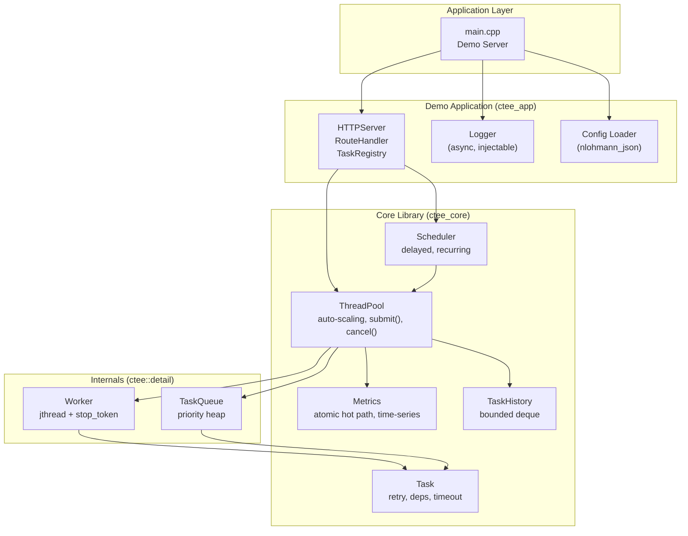
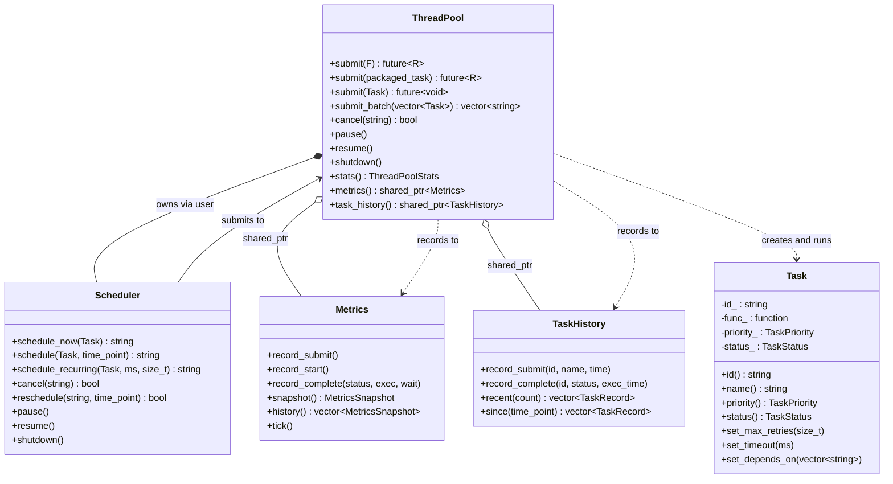

# Concurrent Task Execution Library

**A reusable C++20 library for concurrent task execution featuring thread pools, task scheduling, futures, metrics, and asynchronous logging.**

[](https://en.cppreference.com/w/cpp/20)
[](https://cmake.org/)
[](LICENSE)
[](#building)
[](#building)

Concurrent Task Execution Library (CTEE) is a production-quality C++20 library that provides a fully thread-safe, auto-scaling thread pool with priority scheduling, task retry, timeout, dependency resolution, and real-time metrics. It is designed as a reusable library with zero HTTP or JSON dependencies — link `ctee_core` and use it in any project.

The repository also includes a demonstration application (HTTP REST server + React dashboard) built on top of the library to showcase its capabilities, but the demo is **not** part of the reusable core.

---

## Overview

### Problem

Concurrent C++ applications require a thread pool that handles priority scheduling, automatic scaling, task retry, timeout, and dependency resolution — features that are difficult to implement correctly and safely. Most existing solutions either provide only basic thread pools or require framework-level adoption.

### Solution

CTEE provides a library that can be dropped into any C++20 project. The core library (`ctee_core`) has zero external dependencies beyond pthreads, making it suitable for embedded systems, backend services, and application frameworks alike.

### Design Philosophy

- **Library, not a framework.** You call `pool.submit()`. There is no IoC container, no plugin system, no inheritance-based architecture. The library works the way the standard library works.
- **Correctness first.** Every race condition, deadlock scenario, and exception path is documented, tested, and justified.
- **Zero unnecessary dependencies.** The core library depends only on pthreads. HTTP, JSON, and React are demonstration-only.
- **RAII everywhere.** Thread join in destructors, scope-bound resource management, no manual lifecycle handling.

---

## Architecture Overview

### Layer Diagram



### Component Relationships



---

## Project Structure

```
Concurrent_Task_Execution_Engine/
├── CMakeLists.txt                    Root build configuration
├── cmake/
│   └── CTEEConfig.cmake.in          Package config for find_package()
│
├── include/ctee/                     Public headers
│   ├── core/                         Reusable core (zero external deps)
│   │   ├── task.h                    Task abstraction
│   │   ├── task_queue.h              Priority queue (detail namespace)
│   │   ├── task_priority.h           Priority enum
│   │   ├── task_result.h             Status enum + result struct
│   │   ├── task_history.h            Execution history
│   │   ├── thread_pool.h             Auto-scaling thread pool
│   │   ├── thread_pool_config.h      Configuration + stats structs
│   │   ├── worker.h                  Worker thread (detail namespace)
│   │   ├── scheduler.h               Time-based scheduler
│   │   └── metrics.h                 Thread-safe metrics
│   ├── common/                       Shared utilities
│   │   ├── config.h                  JSON config loader
│   │   ├── logger.h                  Async logger
│   │   ├── thread_naming.h           Platform-specific thread naming
│   │   ├── result.h                  Value-or-error template
│   │   └── non_copyable.h            CRTP non-copyable base
│   └── server/                       Demo application
│       ├── http_server.h             HTTP server wrapper
│       ├── route_handler.h           REST endpoint implementations
│       ├── task_registry.h           In-memory task tracking
│       └── server_config.h           Server configuration
│
├── src/                              Implementation files
│   ├── CMakeLists.txt                Library + install targets
│   ├── main.cpp                      Demo server entry point
│   ├── core/                         7 source files → libctee_core.a
│   ├── common/                       2 source files (logger, config)
│   └── server/                       3 source files (HTTP, routes, registry)
│
├── tests/                            326 tests across 2 targets
│   ├── core/                         252 tests → ctee_core_tests
│   │   ├── thread_pool_test.cpp      ThreadPool lifecycle, submit, future
│   │   ├── scheduler_test.cpp        Delayed, recurring, cancel
│   │   ├── task_test.cpp             Construction, priority, move
│   │   ├── worker_test.cpp           State machine, lifecycle
│   │   ├── task_queue_test.cpp       Push/pop ordering, capacity
│   │   ├── metrics_test.cpp          Atomic recording, time-series
│   │   ├── retry_test.cpp            Retry on failure
│   │   ├── timeout_test.cpp          Timeout handling
│   │   ├── dependencies_test.cpp     Dependency resolution
│   │   ├── batch_test.cpp            Batch submission
│   │   ├── concurrency_test.cpp      Multi-threaded races
│   │   ├── deadlock_test.cpp         Deadlock prevention
│   │   ├── stress_test.cpp           High-volume stress
│   │   ├── load_test.cpp             Variable load patterns
│   │   ├── benchmark_test.cpp        Throughput measurement
│   │   └── edge_case_test.cpp        Boundary conditions
│   ├── common/
│   │   └── logger_test.cpp           34 logger tests
│   └── server/
│       └── http_server_test.cpp      35 REST endpoint tests
│
├── examples/
│   ├── CMakeLists.txt                Example build target
│   └── basic_pool.cpp               Thread pool usage demonstration
│
├── frontend/                         React dashboard (demonstration only)
│   ├── src/pages/                    7 pages (Dashboard, Workers, Queue, etc.)
│   ├── src/services/api.js           Axios client
│   └── package.json                  React 18, Vite 5, Tailwind, Recharts
│
└── docs/                             Detailed documentation
    ├── ARCHITECTURE.md               Internal architecture
    ├── API.md                        REST API reference
    ├── DESIGN_DECISIONS.md           Design rationale
    └── INTERVIEW_GUIDE.md            Interview preparation
```

### Library Separation

The project is split into two CMake targets to enforce dependency boundaries:

| Target | Contents | Dependencies | Use When |
|--------|----------|-------------|----------|
| `ctee_core` | Task, ThreadPool, Worker, TaskQueue, Scheduler, Metrics, TaskHistory | pthreads only | You need thread pool + scheduling |
| `ctee_app` | HTTPServer, RouteHandler, TaskRegistry, Logger, Config | ctee_core + httplib + nlohmann_json | You need the full demo stack |

`ctee_core` can be installed and consumed independently via `find_package(CTEE)`. The server and logger are in `ctee_app` because they depend on external libraries.

---

## Core Framework Components

### ThreadPool

**Purpose:** Auto-scaling concurrent task executor that manages a pool of worker threads.

**Responsibilities:**
- Accept tasks via three `submit()` overloads (callable, `std::packaged_task`, `Task` object)
- Dynamically scale worker count between `min_threads` and `max_threads`
- Scale up when queue depth exceeds `scale_up_threshold`
- Scale down when queue is empty and worker count exceeds `min_threads`
- Track metrics (submit/complete/fail counts, timing, utilization)
- Maintain task execution history

**Public API:**

```cpp
namespace ctee {

class ThreadPool {
public:
    explicit ThreadPool(const ThreadPoolConfig& config = {});
    ~ThreadPool();  // Calls shutdown()

    // Submit a callable (lambda, function pointer, functor)
    template<typename F, typename... Args>
    [[nodiscard]] auto submit(F&& f, Args&&... args)
        -> std::future<std::invoke_result_t<F, Args...>>;

    // Submit a packaged_task
    template<typename R>
    [[nodiscard]] std::future<R> submit(std::packaged_task<R()> task);

    // Submit a Task object (supports retry, dependencies, timeout)
    [[nodiscard]] std::future<void> submit(Task task);

    // Submit multiple tasks at once, returns task IDs
    std::vector<std::string> submit_batch(std::vector<Task> tasks);

    bool cancel(const std::string& task_id);
    void set_completion_handler(const std::string& task_id,
                                std::function<void(TaskStatus)> handler);

    void pause();
    void resume();
    void shutdown();

    [[nodiscard]] ThreadPoolStats stats() const;
    [[nodiscard]] std::vector<WorkerInfo> get_worker_infos() const;
    [[nodiscard]] QueueInfo queue_info() const;
    [[nodiscard]] bool is_running() const noexcept;
    [[nodiscard]] bool is_paused() const noexcept;
    [[nodiscard]] std::size_t thread_count() const noexcept;
    [[nodiscard]] std::shared_ptr<Metrics> metrics() const noexcept;
    [[nodiscard]] std::shared_ptr<TaskHistory> task_history() const noexcept;
};

}  // namespace ctee
```

**Thread Safety:** All public methods are thread-safe. The pool uses a single `std::mutex` protecting all shared state, with `std::condition_variable_any` for worker wakeup.

**Complexity:** `submit()` is O(log n) for the priority queue push. `cancel()` is O(1) amortized (lazy deletion via unordered_set). `stats()` is O(n) where n is worker count.

**Ownership:** The pool owns all workers via `std::unique_ptr<Worker>`. Workers are reaped (joined) during `submit()` calls, never from worker threads, preventing deadlock.

**Exception Guarantees:** If the pool is shut down or the queue is full, `submit()` sets an exception on the returned future (does not throw). Worker exceptions during task execution are captured in `TaskResult::exception`.

---

### Task

**Purpose:** Represents a unit of work with metadata for scheduling, retry, dependencies, and timeout.

**Responsibilities:**
- Hold a callable (`std::function<void()>`) and execution metadata
- Generate a unique ID (UUID v4, thread-safe via `thread_local` RNG)
- Support priority ordering for the priority queue
- Track retry count, dependency satisfaction, and timeout

**Public API:**

```cpp
namespace ctee {

class Task {
public:
    using FuncType = std::function<void()>;

    // Construct with a callable (required — default constructor is deleted)
    Task(FuncType func, std::string name = "",
         TaskPriority priority = TaskPriority::Normal);

    // Move-only (no copy)
    Task(Task&&) noexcept = default;
    Task& operator=(Task&&) noexcept = default;
    Task(const Task&) = delete;
    Task& operator=(const Task&) = delete;
    Task() = delete;

    // Accessors (all noexcept)
    [[nodiscard]] const std::string& id() const noexcept;
    [[nodiscard]] const std::string& name() const noexcept;
    [[nodiscard]] TaskPriority priority() const noexcept;
    [[nodiscard]] TaskStatus status() const noexcept;
    [[nodiscard]] const FuncType& func() const noexcept;
    [[nodiscard]] std::chrono::steady_clock::time_point created_at() const noexcept;
    [[nodiscard]] std::size_t retry_count() const noexcept;
    [[nodiscard]] std::size_t max_retries() const noexcept;
    [[nodiscard]] std::chrono::milliseconds retry_delay() const noexcept;
    [[nodiscard]] const std::vector<std::string>& depends_on() const noexcept;
    [[nodiscard]] std::chrono::milliseconds timeout_ms() const noexcept;

    // Configuration (call before submit)
    void set_max_retries(std::size_t n);
    void set_retry_delay(std::chrono::milliseconds delay);
    void set_depends_on(std::vector<std::string> deps);
    void set_timeout(std::chrono::milliseconds ms);
    void set_id(const std::string& id);

    // Priority comparison (for max-heap ordering)
    bool operator<(const Task& other) const noexcept;
};

}  // namespace ctee
```

**Thread Safety:** Task is not thread-safe. It is designed to be constructed on one thread, submitted to the pool, and then accessed only through the returned future.

**Complexity:** Construction is O(name.length()). `operator<` is O(1) (three-level comparator: priority, timestamp, UUID).

**Ownership:** Tasks are move-only. The pool takes ownership via `std::move()`. The user receives a `std::future<void>` for the result.

**Exception Guarantees:** Task construction does not throw. If the callable throws during execution, the exception is captured in `TaskResult::exception` and propagated through the future.

---

### Scheduler

**Purpose:** Time-based task dispatch — submits tasks to the ThreadPool at specific times or at recurring intervals.

**Responsibilities:**
- Maintain a min-heap of tasks ordered by next execution time
- Sleep the timer thread until the earliest deadline
- Submit tasks to the pool when their time arrives
- Support recurring tasks with configurable repeat count

**Public API:**

```cpp
namespace ctee {

class Scheduler {
public:
    explicit Scheduler(ThreadPool& pool);
    ~Scheduler();  // Calls shutdown()

    // Submit immediately (bypasses the heap)
    std::string schedule_now(Task task);

    // Submit at a specific time
    std::string schedule(Task task, std::chrono::steady_clock::time_point when);

    // Submit repeatedly at a fixed interval
    std::string schedule_recurring(Task task, std::chrono::milliseconds interval,
                                    std::size_t max_repeats = 0);

    bool cancel(const std::string& task_id);
    bool reschedule(const std::string& task_id,
                    std::chrono::steady_clock::time_point new_time);

    void pause();
    void resume();
    void shutdown();

    [[nodiscard]] bool is_running() const noexcept;
    [[nodiscard]] bool is_paused() const noexcept;
    [[nodiscard]] std::size_t scheduled_count() const noexcept;
};

}  // namespace ctee
```

**Thread Safety:** The timer thread and user threads share state through `std::mutex` + `std::condition_variable_any`. `schedule_now()` is thread-safe and submits directly to the pool.

**Complexity:** `schedule()` is O(log n) for heap insertion. `cancel()` is O(1) amortized. Timer thread wake-up is O(1).

**Ownership:** The Scheduler does not own the ThreadPool — it holds a reference. The user is responsible for creating the Scheduler before the ThreadPool is destroyed.

---

### Metrics

**Purpose:** Thread-safe collection of pool performance metrics with time-series history.

**Responsibilities:**
- Record submit/start/complete/cancel events via lock-free atomics
- Track queue length, active threads, peak queue length
- Compute derived metrics: worker utilization, tasks/sec, average wait/exec time
- Maintain a circular-buffer time-series history (default: 60 snapshots at 1-second intervals)

**Public API:**

```cpp
namespace ctee {

class Metrics {
public:
    explicit Metrics(std::size_t history_size = 60);

    // Hot-path recording (lock-free atomics)
    void record_submit(std::size_t count = 1);
    void record_start();
    void record_complete(TaskStatus status,
                         std::chrono::milliseconds exec_time,
                         std::chrono::milliseconds wait_time);
    void record_cancel();
    void set_queue_length(std::size_t len);
    void set_active_threads(std::size_t count);

    // Cold-path reads
    [[nodiscard]] MetricsSnapshot snapshot() const;
    [[nodiscard]] std::vector<MetricsSnapshot> history() const;

    void tick();   // Record a time-series snapshot (call ~once per second)
    void reset();
};

struct MetricsSnapshot {
    std::size_t submitted_tasks, completed_tasks, failed_tasks;
    std::size_t cancelled_tasks, running_tasks;
    std::size_t queue_length, peak_queue_length, active_threads;
    double avg_wait_time_ms, avg_exec_time_ms;
    double worker_utilization, tasks_per_sec;
    std::chrono::steady_clock::time_point timestamp;
};

}  // namespace ctee
```

**Thread Safety:** Hot-path methods (`record_*`) use `std::atomic` and never contend with the pool mutex. Cold-path reads (`snapshot()`, `history()`) take a mutex only to copy the history deque.

**Complexity:** Hot-path recording is O(1). `snapshot()` is O(n) where n is worker count. `history()` is O(h) where h is history size.

---

### TaskHistory

**Purpose:** Bounded deque of task execution records for auditing and querying.

**Public API:**

```cpp
namespace ctee {

struct TaskRecord {
    std::string task_id;
    std::string task_name;
    TaskStatus status;
    std::chrono::steady_clock::time_point submitted_at;
    std::chrono::steady_clock::time_point completed_at;
    std::chrono::milliseconds execution_time;
};

class TaskHistory {
public:
    explicit TaskHistory(std::size_t max_size = 10000);

    void record_submit(const std::string& task_id, const std::string& task_name,
                       std::chrono::steady_clock::time_point at);
    void record_complete(const std::string& task_id, TaskStatus status,
                         std::chrono::milliseconds exec_time);

    [[nodiscard]] std::vector<TaskRecord> recent(std::size_t count) const;
    [[nodiscard]] std::vector<TaskRecord> since(
        std::chrono::steady_clock::time_point since) const;
    [[nodiscard]] std::size_t count() const;
    void clear();
};

}  // namespace ctee
```

**Thread Safety:** All methods are thread-safe via `std::mutex`.

**Complexity:** Recording is O(1) amortized. `recent(n)` is O(n). Oldest records are evicted when capacity is exceeded.

---

### Logger

**Purpose:** Thread-safe, asynchronous logger with console and file output.

**Public API:**

```cpp
namespace ctee {

struct LogContext {
    std::size_t worker_id = 0;
    std::string task_id;
};

class Logger {
public:
    enum class Level : std::uint8_t { Debug, Info, Warn, Error };

    static Logger& instance();     // Singleton access
    Logger();                       // Default (Info level, console enabled)
    explicit Logger(Level level, bool console_enabled = true);
    ~Logger();

    void debug(const std::string& message);
    void info(const std::string& message);
    void warn(const std::string& message);
    void error(const std::string& message);

    // With structured context
    void debug(const std::string& message, const LogContext& ctx);
    void info(const std::string& message, const LogContext& ctx);
    void warn(const std::string& message, const LogContext& ctx);
    void error(const std::string& message, const LogContext& ctx);

    void set_level(Level level);
    void set_console_enabled(bool enabled);
    void set_file_output(const std::string& filepath);
    void flush();
};

}  // namespace ctee
```

**Thread Safety:** All logging methods are thread-safe. `flush()` blocks until all pending entries are written.

**Design Note:** The Logger is in `ctee_app`, not `ctee_core`, because it is an application-level concern. The core library does not log — it reports through `Metrics` and `TaskHistory`.

---

## Public API Examples

### Creating a Thread Pool

```cpp
#include "ctee/core/thread_pool.h"

ctee::ThreadPoolConfig config;
config.min_threads = 4;
config.max_threads = 16;
config.max_queue_size = 1000;
config.scale_up_threshold = 50;

ctee::ThreadPool pool(config);
```

### Submitting Tasks

```cpp
// Lambda with automatic type deduction
auto future = pool.submit([]() { return 42; });
int result = future.get();  // 42

// Lambda with arguments
auto f2 = pool.submit([](int a, int b) { return a + b; }, 3, 4);
int sum = f2.get();  // 7

// Void lambda
auto f3 = pool.submit([]() { std::cout << "done\n"; });
f3.get();

// std::packaged_task
std::packaged_task<int()> pt([]() { return 100; });
auto f4 = pool.submit(std::move(pt));
int val = f4.get();  // 100
```

### Submitting a Task Object (with retry, dependencies, timeout)

```cpp
ctee::Task task([]() {
    // This might fail and be retried
    if (rand() % 2) throw std::runtime_error("transient failure");
}, "important_job", ctee::TaskPriority::High);

task.set_max_retries(3);
task.set_retry_delay(std::chrono::milliseconds(500));
task.set_timeout(std::chrono::seconds(30));
task.set_depends_on({"setup_task_id"});

auto future = pool.submit(std::move(task));
future.get();
```

### Scheduling Delayed and Recurring Tasks

```cpp
ctee::Scheduler scheduler(pool);

// Execute immediately
scheduler.schedule_now(ctee::Task([]() { /* ... */ }, "immediate"));

// Execute after 5 seconds
auto when = std::chrono::steady_clock::now() + std::chrono::seconds(5);
scheduler.schedule(ctee::Task([]() { /* ... */ }, "delayed"), when);

// Execute every 10 seconds (up to 5 times)
scheduler.schedule_recurring(
    ctee::Task([]() { /* ... */ }, "heartbeat"),
    std::chrono::seconds(10),
    5  // max_repeats (0 = unlimited)
);

// Later: shut down the scheduler before the pool
scheduler.shutdown();
```

### Cancellation

```cpp
auto future = pool.submit([]() {
    std::this_thread::sleep_for(std::chrono::seconds(60));
    return "done";
});

bool cancelled = pool.cancel(task_id);
// cancelled == true if the task was pending
// cancelled == false if already running or not found
// future.get() will throw std::runtime_error("Task was cancelled")
```

### Checking Metrics

```cpp
auto snap = pool.metrics()->snapshot();
std::cout << "Completed: " << snap.completed_tasks << "\n";
std::cout << "Queue length: " << snap.queue_length << "\n";
std::cout << "Avg exec time: " << snap.avg_exec_time_ms << " ms\n";
std::cout << "Utilization: " << snap.worker_utilization * 100 << "%\n";

// Access time-series history (for charting)
auto history = pool.metrics()->history();
for (const auto& point : history) {
    // point.timestamp, point.tasks_per_sec, etc.
}
```

### Pause, Resume, Shutdown

```cpp
pool.pause();     // Workers finish current task, then wait
pool.resume();    // Workers resume picking tasks

pool.shutdown();  // Sets running=false, drains queue, joins all threads
// destructor also calls shutdown()
```

---

## Build Instructions

### Prerequisites

- **Compiler:** GCC 11+ / Clang 12+ / MSVC 2019+ with C++20 support
- **CMake:** 3.20 or later
- **Platform:** Windows, Linux, or macOS
- **Internet:** Required on first build to fetch dependencies (httplib, nlohmann_json, GoogleTest)

### Clone and Build

```bash
git clone https://github.com/your-org/Concurrent_Task_Execution_Engine.git
cd Concurrent_Task_Execution_Engine

# Configure
cmake -B build -G Ninja -DCMAKE_BUILD_TYPE=Release

# Build everything (libraries + executable + tests + examples)
cmake --build build

# Build only the core library
cmake --build build --target ctee_core

# Build only the example
cmake --build build --target example_basic_pool
```

### Run

```bash
# Run the demo server
./build/bin/ctee

# Run the example
./build/bin/example_basic_pool

# Run core tests (252 tests)
./build/tests/ctee_core_tests

# Run application tests (74 tests)
./build/tests/ctee_app_tests
```

### CMake Options

| Option | Default | Description |
|--------|---------|-------------|
| `CTEE_BUILD_TESTS` | `ON` | Build unit tests |
| `CTEE_BUILD_EXAMPLES` | `ON` | Build example programs |
| `CTEE_BUILD_FRONTEND` | `OFF` | Build React dashboard assets |
| `CMAKE_BUILD_TYPE` | `Debug` | Release / Debug / RelWithDebInfo |

---

## Installation

### Install the Core Library

```bash
cmake -B build -DCMAKE_INSTALL_PREFIX=/usr/local
cmake --build build
cmake --install build
```

This installs:
- `libctee_core.a` to `lib/`
- Headers to `include/ctee/`
- CMake package config to `lib/cmake/CTEE/`

### Consume in Another CMake Project

```cmake
cmake_minimum_required(VERSION 3.20)
project(MyProject LANGUAGES CXX)

find_package(CTEE REQUIRED)

add_executable(my_app main.cpp)
target_link_libraries(my_app PRIVATE CTEE::ctee_core)
```

Or manually:

```cmake
target_include_directories(my_app PRIVATE /path/to/Concurrent_Task_Execution_Engine/include)
target_link_libraries(my_app PRIVATE ctee_core Threads::Threads)
```

The exported target `CTEE::ctee_core` automatically brings in the pthreads dependency.

---

## Example Programs

### basic_pool

**Location:** `examples/basic_pool.cpp`

**Demonstrates:**
- Creating a `ThreadPool` with configuration
- Submitting lambdas that return values (automatic `std::future`)
- Submitting lambdas with arguments
- Fan-out pattern: submitting N tasks and collecting results
- Submitting a `Task` object with priority
- Querying pool stats

**Build:**
```bash
cmake --build build --target example_basic_pool
./build/bin/example_basic_pool
```

---

## Demo Application

The repository includes a demonstration application that shows how to build a full-stack service on top of the CTEE library. **This is not part of the reusable core.**

### Architecture

```
React Dashboard (port 3000)
        │  Axios HTTP
        ▼
HTTPServer (port 8080)  ←── httplib
        │
RouteHandler             ←── nlohmann_json
        │
ThreadPool  ──→  Workers  ──→  TaskQueue
        │
Scheduler  ──→  Timer Thread
        │
Metrics + TaskHistory
```

### REST API Endpoints

| Method | Path | Description |
|--------|------|-------------|
| `POST` | `/submit` | Submit a task |
| `POST` | `/schedule` | Schedule a delayed task |
| `POST` | `/schedule/recurring` | Schedule a recurring task |
| `POST` | `/batch` | Submit multiple tasks |
| `GET` | `/status/{id}` | Get task status |
| `POST` | `/cancel/{id}` | Cancel a task |
| `GET` | `/workers` | List worker threads |
| `GET` | `/queue` | Queue status |
| `GET` | `/metrics` | Current metrics snapshot |
| `GET` | `/metrics/history` | Time-series metrics |
| `GET` | `/history` | Task execution history |
| `GET` | `/health` | Health check |
| `POST` | `/pause` | Pause the pool |
| `POST` | `/resume` | Resume the pool |
| `POST` | `/shutdown` | Shut down the server |

### React Dashboard

A single-page application built with React 18, Vite 5, Tailwind CSS 3, and Recharts. Provides 7 pages: Dashboard, Workers, Queue, Metrics (with charts), Scheduler, Task History, and Health.

```bash
cd frontend
npm install
npm run dev    # Runs on port 3000, proxies to backend at port 8080
```

---

## Testing

CTEE has **326 tests** split across two independent test targets.

### Test Targets

| Target | Tests | Links Against | Validates |
|--------|-------|---------------|-----------|
| `ctee_core_tests` | 252 | `ctee_core` + GTest | Core library in isolation |
| `ctee_app_tests` | 74 | `ctee_app` + GTest + httplib + nlohmann_json | Server, logger, config |

### Test Categories

| Category | Files | What It Tests |
|----------|-------|---------------|
| **Unit** | task_test, task_queue_test, worker_test, metrics_test, task_history_test | Individual component correctness |
| **Integration** | thread_pool_test, scheduler_test | Component interaction, lifecycle |
| **Feature** | retry_test, timeout_test, dependencies_test, batch_test | Specific features end-to-end |
| **Concurrency** | concurrency_test, deadlock_test | Multi-threaded races, deadlock prevention |
| **Stress** | stress_test, load_test | High-volume, variable load patterns |
| **Performance** | benchmark_test | Throughput measurement |
| **Edge Cases** | edge_case_test | Boundary conditions, error paths |
| **Application** | http_server_test, logger_test, config_test | REST endpoints, logging, config parsing |

### Running Tests

```bash
# Run all tests
cd build
ctest

# Run only core tests
./tests/ctee_core_tests

# Run specific test suite
./tests/ctee_core_tests --gtest_filter="ThreadPoolAutoScale.*"

# Run with verbose output
./tests/ctee_core_tests --gtest_print_time=1
```

---

## Performance

### Complexity Summary

| Operation | Time | Notes |
|-----------|------|-------|
| `submit()` (callable) | O(log n) | Priority queue push |
| `submit_batch()` | O(m log n) | m tasks, n queue size |
| `cancel()` | O(1) amortized | Lazy deletion via `unordered_set` |
| `stats()` | O(w) | w = worker count |
| `Metrics::snapshot()` | O(w) | Atomic reads + derived computation |
| `TaskHistory::recent(k)` | O(k) | Bounded deque slice |

### Synchronization Strategy

| Component | Mechanism | Contention |
|-----------|-----------|------------|
| ThreadPool | `mutex_` + `condition_variable_any` | Single lock for all pool state |
| Worker | `std::atomic<State>` + `std::atomic<bool>` | Lock-free state reads |
| Metrics hot path | `std::atomic<size_t>` | Zero contention with pool |
| Metrics cold path | `timing_mutex_` | Only during `snapshot()` |
| TaskHistory | `mutex_` | Only during `record_*()` and `recent()` |
| Logger | `mutex_` + `condition_variable` | Background thread drains queue |

### Locking Model

The ThreadPool uses a single mutex for all shared state. This design was chosen over fine-grained locking because:

1. **Simplicity.** One lock means no lock ordering, no deadlock risk between subsystems.
2. **Low contention.** `submit()` is fast (push + notify). Workers hold the lock only during queue pop.
3. **Correctness.** Scaling decisions (add/remove workers) must be atomic with queue operations.

### Memory Ownership

- Workers are owned by the pool via `std::unique_ptr<Worker>`
- Metrics and TaskHistory are shared via `std::shared_ptr` (accessible after pool destruction)
- Tasks are move-only; the pool takes ownership on `submit()`
- The returned `std::future` holds a shared state (`std::shared_ptr<promise_impl>`)

### RAII Usage

- `ThreadPool::~ThreadPool()` calls `shutdown()`
- `Scheduler::~Scheduler()` calls `shutdown()`
- `Worker::~Worker()` requests stop and notifies the CV
- `Logger::~Logger()` sets stop flag and joins the background thread
- `std::lock_guard` / `std::unique_lock` for all mutex usage
- `std::jthread` with `std::stop_token` for cooperative cancellation

### Exception Safety

- `submit()` never throws — it sets exceptions on the returned future
- Worker exceptions are captured in `TaskResult::exception_ptr`
- Task retry re-enqueues with preserved metadata on failure
- Queue-full and shutdown conditions propagate as exceptions through futures

---

## Design Decisions

### Why a library, not a framework?

CTEE is a library because you call `pool.submit()` — there is no inversion of control. You create the pool, you submit work, you get futures back. The library does not call your code through virtual methods or plugin interfaces. This makes it composable: use it with any HTTP framework, any logging library, any configuration system.

### Why `std::condition_variable_any` instead of `std::condition_variable`?

`condition_variable_any` works with `std::stop_token` from `std::jthread`. This enables cooperative shutdown: when the pool is destroying, it can notify workers through the CV, and workers can check both the CV predicate and the stop token in a single `wait()` call. This avoids the race condition where a worker misses a notification between checking the predicate and calling `wait()`.

### Why a priority queue via `std::vector` + heap operations instead of `std::priority_queue`?

`std::priority_queue::top()` returns `const T&`, which prevents moving tasks out. The implementation needs to move tasks during pop. Using `std::vector` with `std::push_heap` / `std::pop_heap` provides the same O(log n) guarantees while allowing move semantics.

### Why lazy cancellation (unordered_set) instead of removing from the heap?

Removing an arbitrary element from a heap is O(n). Lazy cancellation marks the task ID in an `unordered_set` and skips it during pop. This is O(1) for the cancel operation and O(1) amortized for the skip during pop.

### Why `std::shared_future` for timeout instead of `std::async`?

`std::async`'s future destructor **blocks** until the async task completes, which defeats timeout entirely. `std::shared_future` does not block on destruction, so on timeout the worker moves on immediately while the detached thread continues running in the background.

### Why `thread_local` for UUID generation?

`std::mt19937` is **not** thread-safe. Using a shared RNG would require a mutex on every UUID generation. `thread_local` gives each thread its own engine, eliminating contention entirely.

### Why `ctee::detail` for Worker and TaskQueue?

These are implementation details that users should not construct directly. `Worker` requires references to the pool's mutex, CV, and queue. `TaskQueue` is managed exclusively by the ThreadPool. Moving them to `ctee::detail` makes the public API surface explicit: users interact with `ThreadPool`, not its internals.

### Why friend classes for Task mutation?

`Task::execute()`, `set_status()`, and `set_result()` are private because they are internal lifecycle methods. Only `ThreadPool` and `Worker` should call them. Making them private with `friend` declarations enforces this at compile time while keeping the Task's public API clean.

### Why separate `ctee_core` and `ctee_app`?

`ctee_core` has zero external dependencies (only pthreads). This means it can be used in embedded systems, kernel modules, or any environment where httplib and nlohmann_json are unavailable. `ctee_app` adds the server and logger, which depend on those external libraries. The separation enforces this boundary at the build system level.

### Why injectable Logger constructor?

The singleton pattern (`Logger::instance()`) is convenient but untestable and inflexible. The new `Logger(Level, bool)` constructor allows creating independent logger instances for testing or multi-tenant applications. The singleton is kept for backward compatibility.

---

## Real-world Applications

CTEE is suitable for any scenario requiring concurrent task execution with scheduling:

| Use Case | How CTEE Helps |
|----------|---------------|
| **Background job systems** | Submit jobs with retry and timeout. Monitor via metrics. |
| **Image/video processing** | Fan-out pattern: submit N tasks, collect results via futures. |
| **Task schedulers** | Use Scheduler for cron-like recurring tasks. |
| **File I/O pipelines** | Submit file processing tasks with dependencies. |
| **Email/notification workers** | Priority queue ensures critical messages are sent first. |
| **Data ingestion** | Batch submission for high-throughput data pipelines. |
| **Health monitoring** | Scheduler runs health checks at regular intervals. |
| **Backend microservices** | ctee_core for task execution, your choice of HTTP framework. |
| **Game engines** | Auto-scaling pool handles variable workload during gameplay. |
| **Build systems** | Parallel compilation tasks with dependency resolution. |

---

## Learning Outcomes

This project demonstrates:

| Area | Topics |
|------|--------|
| **Modern C++** | C++20, `std::jthread`, `std::stop_token`, concepts, `requires` clauses, structured bindings |
| **Concurrency** | Thread pools, work stealing, cooperative cancellation, condition variables, atomics |
| **Synchronization** | Mutex + CV patterns, lock-free atomics, memory ordering (`memory_order_acquire/release`) |
| **Data Structures** | Priority heap, bounded deque, hash sets, circular buffer |
| **API Design** | Template `submit()` with type deduction, `std::future` return, `[[nodiscard]]` |
| **Software Architecture** | Library vs framework, dependency inversion, RAII, clean separation |
| **Build Systems** | CMake FetchContent, exported targets, package config, multi-target builds |
| **Testing** | Unit/integration/stress/deadlock/benchmark tests, 326 total |
| **Error Handling** | Exception propagation through futures, `std::exception_ptr`, retry logic |
| **Performance** | Atomic hot path, lock contention analysis, time-series metrics |

---

## Interview Discussion

### Architecture Questions

**Q: Why did you split the project into `ctee_core` and `ctee_app`?**

A: `ctee_core` has zero external dependencies (only pthreads). This makes it usable in any environment — embedded systems, kernel modules, or projects that already have their own HTTP/JSON libraries. `ctee_app` adds the demo server and logger, which depend on httplib and nlohmann_json. The split enforces this boundary at the CMake level: linking `ctee_core` never pulls in unwanted dependencies.

**Q: Why is this a library and not a framework?**

A: A framework uses inversion of control — you inherit from its base classes and it calls your code. CTEE is a library: you create a `ThreadPool`, call `pool.submit()`, and get back a `std::future`. There are no virtual methods to implement, no lifecycle hooks, no plugin interfaces. This makes it composable with any architecture.

**Q: How does the auto-scaling work?**

A: Scale-up happens in `submit()`: if `queue.size() >= scale_up_threshold` and `workers < max_threads`, a new worker is added immediately under the pool mutex. Scale-down happens in `on_task_complete()`: if the queue is empty and `workers > min_threads`, one idle worker is marked for stop via `request_stop()`. The worker drains any remaining tasks and exits its loop. Stopped workers are reaped (joined) in the next `submit()` call, which is always from a user thread, never from a worker thread — preventing deadlock.

**Q: Why reap stopped workers in `submit()` instead of `on_task_complete()`?**

A: `on_task_complete()` runs on a worker thread. Calling `Worker::~Worker()` → `join()` from a worker thread could deadlock if the joining thread holds the pool mutex while the target thread is also waiting for it. `submit()` runs on user threads, so `join()` cannot deadlock.

---

### Concurrency Questions

**Q: How do you prevent the shutdown deadlock?**

A: During `shutdown()`, `running_` is set to `false` under the mutex, then all workers are notified. Every worker's `cv_.wait()` predicate checks `!pool_running_ && queue_.empty()`, so they all break out of the loop. The destructor then joins all threads. Additionally, `shutdown()` sets `paused_ = false` before notifying, because if the pool is paused, workers would be stuck in `wait()` checking `!pool_paused_` which never becomes true.

**Q: What happens if a task throws an exception?**

A: The worker catches the exception in `Task::execute()`, stores it in `TaskResult::exception_ptr`, and marks the task as `Failed`. The `on_task_complete()` callback then sets the exception on the promise, so `future.get()` rethrows it in the caller's thread. The pool continues operating normally.

**Q: How does cooperative cancellation work?**

A: `cancel()` marks the task ID in an `unordered_set` in the TaskQueue. When a worker pops a task, it checks if the ID is in the cancelled set and skips it. Additionally, `cancel()` invokes any registered cancel handler, which sets a "Task was cancelled" exception on the promise. This is lazy deletion — the task may already be running, in which case `cancel()` returns `false` (no cancel handler found).

**Q: Why use `std::stop_token` with `std::jthread`?**

A: `std::jthread` automatically calls `request_stop()` and `join()` in its destructor. The `stop_token` is checked in the `cv_.wait()` predicate, so when the worker is being destroyed, it sees the stop request immediately and exits the loop. This provides cooperative cancellation without manual thread management.

**Q: How does the timeout mechanism work without blocking?**

A: The task is run on a detached thread. A `std::shared_future` is created from a `std::promise`. The worker calls `done.wait_for(timeout)`. If it returns `ready`, the task completed within the timeout. If not, the worker reports `TimedOut` and moves on — the detached thread continues running in the background. This works because `std::shared_future` does not block on destruction, unlike `std::async`.

**Q: Why are atomics used for Metrics hot path?**

A: `record_submit()` and `record_complete()` are called on every task submission and completion — hot paths that must not contend with the pool mutex. Using `std::atomic<size_t>` with relaxed ordering for counters means these operations are essentially free. The cold path (`snapshot()`) takes a mutex only for compound reads like timing accumulators.

---

### C++ Questions

**Q: Why is `Task` move-only?**

A: `Task` contains a `std::function<void()>` which captures state by value. Copying it would duplicate the captured state, which could lead to double-execution bugs. Move-only semantics enforce single ownership: the task is constructed by the user, moved into the pool, and executed exactly once.

**Q: Why delete the default constructor of `Task`?**

A: A Task without a callable is meaningless — it would have no work to execute. Deleting the default constructor forces users to provide a callable at construction time, making the API harder to misuse.

**Q: Why use `std::invoke_result_t` instead of `std::result_of`?**

A: `std::result_of` was deprecated in C++17 and removed in C++20. `std::invoke_result_t` is the replacement and works with the `requires` clause to constrain the `submit()` template.

**Q: What is the purpose of the `is_packaged_task` type trait?**

A: It disambiguates the `submit()` overloads. Without it, `submit(std::packaged_task<int()>(...))` would match both the callable overload and the packaged_task overload. The trait constrains the callable overload to reject `std::packaged_task` types via `!is_packaged_task_v<std::decay_t<F>>`.

**Q: Why use `std::shared_ptr<std::promise<void>>` for void promises?**

A: The promise must outlive the scope where it is created, because the task may complete after `submit()` returns. `std::shared_ptr` allows the promise to be shared between the cancel handler, completion callback, and the task itself, with automatic cleanup when all references are gone.

---

### Memory and Performance Questions

**Q: What is the memory overhead per worker?**

A: Each worker is a `std::unique_ptr<Worker>` containing: a `std::jthread` (one OS thread + stack, typically 1-8 MB), an atomic `State`, an atomic `bool`, and references to the pool's mutex/CV/queue. The per-worker heap overhead is roughly 100 bytes.

**Q: How does the priority queue handle same-priority tasks?**

A: Tasks are compared on three levels: (1) priority enum value (higher = earlier), (2) creation timestamp (earlier = earlier for FIFO), (3) UUID lexicographic order (for determinism when timestamps are equal). This guarantees a strict weak ordering with no ambiguous comparisons.

**Q: Why not use `std::priority_queue` directly?**

A: `std::priority_queue::top()` returns `const T&`, preventing move semantics. The implementation needs to move tasks out during pop (Task is move-only). Using `std::vector` with `std::push_heap`/`std::pop_heap` provides the same O(log n) guarantees while allowing moves.

---

### Testing Questions

**Q: How do you test for deadlocks?**

A: `deadlock_test.cpp` submits tasks that hold the pool mutex while trying to submit more tasks (recursive submission), runs `shutdown()` while tasks are executing, and tests pause/resume during execution. Each test has a timeout — if it hangs, GTest reports a failure. The tests also verify that `shutdown()` is idempotent and that `destroy` during execution does not deadlock.

**Q: Why split tests into `ctee_core_tests` and `ctee_app_tests`?**

A: To verify that `ctee_core` can be used independently. `ctee_core_tests` links only `ctee_core` + pthreads + GTest — no httplib, no nlohmann_json. This proves the core library is self-contained and can be consumed without pulling in unwanted dependencies.

**Q: How do you test concurrent correctness?**

A: `concurrency_test.cpp` uses `std::barrier` to synchronize multiple submitter threads, submits tasks from N threads simultaneously, and verifies that all tasks complete correctly. `stress_test.cpp` submits 1000+ tasks and verifies queue capacity, priority ordering, and completion counts.

---

### Build System Questions

**Q: Why use FetchContent instead of requiring pre-installed dependencies?**

A: FetchContent downloads and builds httplib, nlohmann_json, and GoogleTest during the CMake configure step. This means users do not need to pre-install these libraries — the build is self-contained. For production use, the exported `CTEE::ctee_core` target can be consumed via `find_package()` after installation.

**Q: Why is `ctee_core` the only exported target?**

A: `ctee_core` has zero external dependencies (only pthreads). Exporting `ctee_app` would require httplib and nlohmann_json to also be installed and discoverable by the consumer's CMake. By exporting only `ctee_core`, downstream projects can use the core library without needing the demo dependencies.

---

## Future Improvements

These are realistic production-grade extensions of the current implementation:

- **Work stealing.** Allow idle workers to steal tasks from other workers' local queues, reducing contention on the shared queue.
- **Per-worker idle timeout.** Currently the `idle_timeout` config field is reserved. Implementing per-worker timeouts would allow more gradual scale-down.
- **Task cancellation token.** Pass a `std::stop_token` into the task callable so long-running tasks can check for cancellation cooperatively.
- **Static thread pool.** A pool with a fixed number of threads (no auto-scaling) for latency-sensitive applications.
- **Executor concept.** A `std::execution::executor`-style interface for C++26 Senders/Receivers integration.
- **Priority inversion prevention.** Priority inheritance protocol for tasks with dependencies.
- **Configurable queue policies.** Support for FIFO, LIFO, or deadline-based ordering beyond the current priority queue.
- **Distributed execution.** Network-transparent task submission across multiple pool instances.

---

## Contributing

1. Fork the repository
2. Create a feature branch (`git checkout -b feature/my-feature`)
3. Ensure all tests pass (`cd build && ctest`)
4. Ensure no compiler warnings (`-Wall -Wextra -Wpedantic`)
5. Add tests for new functionality
6. Submit a pull request with a clear description

### Coding Conventions

- C++20 standard, no compiler extensions
- `snake_case` for functions and variables
- `PascalCase` for classes and structs
- `UPPER_CASE` for constants
- `#pragma once` for header guards
- All public API methods marked `[[nodiscard]]` where applicable
- RAII for all resource management
- Single mutex per component (no fine-grained locking)

---

## License

This project is licensed under the MIT License. See [LICENSE](LICENSE) for details.
