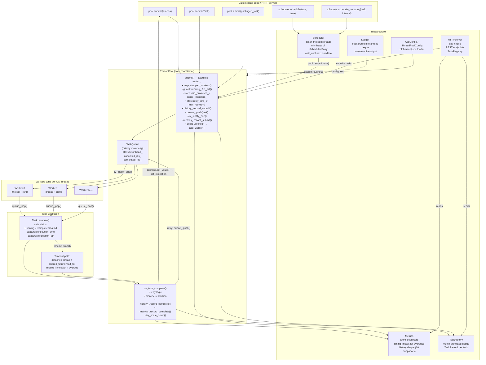

# Phase 1 — Project Overview: Concurrent Task Execution Engine (CTEE)

---

## 1.1 Project Directory Structure

```
Concurrent_Task_Execution_Engine/
│
├── CMakeLists.txt              ← Root build config (C++20, FetchContent for httplib + nlohmann/json)
├── build.bat / build.sh        ← Convenience build scripts for Windows/Linux
├── build_now.bat               ← Alternate quick-build script
├── configure_and_build.bat     ← CMake configure + build in one step
├── .clang-format               ← Code style configuration (auto-formatter)
├── .gitignore                  ← Git exclusions
├── README.md                   ← Project documentation (50 KB — extensive)
│
├── cmake/
│   └── CTEEConfig.cmake.in     ← CMake package config template (for install/find_package)
│
├── include/ctee/               ← All PUBLIC headers (the library's interface)
│   ├── core/
│   │   ├── task_priority.h     ← TaskPriority enum (Low/Normal/High/Critical)
│   │   ├── task_result.h       ← TaskStatus enum + TaskResult struct
│   │   ├── task.h              ← Task class declaration (the unit of work)
│   │   ├── task_queue.h        ← TaskQueue (priority heap + dependency tracking)
│   │   ├── task_history.h      ← TaskHistory (per-task audit log)
│   │   ├── thread_pool_config.h← ThreadPoolConfig, ThreadPoolStats, WorkerInfo, QueueInfo
│   │   ├── metrics.h           ← Metrics + MetricsSnapshot (live performance stats)
│   │   ├── worker.h            ← Worker (one execution thread)
│   │   ├── scheduler.h         ← Scheduler (time-based dispatch)
│   │   └── thread_pool.h       ← ThreadPool (the main public API)
│   ├── common/
│   │   ├── config.h            ← AppConfig struct + load_config()
│   │   ├── logger.h            ← Logger (async background logging)
│   │   ├── non_copyable.h      ← NonCopyable utility base class
│   │   ├── result.h            ← Generic Result<T> type (success/error)
│   │   └── thread_naming.h     ← set_thread_name() (platform-specific, header-only)
│   └── server/
│       ├── server_config.h     ← ServerConfig (host, port)
│       ├── http_server.h       ← HTTPServer declaration
│       ├── route_handler.h     ← RouteHandler declaration (REST API)
│       └── task_registry.h     ← TaskRegistry (server-side task tracking)
│
├── src/                        ← Implementation files
│   ├── CMakeLists.txt          ← Defines ctee_core + ctee_server + ctee_exe targets
│   ├── main.cpp                ← Executable entry point (starts pool+scheduler+HTTP server)
│   ├── core/
│   │   ├── task.cpp            ← Task impl (UUID gen, execute, comparator)
│   │   ├── task_queue.cpp      ← TaskQueue impl (heap ops, dependency check, cancellation)
│   │   ├── task_history.cpp    ← TaskHistory impl (mutex-protected deque)
│   │   ├── metrics.cpp         ← Metrics impl (atomics + timing mutex + history)
│   │   ├── worker.cpp          ← Worker impl (jthread run loop, timeout, state machine)
│   │   ├── scheduler.cpp       ← Scheduler impl (timer loop, min-heap, recurring tasks)
│   │   └── thread_pool.cpp     ← ThreadPool impl (submit, shutdown, scaling, retry)
│   ├── common/
│   │   ├── config.cpp          ← JSON config loading (nlohmann/json)
│   │   └── logger.cpp          ← Logger impl (async queue, background drain thread)
│   └── server/
│       ├── http_server.cpp     ← HTTPServer impl (cpp-httplib, route registration)
│       ├── route_handler.cpp   ← REST endpoint handlers (submit, cancel, stats, history…)
│       └── task_registry.cpp   ← TaskRegistry impl (server-side task metadata store)
│
├── tests/
│   ├── CMakeLists.txt          ← Test targets (likely uses GoogleTest via FetchContent)
│   ├── core/                   ← 19 test files covering every core component
│   │   ├── thread_pool_test.cpp   (32 KB — largest test file)
│   │   ├── concurrency_test.cpp
│   │   ├── deadlock_test.cpp
│   │   ├── benchmark_test.cpp
│   │   ├── load_test.cpp
│   │   ├── metrics_test.cpp
│   │   ├── scheduler_test.cpp
│   │   ├── task_queue_test.cpp
│   │   ├── edge_case_test.cpp
│   │   ├── stress_test.cpp
│   │   ├── task_test.cpp
│   │   ├── worker_test.cpp
│   │   ├── retry_test.cpp
│   │   ├── timeout_test.cpp
│   │   ├── dependencies_test.cpp
│   │   ├── config_test.cpp
│   │   ├── batch_test.cpp
│   │   ├── task_history_test.cpp
│   │   └── thread_naming_test.cpp
│   ├── common/
│   │   └── logger_test.cpp
│   └── server/
│       └── http_server_test.cpp
│
├── examples/
│   ├── CMakeLists.txt
│   └── basic_pool.cpp          ← Simple demo: submit lambdas, get futures, check stats
│
└── frontend/                   ← React/Vite dashboard (separate web app)
    ├── index.html
    ├── package.json
    ├── vite.config.js
    ├── tailwind.config.js
    └── src/                    ← React source (talks to HTTP server via REST)
```

---

## 1.2 High-Level Architecture

CTEE has **six major components**, cleanly separated into headers/sources:

| Component | Key Files | Responsibility |
|---|---|---|
| **Task** | `task.h/cpp`, `task_priority.h`, `task_result.h` | Represents a single unit of work. Holds the callable, ID, priority, status, retry/timeout config, dependency list, and result. |
| **TaskQueue** | `task_queue.h/cpp` | Priority max-heap that stores pending tasks. Handles dependency gating (blocks tasks whose `depends_on` IDs haven't completed). Supports cancellation marking. |
| **Worker** | `worker.h/cpp` | One OS thread (`std::jthread`). Loops forever: wait → pop task → execute → report. Implements state machine (Idle/Waiting/Running/Stopped). |
| **ThreadPool** | `thread_pool.h/cpp`, `thread_pool_config.h` | Central coordinator. Manages a vector of Workers, the TaskQueue, metrics, task history, retry state, promises, and auto-scaling. Owns the public API: `submit()`, `cancel()`, `pause()`, `shutdown()`. |
| **Scheduler** | `scheduler.h/cpp` | A separate `jthread` timer loop that sits on top of `ThreadPool`. Maintains a min-heap ordered by "next execution time". Fires tasks into the pool at their due time and re-queues recurring tasks. |
| **Metrics + TaskHistory** | `metrics.h/cpp`, `task_history.h/cpp` | Metrics: lock-free atomic counters + time-series snapshots. TaskHistory: per-task audit log (submitted/completed timestamps, status). Both are `shared_ptr`-owned by the pool. |

**Supporting infrastructure:**

| Component | Key Files | Responsibility |
|---|---|---|
| **Logger** | `logger.h/cpp` | Async background logger. Callers push `LogEntry` into a deque; a background `std::thread` drains and formats entries. Never blocks the caller. |
| **Config** | `config.h/cpp`, `thread_pool_config.h` | `ThreadPoolConfig` holds all pool tuning knobs. `AppConfig` wraps pool + server + retry defaults. `load_config()` parses a JSON file via nlohmann/json. |
| **HTTP Server** | `http_server.h/cpp`, `route_handler.h/cpp`, `task_registry.h/cpp` | A REST API (cpp-httplib) that exposes the pool and scheduler over HTTP. The frontend dashboard calls these endpoints. |
| **Utilities** | `thread_naming.h`, `non_copyable.h`, `result.h` | Platform-specific thread naming, a copy-prevention base class, and a generic `Result<T>` type. |

---

## 1.3 Architecture Diagram



**Key to arrows:**
- **Solid arrow** → direct function call or data flow in the normal path.
- **Dashed arrow** → indirect usage (optional, background).

---

## 1.4 File Dependency Map

### What "depends on" means

There are three distinct kinds of dependency:

| Type | Description | Example |
|---|---|---|
| **Header inclusion** (compile-time) | `#include "X.h"` means the compiler needs `X.h` to compile this file. | `thread_pool.h` includes `task.h` |
| **Class uses another class** (semantic) | A class holds a member of another type, or calls its methods. | `ThreadPool` holds a `detail::TaskQueue` member |
| **Runtime callback** (dynamic) | A function pointer or `std::function` passed at construction, called later from a different thread. | `Worker` receives `on_complete_` → calls `ThreadPool::on_task_complete()` |

### Header Inclusion Tree

```
task_priority.h          ← no project deps
task_result.h            ← no project deps

task.h
  ├── task_priority.h
  └── task_result.h

task_queue.h
  └── task.h

task_history.h
  └── task_result.h

thread_pool_config.h     ← no project deps

metrics.h
  └── task_result.h

worker.h
  ├── task_queue.h
  └── task_result.h

scheduler.h
  ├── task.h
  ├── task_priority.h
  └── task_result.h

thread_pool.h            ← the "fat" header — includes everything
  ├── task.h
  ├── task_queue.h
  ├── task_history.h
  ├── thread_pool_config.h
  ├── worker.h
  └── metrics.h

logger.h                 ← no project deps

config.h
  ├── thread_pool_config.h
  └── server/server_config.h

thread_naming.h          ← header-only, platform #ifdef
non_copyable.h           ← no project deps
result.h                 ← no project deps
```

### Class-Level Dependencies

| Class | Holds / Uses |
|---|---|
| `Task` | `TaskPriority`, `TaskStatus`, `TaskResult`, `FuncType` (std::function<void()>) |
| `detail::TaskQueue` | `Task` (stored in vector heap_) |
| `detail::Worker` | References to `std::mutex`, `std::condition_variable_any`, `TaskQueue`, `bool pool_running_`, `bool pool_paused_`; owns a `std::jthread`; calls `on_complete_` callback |
| `ThreadPool` | Owns `detail::TaskQueue`, `vector<unique_ptr<detail::Worker>>`, `shared_ptr<Metrics>`, `shared_ptr<TaskHistory>`, `std::mutex`, `std::condition_variable_any`, maps for promises/callbacks/retry |
| `Scheduler` | Holds a reference `ThreadPool&`, owns a `std::jthread`, a min-heap `vector<ScheduledEntry>` |
| `Metrics` | Atomic counters, `timing_mutex_`, `history_mutex_`, `deque<MetricsSnapshot>` |
| `TaskHistory` | `std::mutex`, `deque<TaskRecord>` |
| `Logger` | `std::thread` (background worker), `std::mutex`, `std::condition_variable`, `deque<LogEntry>`, `std::ofstream` |
| `HTTPServer` | References `ThreadPool&`, `Scheduler&`; owns `RouteHandler`, `unique_ptr<httplib::Server>`, `std::thread` |
| `RouteHandler` | References `ThreadPool&`, `Scheduler&`; owns `TaskRegistry` |

### Runtime Callback Connections

```
ThreadPool::add_worker()
  └── creates Worker with:
       on_complete_ = [this](...){ on_task_complete(...); }   ← Worker → ThreadPool
       on_start_    = [this](){ metrics_->record_start(); }   ← Worker → Metrics
```

This is the most important runtime link: the Worker does not know about `ThreadPool` at compile time through a member — it communicates back exclusively through a callback function stored as `std::function`.

---

## 1.5 End-to-End Overview

Here is what happens, from start to finish, for a single task:

### Step 1 — Pool Construction
```cpp
ctee::ThreadPoolConfig config;
config.min_threads = 4;
ctee::ThreadPool pool(config);
```
- `ThreadPool` constructor stores `config_`, creates `Metrics` and `TaskHistory` (both `shared_ptr`).
- It calls `add_worker()` exactly `min_threads` times (default: 2).
- Each `add_worker()` creates a `detail::Worker`, which immediately launches a `std::jthread` that starts its `run()` loop.
- Each worker thread immediately blocks inside `cv_.wait(lock, ...)` waiting for work.

### Step 2 — Task Submission
```cpp
auto future = pool.submit([]() { return 42; });
```
- The template `submit(F&&, Args&&...)` is called.
- A `std::promise<int>` is created and a `std::future<int>` is extracted from it.
- A `Task` object is constructed. Its `func_` is a lambda that: calls the user's lambda, stores the result in a `shared_ptr`, then assigns a "setter" function to set the promise.
- Under `mutex_`: the task is pushed into `queue_` (the priority heap), `cv_.notify_one()` is called to wake one worker, and metrics are updated.
- The `future` is returned to the caller.

### Step 3 — Worker Picks Up the Task
- One worker wakes from `cv_.wait(lock, ...)`.
- It checks: `!queue_.empty() && !pool_paused_` is true.
- It calls `queue_.pop()`, which runs the priority heap's `pop_heap` and performs dependency checking.
- The lock is released. The worker holds the `Task` by value (`optional<Task> task_opt`).

### Step 4 — Task Execution
- `task_opt->execute()` is called.
- Inside `Task::execute()`: the status is set to `Running`, `func_()` is invoked, the result (success or exception) is recorded in `result_`, and status is set to `Completed` or `Failed`.
- If the task has a `timeout_ms > 0`, execution happens on a **detached thread** and the worker waits via `shared_future::wait_for()`. If the deadline passes, `TimedOut` is reported.

### Step 5 — Completion Callback
- The worker calls its `on_complete_` callback with (task_id, status, wait_time, exec_time).
- This runs `ThreadPool::on_task_complete()` (under `mutex_`):
  - If the task **succeeded**: the promise is set to the result via the `setter` lambda (for the template overload) or `promise->set_value()` (for the `Task` overload). The caller's `future.get()` unblocks.
  - If the task **failed and has retries left**: the same task is re-enqueued with the same ID, and the promise is deferred.
  - If the task **failed with no retries**: `promise->set_exception()` is called. The caller's `future.get()` throws.
  - If the task **timed out**: same as failed — exception is set.
  - Metrics and TaskHistory are updated.
  - `try_scale_down()` is called to check whether excess workers should be retired.

### Step 6 — Result Retrieval
```cpp
int result = future.get(); // → returns 42
```
- `future.get()` blocks until the promise has been set (either value or exception).
- If a value was set: returns it.
- If an exception was set: rethrows it.

### Step 7 — Shutdown
```cpp
pool.shutdown();
```
- `running_` is set to `false` under `mutex_`, `paused_` is cleared.
- `cv_.notify_all()` wakes all workers.
- Each worker sees `!pool_running_ && queue_.empty()` and breaks out of its loop.
- `worker.reset()` on each `unique_ptr<Worker>` calls `Worker::~Worker()`, which joins the `jthread`.
- After all workers are joined, the pool is fully stopped.
