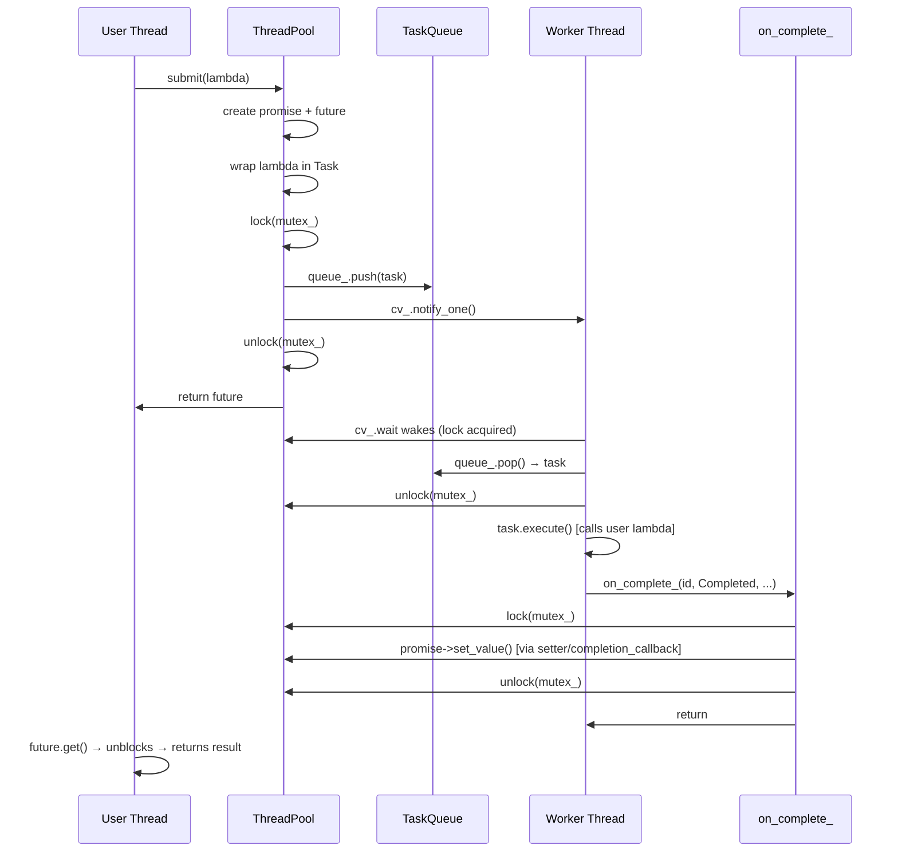

# Phase 3 — Complete Runtime Execution Flow

---

## 3.1 Initialization Flow

**What happens when you write:**
```cpp
ctee::ThreadPoolConfig config;
config.min_threads = 4;
config.max_threads = 8;
ctee::ThreadPool pool(config);
```

**Step-by-step:**

1. `ThreadPool::ThreadPool(const ThreadPoolConfig& config)` runs on the **calling thread (main thread)**.

2. **Member initializer list executes** (before the constructor body):
   ```
   config_   = config                    → stores the config
   queue_    = detail::TaskQueue(10000) → creates empty heap, sets capacity=10000
   running_  = true
   paused_   = false
   metrics_  = make_shared<Metrics>()   → atomic counters zeroed, start_time_ = now
   history_  = make_shared<TaskHistory>() → empty deque, max_size=10000
   next_worker_id_ = 0  (atomic)
   total_completed_ = 0 (atomic)
   total_failed_    = 0 (atomic)
   ```

3. **Constructor body:**
   ```cpp
   workers_.reserve(config_.min_threads);   // pre-allocate vector slots
   for (size_t i = 0; i < config_.min_threads; ++i) {
       add_worker();   // called 4 times for min_threads=4
   }
   ```

4. **Each `add_worker()` call:**
   ```cpp
   auto id = next_worker_id_.fetch_add(1); // → 0, 1, 2, 3
   auto worker = make_unique<detail::Worker>(
       id,
       mutex_,        // pool's mutex (passed by reference)
       cv_,           // pool's cv_any (passed by reference)
       queue_,        // pool's TaskQueue (passed by reference)
       running_,      // pool's bool (passed by reference)
       paused_,       // pool's bool (passed by reference)
       [this](...) { on_task_complete(...); },   // completion callback
       [this]() { metrics_->record_start(); }    // start callback
   );
   workers_.push_back(move(worker));
   metrics_->set_active_threads(workers_.size());
   ```

5. **Inside `Worker::Worker()`:**
   ```cpp
   thread_ = jthread([this](stop_token token) { run(token); });
   ```
   This launches a new OS thread immediately. The thread begins executing `run()`.

6. **Inside `Worker::run()`** (on the new worker thread):
   ```cpp
   ctee::common::set_thread_name("ctee-w0");    // names thread for debuggers
   state_.store(State::Waiting, memory_order_release);
   while (true) {
       unique_lock lock(mutex_);
       cv_.wait(lock, stop_token, predicate);    // ← BLOCKS HERE (queue is empty)
       ...
   }
   ```
   All 4 workers block here, sleeping, waiting for work.

7. **After construction returns:** The pool is fully initialized. 4 threads are running but sleeping. The main thread continues.

**State after construction:**
```
workers_ = [Worker-0(Waiting), Worker-1(Waiting), Worker-2(Waiting), Worker-3(Waiting)]
queue_   = empty
running_ = true
paused_  = false
```

---

## 3.2 Task Submission Flow

### Path A: Template `submit(F&&, Args&&...)` — most common

**What happens when you write:**
```cpp
auto future = pool.submit([](int x) { return x * 2; }, 21);
```

**Compile-time:**
1. Compiler deduces `F = lambda<...>`, `Args = {int}`.
2. `requires std::invocable<F, int>` — checks lambda is callable with `int`. ✓
3. `!is_packaged_task_v<decay_t<F>>` — lambda is not a `packaged_task`. ✓
4. `R = std::invoke_result_t<F, int>` = `int`.
5. Return type = `std::future<int>`.

**Runtime (calling thread, step by step):**

1. `using R = int;`

2. ```cpp
   auto promise = make_shared<std::promise<int>>();
   auto future  = promise->get_future();
   auto once    = make_shared<std::once_flag>();
   auto setter  = make_shared<std::function<void()>>([](){});
   ```
   `promise` and `future` share the same internal state block (allocated on heap). `once` prevents double-set. `setter` starts as a no-op.

3. A `Task` is constructed with a lambda that:
   - Moves the user's lambda (`fn`) and arguments (`capture = 21`) into the closure.
   - When executed: calls `std::invoke(fn, 21)` → `42`. 
   - Stores `42` via `make_shared<int>(42)` into `result_ptr`.
   - Assigns `*setter = [promise, result_ptr](){ promise->set_value(move(*result_ptr)); }`.
   - On exception: assigns `*setter = [promise, ep](){ promise->set_exception(ep); }`.

4. `std::lock_guard lock(mutex_)` — acquires the pool's mutex. Other submitters block here.

5. `reap_stopped_workers()` — scans the worker list for stopped workers and joins/removes them.

6. Guard checks:
   ```cpp
   if (!running_) → set exception "ThreadPool is shut down" → return future
   if (queue_.is_full()) → set exception "Task queue is full" → return future
   ```

7. ```cpp
   string id = task.id();
   cancel_handlers_[id] = [promise, once]() {
       call_once(*once, [promise]() {
           // set exception "Task was cancelled"
       });
   };
   completion_callbacks_[id] = [setter, once](TaskStatus status) {
       if (status != TaskStatus::Cancelled)
           call_once(*once, [setter]() { (*setter)(); });
   };
   ```

8. ```cpp
   task.set_status(TaskStatus::Queued);
   queue_.push(move(task));          // O(log n) heap insert
   cv_.notify_one();                 // wake ONE sleeping worker
   metrics_->record_submit();
   metrics_->set_queue_length(queue_.size());
   ```

9. Scale-up check:
   ```cpp
   if (queue_.size() >= config_.scale_up_threshold &&
       workers_.size() < config_.max_threads) {
       add_worker();   // spawn a new worker thread right now
   }
   ```

10. Lock released. `future` returned to caller. **Calling thread is now free.**

---

### Path B: `submit(Task task)` — the full-featured overload

Used when the caller pre-constructs a `Task` with name, priority, retries, etc.

**Key differences from Path A:**
- Stores `void_promises_[id] = promise` (a `promise<void>`, not typed).
- If `task.max_retries() > 0`: stores `retry_info_[id]` with the function + metadata.
- Calls `history_->record_submit(id, task.name(), task.created_at())`.
- No `setter`/`once` machinery — promise is set directly in `on_task_complete()`.

---

## 3.3 Worker Thread Execution Flow

**This runs on a worker thread, completely independently of the calling thread:**

1. Worker wakes from `cv_.wait()` because `cv_.notify_one()` was called and the predicate is true (`!queue_.empty() && !pool_paused_`).

2. ```cpp
   unique_lock lock(mutex_);   // acquires the pool's mutex
   task_opt = queue_.pop();    // pops highest-priority ready task
   // lock is released at the closing }
   ```
   `queue_.pop()` scans for a task with satisfied dependencies and returns it wrapped in `optional<Task>`. If no task is ready (all have unsatisfied deps), returns `nullopt`.

3. Lock released. Worker now holds `task_opt` — a private copy on its stack. No other worker can take this task.

4. ```cpp
   state_.store(State::Running);
   auto start_time = steady_clock::now();
   auto wait_time = duration_cast<milliseconds>(start_time - task_opt->created_at());
   if (on_start_) on_start_();    // metrics_->record_start() → running_ atomic++
   ```

5. **Branch: does the task have `timeout_ms > 0`?**

   **No timeout:**
   ```cpp
   task_opt->execute();
   // Inside execute():
   //   status_ = Running
   //   call func_()
   //   if success: status_ = Completed, result_.success = true
   //   if throws:  status_ = Failed, result_.exception = current_exception()
   auto exec_time = task_opt->result().execution_time;
   on_complete_(task_opt->id(), task_opt->status(), wait_time, exec_time);
   ```

   **With timeout:**
   ```cpp
   auto task_ptr = make_shared<Task>(move(*task_opt));
   promise<void> p;
   shared_future<void> done = p.get_future().share();
   thread([task_ptr, promise = move(p)]() mutable {
       task_ptr->execute();
       promise.set_value();
   }).detach();

   if (done.wait_for(task_ptr->timeout_ms()) == future_status::ready) {
       on_complete_(task_ptr->id(), task_ptr->status(), wait_time, exec_time);
   } else {
       on_complete_(task_ptr->id(), TaskStatus::TimedOut, wait_time, timeout_ms);
   }
   ```

6. `on_complete_` calls `ThreadPool::on_task_complete()` — explained next.

7. ```cpp
   state_.store(State::Waiting);
   // Loop back to cv_.wait()
   ```

---

## 3.4 `on_task_complete()` — The Completion Handler

**Called by the worker thread, but runs inside `mutex_` lock:**

```cpp
void ThreadPool::on_task_complete(const string& task_id, TaskStatus status, ...) {
    lock_guard lock(mutex_);
```

**Step by step:**

1. `cancel_handlers_.erase(task_id)` — task is done; no longer cancellable.

2. **Retry check:**
   ```cpp
   bool will_retry = false;
   if (status == Failed || status == TimedOut) {
       auto rit = retry_info_.find(task_id);
       if (rit != retry_info_.end()) {
           auto& rc = retry_counts_[task_id];
           if (rc < rit->second.max_retries)
               will_retry = true;
       }
   }
   ```

3. `queue_.mark_completed(task_id)` — adds to `completed_ids_`, unblocking dependent tasks.

4. **Promise resolution** (via `void_promises_`):
   - `will_retry` → defer (promise stays unset).
   - `Completed` → `promise->set_value()`.
   - `Cancelled` → `promise->set_exception("cancelled")`.
   - `Failed/TimedOut, no retries` → `promise->set_exception("failed/timed_out")`.

   **For the template overload**, promise is set via the `completion_callbacks_[id]` which calls `(*setter)()`.

5. **Counters:**
   ```cpp
   if (status == Completed) total_completed_++;
   else total_failed_++;
   ```

6. `metrics_->record_complete(status, exec_time, wait_time)` — updates atomic counters.
7. `metrics_->tick()` — maybe records a time-series snapshot.
8. `history_->record_complete(task_id, status, exec_time)` — updates the audit log.

9. **Completion callback** (external `set_completion_handler` callbacks):
   ```cpp
   auto cb = completion_callbacks_.find(task_id);
   if (cb != completion_callbacks_.end()) {
       if (!will_retry) cb->second(status);
       completion_callbacks_.erase(cb);
   }
   ```

10. **If `will_retry`:**
    ```cpp
    auto& rc = retry_counts_[task_id];
    ++rc;
    Task retry_task(info.func, info.name, info.priority);
    retry_task.set_id(task_id);          // ← same ID! promise stays associated
    retry_task.set_max_retries(info.max_retries);
    retry_task.set_retry_delay(info.retry_delay);
    ...
    retry_task.set_status(TaskStatus::Queued);
    queue_.push(move(retry_task));
    cv_.notify_one();
    ```

11. `try_scale_down()` — maybe marks an excess worker for stop.

---

## 3.5 Result Retrieval Flow

**Back on the calling thread:**

```cpp
int result = future.get();
```

1. `future.get()` checks if the internal shared state is "ready."
2. If not ready: **blocks** (the calling thread sleeps inside the OS).
3. When the worker calls `promise->set_value(42)`, the shared state becomes ready.
4. The OS unblocks the waiting thread.
5. `future.get()` returns `42`.

**If an exception was set:** `promise->set_exception(ep)` stores the `exception_ptr`. `future.get()` calls `rethrow_exception(ep)` — the original exception is re-thrown on the calling thread, even though it originally threw on a worker thread.

**Important:** Calling `future.get()` more than once on the same `std::future` throws `std::future_error`. Use `std::shared_future` if multiple threads need to read the result.

---

## 3.6 Priority and Scheduling Flow

### In `TaskQueue::pop()`:

```
heap_ = [Critical-A, High-B, High-C, Normal-D, Low-E]
         (sorted by Task::operator< as a max-heap)
```

1. `pop_heap(begin, end)` moves the top element (`Critical-A`) to `heap_.back()`.
2. `task = move(heap_.back()); heap_.pop_back()`.
3. Is `Critical-A` cancelled? → No.
4. Are `Critical-A`'s dependencies met? → Yes (no deps).
5. Return `Critical-A`. Done.

**Dependency example:**
```
heap_ = [Critical-A(depends_on=[B]), High-B]
```
1. Pop `Critical-A`. Check deps: `B` not in `completed_ids_`. → Defer.
2. Pop `High-B`. Check deps: none. → Return `High-B`.
3. Push deferred `Critical-A` back into heap.
4. (After `High-B` completes, `mark_completed("B")` is called.)
5. Next `pop()`: `Critical-A` deps now met → returned.

---

## 3.7 Retry Flow

**Scenario:** Task with `max_retries = 3` throws on attempts 1 and 2.

```
Attempt 1:
  Worker::run() → task.execute() → throws → status = Failed
  on_complete_(id, Failed, ...) called
  → retry_counts_[id] = 0 < max_retries(3) → will_retry = true
  → promise NOT set (deferred)
  → retry_task created with same id, pushed to queue
  → retry_counts_[id] = 1

Attempt 2:
  Same as attempt 1.
  → retry_counts_[id] = 2

Attempt 3 (success):
  Worker::run() → task.execute() → no throw → status = Completed
  on_complete_(id, Completed, ...) called
  → retry_counts_[id] = 2 == max_retries(3)? No → 2 < 3 is true... 
  Wait: the condition is rc < max_retries. rc=2, max_retries=3.
  → will_retry = true again! A 4th attempt would be made.
  
  Actually: rc starts at 0. After attempt 1: rc=1. After attempt 2: rc=2.
  On attempt 3 (success): status=Completed → retry check only runs for Failed/TimedOut.
  → will_retry = false → promise->set_value() → future.get() returns.
  → retry_info_[id] and retry_counts_[id] erased.
```

**Important detail about `retry_delay`:** The `RetryInfo` stores `retry_delay`, but the current implementation does **NOT** actually wait before re-enqueuing. The retry task is pushed immediately. The `retry_delay` field is preserved in `RetryInfo` and passed to the new task, but no `std::this_thread::sleep_for` or timer-based delay is applied. This is a **partially implemented feature** — the data is stored, but the waiting behavior is missing.

---

## 3.8 Timeout Flow

**Scenario:** Task has `timeout_ms = 100ms`, actual work takes 5 seconds.

```
Worker thread:
  1. task has timeout_ms = 100ms
  2. task_ptr = make_shared<Task>(move task)
  3. Launch detached thread:
       detached thread → task_ptr->execute() → sleep(5s) → [still running]
  4. done.wait_for(100ms) → returns future_status::timeout (after 100ms)
  5. on_complete_(id, TimedOut, wait_time, timeout_ms) → acquires mutex_
  6. In on_task_complete():
       → void_promises_[id]->set_exception("Task execution timed out")
       → history_->record_complete(id, TimedOut, ...)
  7. Worker state → Waiting. Worker moves to next task.

Calling thread:
  future.get() → throws std::runtime_error("Task execution timed out")

Background (after 5 seconds):
  Detached thread finishes execute().
  Tries to call promise.set_value() inside the detached thread.
  BUT: the task's promise is a shared_ptr<promise<void>> in void_promises_.
  The void_promises_[id] was already erased in on_task_complete().
  The detached thread does NOT interact with the promise at all.
  It just calls task_ptr->execute() and task_ptr->set_value() on the local promise p.
  Local promise p goes out of scope → shared_future 'done' becomes broken_promise... 
  but 'done' already returned timeout, so nobody is waiting. No crash.
```

**Key insight:** The detached thread holds a `shared_ptr<Task>` keeping the task alive. The local `promise<void> p` is moved into the detached thread's lambda. When the detached thread finishes, `p.set_value()` is called — but the `shared_future done` has already returned from `wait_for` and gone out of scope. Nobody is waiting. This is safe.

---

## 3.9 Dynamic Thread Pool Scaling

### Scale-Up (inline in `submit()`):

```
Before submit: workers_ = [W0, W1, W2, W3], queue_.size() = 9, scale_up_threshold = 10
After push:    queue_.size() = 10
Condition: 10 >= 10 && 4 < max_threads(8) → TRUE
→ add_worker() called → W4 spawned
workers_ = [W0, W1, W2, W3, W4]
```

### Scale-Down (in `try_scale_down()` after each task completes):

```
After task completes: queue_.empty() = true, workers_.size() = 5, min_threads = 4
live = 5 - stopping_count_(0) = 5 > min_threads(4) → TRUE
excess = 5 - 4 = 1
Scan workers_:
  W0: state = Running → skip
  W1: state = Waiting, !marked_stop → mark stop: request_stop() + stopping_count_++
  Break (excess = 0)

W1 receives stop signal:
  W1's cv_.wait predicate sees should_stop_ = true → wakes
  queue_.empty() → true → breaks loop
  state_ = Stopped
  (W1's jthread now waiting to be joined)

Next submit() call:
  reap_stopped_workers():
    W1: is_stopped() = true → reset() → ~Worker() → jthread joins
    workers_.erase(W1)
    stopping_count_-- → 0
workers_ = [W0, W2, W3, W4]  (4 workers, back to min_threads)
```

---

## 3.10 Metrics and Logging Update Flow

**On every `submit()`:**
```
metrics_->record_submit()     → submitted_.fetch_add(1, relaxed)
metrics_->set_queue_length(N) → queue_length_.store(N, relaxed)
                                peak_queue_length_ CAS update
```

**On task start (in worker, before execute):**
```
on_start_()                   → metrics_->record_start()
                                → running_.fetch_add(1, relaxed)
```

**On task complete (in on_task_complete):**
```
metrics_->record_complete(status, exec_time, wait_time)
  → running_.fetch_sub(1, relaxed)
  → if Completed: completed_.fetch_add(1, relaxed)
  → if Failed:    failed_.fetch_add(1, relaxed)
  → lock timing_mutex_: total_exec_time_ += exec_time, exec_samples_++
  → total_busy_ns_.fetch_add(exec_ns, relaxed)
metrics_->set_queue_length(queue_.size())
metrics_->tick()              → maybe records snapshot (rate-limited to 1/sec)
history_->record_complete(...)→ linear scan + in-place update
```

**Logging:** The Logger is not automatically called for every task event in the current implementation. Logging is used at the server layer (`http_server.cpp`, `config.cpp`, `main.cpp`) for startup/shutdown messages. Individual task events (submit, execute, complete) are not logged by default — this keeps the hot path fast.

---

## 3.11 Shutdown and Destruction Flow

**When `pool.shutdown()` is called:**

```
1. lock_guard lock(mutex_)
2. if (!running_) return;    // idempotent guard
3. running_ = false
4. paused_ = false
5. completion_callbacks_.clear()
6. lock released
7. cv_.notify_all()          // wake ALL workers simultaneously

Workers (all 4, concurrently):
  Each worker wakes from cv_.wait()
  Checks predicate: !pool_running_ → true → exits wait()
  Checks: !pool_running_ && queue_.empty() → true → break
  state_.store(Stopped)
  [jthread function returns]

8. for (auto& worker : workers_) {
       worker.reset();    // ~Worker() called
   }
   Inside ~Worker():
       thread_.request_stop()  // signals stop_token
       cv_.notify_all()
       [jthread destructor: auto-joins the now-exited thread]

9. workers_.clear()
10. metrics_->set_active_threads(0)
```

**What about tasks still in the queue?**
- They are **not executed**. `queue_` is not cleared by `shutdown()`.
- Futures for unstarted tasks remain pending **forever** (the promise is never set).
- Callers blocking on `future.get()` will **block indefinitely** (or until the future is destroyed, which causes `std::future_error: broken promise`).

**What about tasks currently executing when shutdown is called?**
- They continue to execute on their worker threads (C++ cannot interrupt a running thread).
- When they call `on_complete_`, they try to acquire `mutex_` and call the callback.
- `completion_callbacks_` was cleared in step 5, so no callback fires.
- The `void_promises_` map still exists and will be set if the task has one.
- Workers see `!pool_running_ && queue_.empty()` and exit after finishing.

**`ThreadPool::~ThreadPool()`:**
```cpp
ThreadPool::~ThreadPool() {
    shutdown();    // shutdown() is idempotent — safe to call again
}
```
If the user never calls `shutdown()` manually, the destructor calls it. All workers are joined before the destructor returns.

---

## Master Timeline Diagram


