# Phase 5 — Call Graph and Data-Flow Map

---

## 5.1 Complete Call Graph

```mermaid
flowchart TD
    subgraph PublicAPI["Public API (user/HTTP thread)"]
        S1["pool.submit(F&&, Args&&...)"]
        S2["pool.submit(Task)"]
        S3["pool.submit(packaged_task)"]
        S4["pool.submit_batch(vector<Task>)"]
        S5["pool.cancel(task_id)"]
        S6["pool.set_completion_handler(id, fn)"]
        S7["pool.pause() / resume()"]
        S8["pool.shutdown()"]
        S9["pool.stats()"]
        S10["pool.metrics()"]
        S11["pool.task_history()"]
        S12["pool.get_worker_infos()"]
        S13["pool.queue_info()"]
        S14["scheduler.schedule(task, when)"]
        S15["scheduler.schedule_recurring(task, interval)"]
        S16["scheduler.schedule_now(task)"]
        S17["scheduler.cancel(id)"]
        S18["scheduler.reschedule(id, time)"]
    end

    subgraph Internal["Internal ThreadPool Methods"]
        I1["add_worker()"]
        I2["reap_stopped_workers()"]
        I3["try_scale_down()"]
        I4["on_task_complete(id, status, wait, exec)"]
    end

    subgraph QueueOps["TaskQueue Operations"]
        Q1["queue_.push(task)"]
        Q2["queue_.pop() → optional<Task>"]
        Q3["queue_.cancel(id)"]
        Q4["queue_.mark_completed(id)"]
        Q5["queue_.is_full()"]
    end

    subgraph WorkerLoop["Worker::run() [worker thread]"]
        W1["cv_.wait(lock, token, pred)"]
        W2["queue_.pop()"]
        W3["task.execute()"]
        W4["on_complete_ callback"]
        W5["state_.store(Running/Waiting/Stopped)"]
        W6["Timeout: detach thread + wait_for"]
    end

    subgraph Metrics["Metrics Operations"]
        M1["record_submit()"]
        M2["record_start()"]
        M3["record_complete(status,exec,wait)"]
        M4["record_cancel()"]
        M5["set_queue_length(n)"]
        M6["set_active_threads(n)"]
        M7["tick()"]
        M8["snapshot()"]
    end

    subgraph History["TaskHistory Operations"]
        H1["record_submit(id, name, at)"]
        H2["record_complete(id, status, exec)"]
    end

    subgraph PromiseLayer["Promise / Future Layer"]
        P1["promise<R>::set_value(result)"]
        P2["promise<R>::set_exception(ep)"]
        P3["future<R>::get() → R or throws"]
    end

    S1 --> I2 --> Q1
    S1 --> Q5
    S1 --> Q1
    S1 --> M1
    S1 --> M5
    S1 --> I1

    S2 --> I2
    S2 --> Q5
    S2 --> Q1
    S2 --> M1
    S2 --> M5
    S2 --> H1
    S2 --> I1

    S3 --> I2
    S3 --> Q1
    S3 --> M1
    S3 --> M5
    S3 --> I1

    S4 --> I2
    S4 --> Q1
    S4 --> H1
    S4 --> M5
    S4 --> I1

    S5 --> Q3
    S5 --> P2

    S8 --> W1

    I1 --> W1

    W1 --> W2
    W2 --> W3
    W3 --> W4
    W4 --> I4

    I4 --> Q4
    I4 --> P1
    I4 --> P2
    I4 --> M3
    I4 --> M5
    I4 --> M7
    I4 --> H2
    I4 --> Q1
    I4 --> I3

    I3 --> W5

    S14 --> Q1
    S15 --> Q1
    S16 --> S2

    M7 --> M8
```



---

## 5.2 Detailed Call Sequences Per Public Method

### `pool.submit(lambda)` (template overload) — complete call chain:

```
submit(F&&, Args&&...)
  │ [construct promise, future, once_flag, setter, Task]
  ├─ reap_stopped_workers()
  │   └─ Worker::is_stopped() [reads state_ atomic]
  │   └─ Worker::~Worker() → jthread joins
  │   └─ metrics_->set_active_threads()
  ├─ [guard: !running_ / queue_.is_full()]
  ├─ [store cancel_handlers_[id], completion_callbacks_[id]]
  ├─ Task::set_status(Queued)
  ├─ TaskQueue::push(task)
  │   └─ push_heap(heap_) using Task::operator<
  ├─ cv_.notify_one()
  ├─ metrics_->record_submit()   → submitted_++
  ├─ metrics_->set_queue_length()→ queue_length_ store + peak CAS
  └─ [scale-up check] → add_worker()
      └─ next_worker_id_.fetch_add()
      └─ new Worker(id, mutex_, cv_, queue_, running_, paused_, callbacks)
          └─ jthread([this](stop_token) { run(stop_token); })
      └─ metrics_->set_active_threads()
```

### `Worker::run()` — complete loop iteration:

```
run(stop_token)
  │ set_thread_name("ctee-wN")
  │ state_ = Waiting
  └─ loop:
      ├─ unique_lock lock(mutex_)
      ├─ cv_.wait(lock, stop_token, predicate)
      │   predicate checks: queue_.empty(), pool_paused_, pool_running_, should_stop_
      ├─ [exit checks: !running_&&empty, stop_requested&&empty, should_stop_&&empty]
      ├─ TaskQueue::pop()
      │   └─ pop_heap + cancelled check + dependency check
      │   └─ deferred tasks re-pushed to heap
      ├─ unlock() [implicit at } of unique_lock scope]
      ├─ state_ = Running
      ├─ start_time = now(), wait_time = start_time - created_at
      ├─ on_start_() → metrics_->record_start() → running_++
      │
      ├─ [if timeout_ms > 0]:
      │   ├─ task_ptr = make_shared<Task>(move task)
      │   ├─ promise<void> p; shared_future done = p.get_future().share()
      │   ├─ thread([task_ptr, p=move(p)](){ task_ptr->execute(); p.set_value(); }).detach()
      │   ├─ done.wait_for(timeout_ms)
      │   └─ on_complete_(id, status_or_TimedOut, wait_time, exec_time)
      │
      ├─ [if no timeout]:
      │   ├─ Task::execute()
      │   │   ├─ status_ = Running
      │   │   ├─ func_()           ← user's lambda runs here
      │   │   ├─ result_.success = true / exception captured
      │   │   └─ status_ = Completed / Failed
      │   └─ on_complete_(id, task.status(), wait_time, result.execution_time)
      │
      └─ state_ = Waiting / [break → state_ = Stopped]
```

### `ThreadPool::on_task_complete()` — complete:

```
on_task_complete(task_id, status, wait_time, exec_time)
  [acquires mutex_]
  ├─ cancel_handlers_.erase(task_id)
  ├─ [retry check: Failed/TimedOut && retry_counts_[id] < max_retries]
  │   → will_retry = true/false
  ├─ queue_.mark_completed(task_id) → completed_ids_.insert(id)
  ├─ [void_promises_ resolution]:
  │   ├─ will_retry → skip (defer promise)
  │   ├─ Completed → promise->set_value()
  │   ├─ Cancelled → promise->set_exception("cancelled")
  │   └─ Failed/TimedOut → promise->set_exception("failed/timed out")
  ├─ total_completed_++ / total_failed_++
  ├─ metrics_->record_complete(status, exec_time, wait_time)
  │   ├─ running_-- (atomic)
  │   ├─ completed_++ / failed_++ (atomic)
  │   ├─ timing_mutex_: total_exec_time_ += exec_time
  │   └─ total_busy_ns_ += ns (atomic)
  ├─ metrics_->set_queue_length(queue_.size())
  ├─ metrics_->tick()
  │   └─ [if elapsed >= 1s]: snapshot() + record_snapshot() + history_.push_back
  ├─ history_->record_complete(task_id, status, exec_time)
  │   └─ [linear scan of entries_, in-place update]
  ├─ completion_callbacks_[id](status) [if exists, if !will_retry]
  ├─ [if will_retry]:
  │   ├─ retry_counts_[id]++
  │   ├─ create new Task with same id
  │   ├─ queue_.push(retry_task)
  │   └─ cv_.notify_one()
  └─ try_scale_down()
      ├─ [if queue_.empty() && live > min_threads]
      ├─ find Waiting, non-marked worker
      ├─ worker->request_stop() → should_stop_ store(true, release) + cv_.notify_all()
      └─ stopping_count_++
```

---

## 5.3 Data-Flow Map

### The Callable (user's lambda / function)

| Stage | What holds it | How |
|---|---|---|
| Before submit | User's variable | Stack variable or captured reference |
| In template submit | Task closure | `fn = std::forward<F>(f)` capture — moved into lambda |
| In TaskQueue heap | Task's `func_` | `std::function<void()>` — type-erased |
| During execute | Task's `func_` | Called as `func_()` |
| After execute | Task's `func_` | Still in `func_`, but not called again |
| Task destructs | — | `std::function` destructs, releases captured resources |

**For retry:** The callable is **copied** into `RetryInfo::func` (a `std::function` copy) so it can be re-used for each retry attempt. This is why `Task::func()` returns a `const FuncType&` — the pool takes a copy.

### Task Identity (UUID)

| Stage | Where | How |
|---|---|---|
| Created | `Task::Task()` | `generate_uuid()` via thread_local mt19937 |
| Stored | `Task::id_` | `std::string` member |
| Used as map key | `cancel_handlers_`, `void_promises_`, `completion_callbacks_`, `retry_info_`, `retry_counts_` | All keyed by `task.id()` string |
| For retry | `retry_task.set_id(task_id)` | Same ID reused — keeps promise association |
| In TaskHistory | `TaskRecord::task_id` | Copied at submit time |
| Lifetime | Until all maps erase it | Maps erased in `on_task_complete()` and `cancel()` |

### The Result Value

| Stage | Container | Thread |
|---|---|---|
| Computed | Stack variable `result` inside `func_()` | Worker thread |
| Stored | `auto result_ptr = make_shared<R>(move(result))` | Worker thread |
| Lambda captures it | `setter = [promise, result_ptr](){ promise->set_value(move(*result_ptr)); }` | Worker thread |
| Setter called | In `completion_callbacks_[id](status)` → `(*setter)()` | Worker thread (still inside on_task_complete under mutex) |
| Into promise | `promise->set_value(move(*result_ptr))` → shared state | Cross-thread |
| Retrieved | `future.get()` → moves out of shared state | Calling thread |

### Exceptions

| Stage | Container | Thread |
|---|---|---|
| Thrown | Inside `func_()` | Worker thread |
| Captured | `result_.exception = std::current_exception()` in `Task::execute()` | Worker thread |
| Re-packaged | `*setter = [promise, ep](){ promise->set_exception(ep); }` | Worker thread |
| Set on promise | `promise->set_exception(ep)` | Worker thread (in on_task_complete) |
| Re-thrown | `future.get()` calls `std::rethrow_exception(ep)` | Calling thread |

**Key insight:** The exception is captured as `exception_ptr` — a reference-counted handle. The actual exception object lives on the heap. It crosses thread boundaries safely because `exception_ptr` is copy-safe.

### Retry Counter

| Stage | Container | Thread |
|---|---|---|
| Initial | 0 (implicit, map not populated) | — |
| Incremented | `retry_counts_[task_id]++` in `on_task_complete()` | Worker thread (under mutex) |
| Read | `retry_counts_[task_id]` in `on_task_complete()` | Worker thread (under mutex) |
| Erased | `retry_counts_.erase(task_id)` after final attempt | Worker thread (under mutex) |
| Lifetime | From first failure to final completion | Owned by `ThreadPool` |

### Timeout Information

| Stage | Container | Thread |
|---|---|---|
| Set by user | `task.timeout_ms_` | Calling thread |
| Read | `task_opt->timeout_ms().count() > 0` in Worker | Worker thread |
| Used | `done.wait_for(task_ptr->timeout_ms())` | Worker thread |
| Reported | `on_complete_(id, TimedOut, wait_time, timeout_ms)` | Worker thread |
| In history | Stored as `TimedOut` status | Worker thread (via on_task_complete) |

### Metrics Data Flow

```
submit() call:
  → submitted_++ (atomic, lock-free, calling thread)
  → queue_length_ store (atomic, lock-free, calling thread)
  → peak CAS (atomic, lock-free, calling thread)

Task starts (worker thread):
  → running_++ (atomic, lock-free, worker thread)

Task completes (worker thread, inside mutex):
  → running_-- (atomic)
  → completed_++ or failed_++ (atomic)
  → total_exec_time_ += exec_time (timing_mutex_)
  → total_wait_time_ += wait_time (timing_mutex_)
  → exec_samples_++, wait_samples_++ (timing_mutex_)
  → total_busy_ns_ += ns (atomic)
  → queue_length_ update (atomic)
  → [maybe] snapshot recorded (history_mutex_)

HTTP GET /metrics (HTTP server thread):
  → metrics_->snapshot() (atomic reads + timing_mutex_)
  → metrics_->history() (history_mutex_)
```

### Component Ownership Table

| Data | Owner | Lifetime |
|---|---|---|
| `Task` objects (queued) | `TaskQueue::heap_` (inside ThreadPool) | From push to pop |
| `Task` objects (executing) | Worker's stack (`optional<Task> task_opt`) | During execution |
| `promise<R>` | `shared_ptr` shared between: Task closure, cancel_handlers_, completion_callbacks_ | From submit to promise resolution |
| `future<R>` | Calling thread | From submit until `get()` or destruction |
| `RetryInfo` | `ThreadPool::retry_info_` map | From first submit to final completion |
| `MetricsSnapshot` history | `Metrics::history_` deque | Rolling 60 entries |
| `TaskRecord` | `TaskHistory::entries_` deque | Rolling 10,000 entries |
| `Worker` objects | `ThreadPool::workers_` vector | From add_worker to reap |
| `jthread` | `Worker::thread_` | From Worker construction to Worker destruction |
